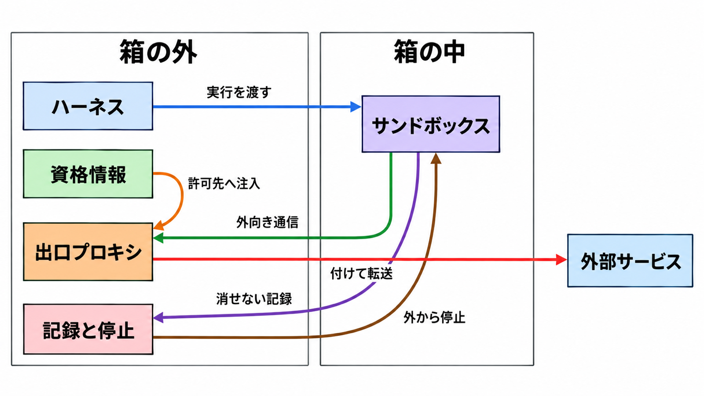

# ダイジェスト: マルチエージェントを本番で動かす4つの問題を一次資料で切り分ける

元記事: [katelyn-lesse-multiagent-problem_20261027.md](../../../../../articles/katelyn-lesse-multiagent-problem_20261027.md)

## ひとことで言うと

実行基盤・身元と認可・隔離・監視と停止の未解決度は揃っていない。単一クラウドの認可には手順があり、改ざん耐性・全体停止・出口の資格情報注入は開いたままである。

## 核心ポイント

- Katelyn Lesse の論考の規模は例えで、生きた Pod のまま大量のアイドルを置くことは Kubernetes と GKE が否定している。待機ワーカーへ多重化する GKE の Agent Substrate は全仕事の前提ではなく、その本番 GA は申請して承認された顧客だけである。
- 本人のブログは、ハーネス（モデルを呼び、ツール実行を仲介する本体）とセッション、資格情報、記録、停止をサンドボックスの外に置く。出口プロキシ（外へ出る中継）だけが許可先へ資格情報を足し、中には仮の値だけを置く。
- 論考の「認可は空洞」は単一クラウドでは言い過ぎで、Google は 24 時間で回る証明書と、ユーザーの代わりのときエージェントとユーザーの身元が残る監査を書く。Entra では種類ごとの登録（親）への事前同意を、個々のエージェント（子）がテナント内で継承するが、数週間続く承認の標準も、ベンダーをまたぐ委任も、公開された仕様では閉じていない。
- 本人はカーネル共有のコンテナは境界ではないと書き、microVM を好む。GKE の既定は gVisor（コンテナより一段強い隔離）で microVM を構成せず、Vercel の本番では microVM の Firecracker を境界にしてもホストメモリが漏れた。
- 箱の外の記録だけでは、改ざんできない監査にならない。生成 AI 向け OpenTelemetry は Development（破壊的変更があり得る草案）であり、span を偽造できない保証は無く、系全体の停止と資格情報の切断を一つの仕様が保証した例は確認範囲に無かった。

## メンタルモデル

「消せない」は、中のプロセスがログを消せないことである。

## 具体例

Agent Substrate の再開 500 ms 未満、標準コンテナ比の密度10倍、エージェント200,000 は自己申告で、測定条件は資料に無い。GKE About は再開 1秒未満だけで、これらの数字は無い。

## 適用と判断

向く場面:

- エージェント基盤で、今期に固定する設計制約を決める。
- GKE の Agent Substrate を、容量計画や資格情報の注入に使うかを決める。
- 停止手順を、製品ごとの止まる範囲で書く。

確認すること:

- GKE の製品ドキュメントが資格情報の注入を未サポートと書くのに、Google Cloud Blog で補っていないか。
- 10倍、200,000、500 ms を、測定条件の公開前に容量の入力にしていないか。
- ユーザーの代わりのとき両方の身元が残るか、証明書の 24 時間を即時失効の代わりにしていないか。
- 停止の手段ごとに、止まる範囲が違うことをランブックに書いたか。
- 生成 AI 向け OpenTelemetry の名前を、長期の契約にしていないか。

## 限界・注意点

- 論考は脆弱性がパッチより速いと書くが、CVE は名指しされておらず裏づけには使えない。
- Google Cloud Blog と Substrate の README は箱の外での注入を書き、GKE About は未サポートと書く。実装の実態は公開資料では決められない。
- エージェントごとの身元（Agent Identity）は Substrate を対象に含めず、エージェントを消しても IAM の紐づけは残る。
- ログアウトは API キーを消さない。動的なワークフローを含むセッションでは、Claude の interrupt は run（処理単位）を終わらせず、Redpanda の kill switch は拒否後もランタイムが動き続ける。
- 外で資格情報を入れる OpenSandbox は、一時停止（pause）のあとサイドカーの保管庫が空になる。DNS だけの出口制御では注入を安全に有効にできず、プロキシが落ちると捕捉した通信は遮断側に倒れる。

## 参考

- 元記事: [katelyn-lesse-multiagent-problem_20261027.md](../../../../../articles/katelyn-lesse-multiagent-problem_20261027.md)
- [Katelyn Lesse の X の論考](https://x.com/katelyn_lesse/status/2114542280535318557)
- [エージェントの安全な構造とサンドボックス](https://www.katelynlesse.com/blog/secure-agents-architecture-and-sandboxing)（2026-09-13）
- [GKE: About Agent Substrate](https://docs.cloud.google.com/kubernetes-engine/ai-ml/about-agent-substrate)
- [Google Agent Identity の概要](https://docs.cloud.google.com/gemini-enterprise-agent-platform/govern/agent-identity-overview)
