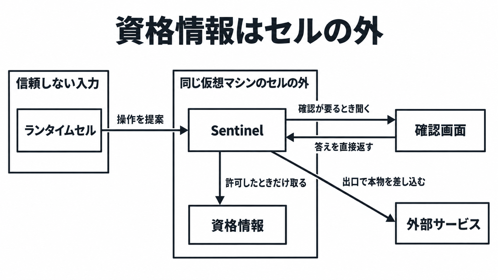

# ダイジェスト: Metaの個人エージェントMuseを支えるSecure VMの構造とデータ設計

元記事: [meta-muse_20261027.md](../../../../../articles/meta-muse_20261027.md)

## ひとことで言うと

利用者ごとの仮想マシンでは、信頼しない入力は隔離領域が扱い、本物の資格情報はその外にある。外のサービスへ出すとき、本物を差し込めるのは許可を出す主体だけ。

## 核心ポイント

- 各利用者に専用の Linux 仮想マシン（Secure VM）が 1 台ある。エージェントは隔離領域（ランタイムセル）の中で動き、見るのは本物の代わりのトークンだけで、資格情報の正本は同じ仮想マシンでもセルの外にある。
- メールや予定などの接続口（Connector）と、外へ出る通信（出口）を許可できるのは、番人の Sentinel だけである。本物の秘密は、許可したリクエストが出口を通るときだけ差し込まれる。
- 購入やメール送信のような機密な書き込みは、毎回の承認が要る。答えは会話の本文を通らず、アプリの確認画面から Sentinel へ直接戻る。
- 開発者が呼ぶ Meta Model API はモデルへの補完だけで、製品の仮想マシンは操作できない。OpenAI 互換の基底 URL は `https://api.meta.ai/v1`、Anthropic 互換は `https://api.meta.ai` である。
- 公開版の Secure VM は運用上の制限で、利用者の鍵で暗号化し Meta も中身を読めない仮想マシン（Confidential VM）ではない。眼鏡型端末の処理は、この Secure VM とは別の計算である。

## メンタルモデル

セルは操作を提案するだけで、本物を出口へ差し込むのは Sentinel が許可したときだけである。

## 具体例

接続の操作は 3 区分ある。読み取りと書き込みの承認メニューは同じで、狭いのは機密な書き込みだけである。

| 区分 | 確認 | 選べること |
| --- | --- | --- |
| 読み取り、書き込み | 初回のあと、常時許可を選ばない限り都度 | 今回だけ、常時許可、拒否 |
| 機密な書き込み | 毎回 | 今回だけ、拒否。常時許可にはできない |

## 適用と判断

向く場面:

- 受信箱を代理人に扱わせるとき、読み取りから始め、送信は別の承認にする。
- 予定を代理人に扱わせるとき、読み取りから始める。
- 店舗での購入を任せるとき、画面に出た内容だけを今回の承認にする。

確認すること:

- 接続の初期値が、すべての書き込みと重要な読み取りの前に聞く設定か、あらゆる操作の前に聞く設定か。
- 承認したあと金額、宛先、範囲が変わっていれば、新しい承認が要る。
- 学習への利用は、英国向けヘルプでは最初オンで、オフは過去の対話にも及ぶ。
- 学習に使わない `muse-spark-1.3` と、単価が下がり学習に使われ得る `muse-spark-1.3-contributor` を取り違えない。
- 音声入力が要る経路は `muse-spark-1.3` のままにせず、音声理解は完全ではないので代わりは `muse-spark-1.2` か `muse-voice-transcribe-1.0` である。

## 限界・注意点

- 研究記事は、公開版では Meta が支援、安全、運用のためにデータへ到達し得ると書く。2026 年 10 月 27 日時点で、Confidential VM が一般提供へ切り替わった告知は、開いた一次ページには無かった。
- 製品の全利用者の既定モデルを、Muse Spark 1.3 や、より新しいモデル Muse Wonder だと決めない。Wonder は、製品の加入者から入る予定である。
- 初期展開は米国向けである。Link（承認済みの支払いに資格情報を返す財布）は米国とカナダの消費者向けで、カナダで Muse 製品自体が一般提供かは、開いた一次ページからは決められなかった。
- 接続を外しても、それまでの会話と、利用者について仮想マシン内に残る記録（メモリ）は消えない。それらとファイルと進行中の仕事を消すのは Reset だが、外へ送ったメールや店の注文は Reset では取り消されない。
- 会話の共有 URL が発見可能だった、という二次情報がある。それを止めた記述は、開いた公式ヘルプと研究記事には無かった。

## 参考

- 元記事: [meta-muse_20261027.md](../../../../../articles/meta-muse_20261027.md)
- [Introducing Muse](https://about.fb.com/news/2026/09/introducing-muse-personal-ai-agent/)
- [How We Built Safety Into Muse](https://research.meta.ai/blog/security-and-safety-for-ai-agents-our-approach-with-muse)
- [How Muse works with your guidance and approval](https://www.meta.com/help/artificial-intelligence/1385290430137537/)
- [Models](https://dev.meta.ai/docs/models)
