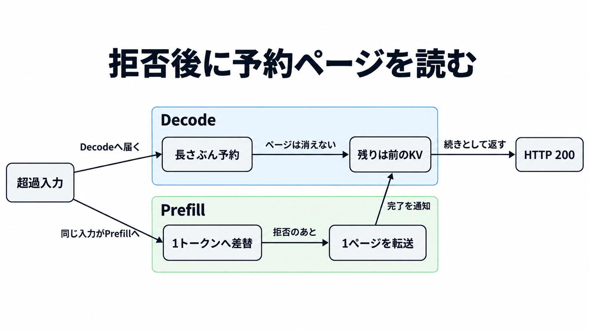

# ダイジェスト: Workers AIのGLM-5.3で別セッションのKVが応答に混入した

元記事: [cloudflare-workers-ai-kv-p1_20261028.md](../../../../../articles/cloudflare-workers-ai-kv-p1_20261028.md)

## ひとことで言うと

GLM-5.3で、長すぎる入力の拒否後に、別セッションの計算途中のデータが応答へ混ざった。

## 核心ポイント

- Workers AI（Cloudflare がホストするモデル推論）の KV キャッシュは、推論エンジンが次トークン用に持つ keyとvalueのページで、名前が近い Workers KV とは別である。混入経路の公開モデルは `@cf/zai-org/glm-5.3` だけである。
- 公開コンテキスト（入力の上限）は 1,048,576 トークン、prefill（KV を作る段）のプール（容量）は 681,280 トークンで、プールを超えたプロンプトの中身は 1 トークンへ差し替わる。prefill と decode（続きを出す段）を別ノードに置くときだけ、予約したページを読んで HTTP 200 を返し、単一ノードはエラーになる。
- HTTP 200、入力長どおりの prompt_tokens（数えた入力トークン）、続きとして読める文章が返る。Cloudflare が数えた混入応答は 155 件で、そのプロンプトはいずれも 681,280 トークンを超え、顧客数でも漏れた量でも、しきい値を超えた試行の全数でもない。
- 2026年9月9日、プールを約 204 万トークンへ広げた canary（限定した確認配備）は、この経路の影響を受けないと確認され、同日にそのプールのまま公開へ戻った。Cloudflare は、この拡大だけでこのバグは踏まれなくなると書き、拒否した要求を受け渡し前に外す修正は、プールが再びずれたときや、別理由の拒否が同じ受け渡しに入るときの後段である。

## メンタルモデル

Decode はプロンプト長のページを予約し、Prefill から渡る KV は 1ページだけなので、残りは前の要求の KV のまま読まれる。

## 具体例

発見者の計測では、662,162 トークンまでは通常の遅延で返り、700,166 トークン以降は短時間の無関係な応答が始まった。

## 適用と判断

向く場面:

- 2026年8月27日から9月9日の混入期間に、入力が 681,280 トークンを超えた応答を、成功コードだけで安全と見なさない。
- 自分で持つ SGLang（推論エンジン）の分離構成では、起動中の prefill と decode のプールが公開コンテキスト以上かを検査する。
- 呼び出し元の隔離や、プロンプトに他テナントのデータを置かない対策では、共有の decode が前のページを読む混入は閉じない。

確認すること:

- プールや受け付ける長さが公開コンテキストより小さいとき、HTTP 200、入力長どおりの prompt_tokens、無関係な本文が同時に出ていない。入力が残っているかの印を書くよう頼むと、境界を超えたとき本文と思考過程の両方から消える。
- KV 転送の途中で切れたあと、次の要求の本文に前の断片が出ていない。切れた側だけだと、向きが逆で取りこぼす。

## 限界・注意点

- 155 が自社試験と報告者の除外の前か後かは、原文の接続だけでは確定できない。発見時の応答が 155 に入るかは、公開記事には無い。
- ステータスページの題はエラー増加で、期間は 2026-09-09T14:25:16Z から 20:09:37Z だけであり、8月27日から9月8日の露出は載らない。顧客通知と届出の有無は、公開資料から言えない。
- 1,048,576 を超える要求は HTTP 400 で、セキュリティ上の影響は無かった、と発見者は書く。681,280 ちょうどを外部から切った計測は、公開資料には見当たらない。
- SGLang の v0.5.20 は差し替え結果の前に要求を外し、v0.5.21 はそれより前に拒否し、勧める版は両方を含む v0.5.22 以降である。三つのどれか一つでは、予約ページを読む経路と、中断後に次のページへ書く経路の両方が閉じたことにはならない。
- 他モデルは影響を受けていない、意図的な悪用の証拠は無い、は事業者の調査結果である。発見者が glm-5.3-flash、glm-5.2、glm-4.7-flash を試し、成功か拒否だったことは全体の監査ではなく、この経路の CVE 番号は一次記録に見当たらない。

## 参考

- 元記事: [cloudflare-workers-ai-kv-p1_20261028.md](../../../../../articles/cloudflare-workers-ai-kv-p1_20261028.md)
- [Cloudflare, Cross-request KV cache exposure（2026-10-26）](https://blog.cloudflare.com/kv-cache-exposure-remediation/)
- [SGLang Team, improving request isolation（2026-10-26）](https://www.lmsys.org/blog/2026-10-26-cf-security)
- [Knostic, Hallucination or Cross-Tenant（2026-10-27）](https://www.knostic.ai/blog/hallucination-or-cross-tenant-when-an-llm-answers-with-another-users-context)
- [Cloudflare Status, jsvvrtk5hvym](https://www.cloudflarestatus.com/incidents/jsvvrtk5hvym)
