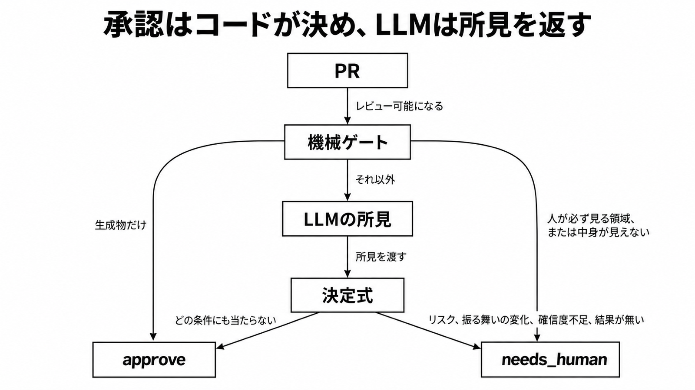

# ダイジェスト: newmoのPR判定はコードが決め、レビュー待ちはラベルで数える

元記事: [本文](../../../../../articles/newmo-pr-tech-newmo-me-entry-p2_20261028.md)

## ひとことで言うと

newmo の riskjudge（PR を approve か needs_human に分ける判定器）では、承認の可否をコードが決める。LLM は差分の所見を返すだけである。

## 核心ポイント

- 機械ゲートはパスと差分の形だけを見、人が必ず見る領域（認証、認可、個人情報、本番 DB マイグレーション、決済、インフラ、CI 設定）は原則 needs_human（人がレビューする）。通すのは、CI の YAML のコメントだけの変更と、GraphQL と Protocol Buffers の出力型へのフィールド追加、enum 値の追加、description の文言変更だけで、決済などのパスへ効くとは書いていない。
- 生成物（生成された印が付いたファイル）だけの PR はここで approve になり、必ず人のパスと重なった先後は書いていない。中身が見えない差分（生成物を除いた差分が 512KB 超、または patch が返らない巨大ファイルやバイナリ）も needs_human になる。
- ゲートを通過した差分だけを LLM が読み、業務ロジックが変わったか、確信度（0から1）、リスクを JSON で返す。LLM は approve を返さない。
- 残りの approve は決定式（同じ入力なら同じ結果の Go の関数）だけが返す。条件は除外パス、LLM の結果が無い、止めに相当するリスク、テストとドキュメント以外の業務ロジックの変化、確信度が 0 以上 1 以下の外か閾値未満の順で、当たらなければ approve し、変化と確信度とリスクは JSON のその項目を見る。
- needs_human と判定した PR と、判定失敗（LLM の呼び出し失敗を含む）には needs_human ラベルが付く。待ち件数で新しい作業を止めることは「条件にできる」までで、本番で強制したとは書いていない。

## メンタルモデル

## 具体例

| 差分 | 決まる段 | 結果 |
|---|---|---|
| 生成物だけ | 機械ゲート | approve |
| 認証や決済などのパス、中身が見えない差分 | 機械ゲート | needs_human |
| ゲートを通過し、決定式の 5 条件に当たらない | 決定式 | approve |

## 適用と判断

向く場面:

- 必要承認が 1 のとき、bot の承認がその 1 枠を埋めてよいかを先に決める。
- レビュー待ちをラベルで数え、新しい実装を始める条件にしたい。

確認すること:

- 承認の可否を出している場所が、LLM の文面か、終了コードか。
- needs_human を、どのゲートで決まったかまで残せるか。
- レビュー待ちの件数は、自分の待ち時間から決める。
- エージェントが書いた PR に人の承認を 2 つ求めるなら、判定 bot の Approve を人数から外しているか。
- 生成物だけの差分で、生成器のソースが同じ PR に無いものは、初期は人に残すか。

## 限界・注意点

- approve した PR がリリース後の不具合の原因になった割合は needs_human の半分ほどだが、needs_human に大きな変更や重要領域が集まるので単純比較できない。業務ロジックの変化で止めた PR のレビュー指摘率も approve とあまり変わらず、どちらも分母は無い。
- 見逃しの多くは呼び出し先や別ファイルの SQL など差分の外だった。入力が差分とパスである限り、この見逃しは残る。
- コードオーナー（その領域の責任者）でない作成者は人に固定せず、閾値（既定 0.80、重要領域 0.95）へ 0.10 を足すだけである。重要領域は配車や決済で、人が必ず見る領域と同一とは書いておらず、1 で頭打ちにするかも不明である。
- 人のレビューと、人が bot 承認を取り消した PR は、自動で承認し直さない。push で bot の承認が消えることと、判定が PR のコードを実行しないことは、ruleset と workflow が非公開で監査できない。
- 重要領域か変更行数 1,000 超は LLM を 3 回し、1 回でも懸念があれば懸念あり、確信度は最小を取る。懸念の中身は記事が分けておらず、決済は人が必ず見る領域にも挙がるので、重なる PR の段は書いていない。

## 参考

- 元記事: [newmo-pr-tech-newmo-me-entry-p2_20261028.md](../../../../../articles/newmo-pr-tech-newmo-me-entry-p2_20261028.md)
- newmo 技術ブログ（2026-10-27）: [プルリクエストのリスクを判定する仕組み](https://tech.newmo.me/entry/2026/10/27/100000)
- GitHub Docs: [Available rules for rulesets](https://docs.github.com/en/repositories/configuring-branches-and-merges-in-your-repository/managing-rulesets/available-rules-for-rulesets)
- GitHub Docs: [Securely using pull_request_target](https://docs.github.com/en/actions/reference/security/securely-using-pull_request_target)