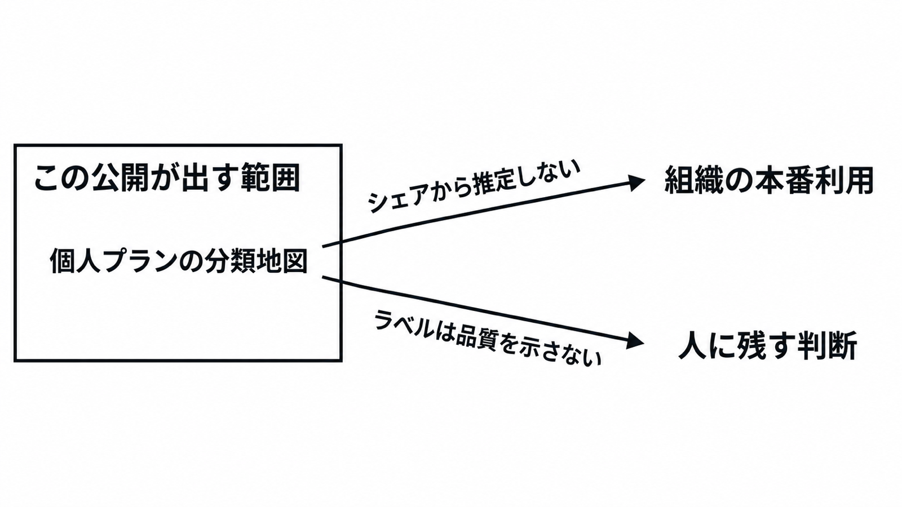

# ダイジェスト: 個人向けChatGPTの業務利用を165活動で国別に見る

元記事: [openai-100-165-chatgpt-ai-p7_20261028.md](../../../../../articles/openai-100-165-chatgpt-ai-p7_20261028.md)

## ひとことで言うと

OpenAI が 2026年10月26日に公開した Signals v3.0 は、個人向け ChatGPT の業務メッセージを 165 活動に分けた国別シェアである。評価項目の一覧にはならない。

## 核心ポイント

- 1行は、国・四半期・活動に対する個人プランの業務メッセージのシェアであり、会話・職種・成果は列に無い。組織向けプラン（enterprise）と、辞書がそれと並べて外に置く Codex は入らず、除くと業務と技術の利用を過小にしうる。
- 活動は 165 個で、O*NET（米国の職業情報）の中間の層（細かい作業を束ねた層）のうち、名前を残した 164 個と、届かなかった活動の束 Other である。シェアが小さい活動を Other へ移す規則ではない。
- 7四半期そろった74か国を同じ重みで平均した国内上位10活動の合計は、2025年第1四半期の56.0%から2026年第3四半期の51.1%へ下がり、再計算と発表は小数第1位で一致する。寄与の内訳はこの公開値だけでは分からず、利用構成の変化のほか、集計の不確実性と期間ごとの累積プライバシー予算の違いが影響しうる。
- 2026年第3四半期の先頭は、日本も米国も文書編集、次が視覚デザインである。日本は 0.14505 と 0.06663、米国は 0.17102 と 0.07629 である。
- 人だけのラベルの揃い（Fleiss κ）は、活動名0.34、業務の有無0.66である。検証は本番ログではなく、公開会話100件、注釈者2人である。

## メンタルモデル

出るのは個人プランの活動別地図だけである。組織の本番利用（API と他社ツールを含む）と、人に残す判断（事実の採否、対外責任、例外処理）は別の層である。

## 具体例

日本の文書編集（0.14505）は、業務メッセージの約14.5%がそこへ振られたと読む。自社の本番利用量は、この割合から推定しない。事実と対外責任を人が持つかは、ラベルとは別に書き分ける。

## 適用と判断

向く場面:

- 文書編集や視覚化のような粗い束で、育成の問いを切るとき。
- チャットの利用と米国の仕事の差を見るとき、公開ブログは、対応づけた米国職業の雇用加重タスクの約 43% が個別行の外（Other）に入ると書き、その計算表は CSV に無い。

確認すること:

- enterprise と Codex が入らない個人プランのシェアだと、分かって見ているか。
- 日本なら 2026年第3四半期の上位 5（文書編集、視覚デザイン、言語・文化情報の解釈、教育・職業上の助言、マーケ素材）までに留め、それより下を使っていないか。
- 自社の作業一覧で人の一致が実用に足るまで上がるか、同じ活動一覧で出した組織向けプランの公開が個人プランと同じ順位を示すか、どちらかが満たされるまでは、この表を評価項目の一覧にしないか。
- 組織の利用量を、自社の enterprise か API のログ、または作業時間の自己申告で別に取るか。
- 「チャットに出してよいか」と「人が最終判断を持つか」を、シェアの大小で分けていないか。

## 限界・注意点

- 測るのは、個人プランに残り、削除されておらず、モデルの学習への利用を拒否していない、申告年齢 18 歳以上のアカウントのメッセージが、どの活動へ振られたかである。職の置換でも、作業の完了でもない。
- 1 メッセージは 1 ラベルに潰れ、同じ意図の往復は複数回数えうる。人数でも完了でもない。
- 近い活動が別ラベルになりうる。日本の行は、日本の職務記述ではなく、米国の職業リストへの分類である。
- 細かい順位は分母も標準誤差も無く、重みとノイズのあとのメッセージ件数が 1000 を少し超えるだけの国では、小さい活動の行が不安定になりうる。この重みは、国を平均する重みとは別である。
- 不明な点は、どれにも定めない分類が分母に残るか、164 個を残す基準、学習・転職・起業が業務関連に入るか、国数が 2025年第1四半期の 90 から 2026年第3四半期の 76 へ減った理由（縮小か、1000件未満の非表示か）は分からず、この76は7四半期すべてに行がある74か国とは別の数である。この公開自体への独立した検証は、2026年10月28日時点では見つかっていない。

## 参考

- 元記事: [openai-100-165-chatgpt-ai-p7_20261028.md](../../../../../articles/openai-100-165-chatgpt-ai-p7_20261028.md)
- [ChatGPT’s expanding world of work](https://openai.com/index/chatgpt-expanding-world-of-work)（OpenAI、2026-10-26）
- [Download data and methodology](https://openai.com/signals/data-download/)（OpenAI Signals v3.0）
- [OpenAI Signals README Version 3.0（データ辞書 PDF）](https://cdn.openai.com/signals/data-dictionary.pdf)
- [How People Use ChatGPT（NBER Working Paper 34255）](https://www.nber.org/papers/w34255)（Chatterji et al., 2025）
- [O*NET 31.0 Database](https://www.onetcenter.org/database.html)
