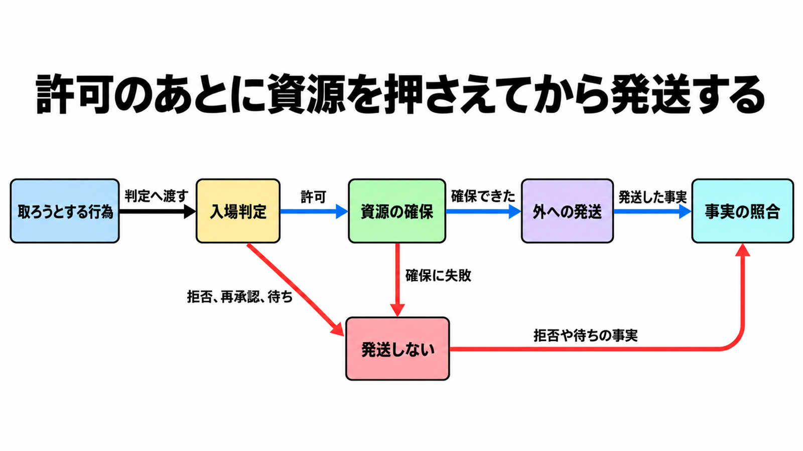

# ダイジェスト: エージェントの業務テストに委任・義務・状態変化を含める

元記事: [arxiv-abs-2610-35978-p8_20261029.md](../../../../../articles/arxiv-abs-2610-35978-p8_20261029.md)

## ひとことで言うと

代理人の業務テストの単位は、エージェントとタスクの組ではなく、依頼者、委任、義務、世界の状態、証拠を束ねた1件である。

## 核心ポイント

- テストの1件は service episode（サービスの1件のやりとり）で、記録には依頼者、委任（代理人に許された操作の範囲）、世界の状態（コーディングへ写すときの実行前後では、ブランチ、チケット、デプロイ、外部チケット、請求など）、証拠を残す。相手（依頼者と約束を交わす側）との約束は、合意した手続きを通ったときだけ、協働上の義務になる。
- 判定は1個の点数ではない。結果と義務、権限、協働（義務が今どの状態か）、継続（担い手や計画が変わったあとも閉じられるか）、証拠、人の作業、依頼者や相手方の得失を、別々の項にする。
- 結果を伴う行為は、発送（外の世界へ出すこと）の前に入場判定し、複数が当たるときは拒否、再承認（元の行為を止めて承認へ上げる）、待ち（発送せず、条件と期限を残す）、許可の順で一つにする。許可は、共有の予算や在庫を押さえる段階へ進むだけでまだ発送せず、押さえに失敗したら待ちに戻す。
- 権限の取消は、これから先の行使を止め、既に発生した義務は残す。終了は明示し、履行と打ち切りを分ける。
- コーディングエージェントへ写すとき、完了の証拠は差分、テスト結果、承認、外部の記録である。モデルの完了宣言は証拠にしない。

## メンタルモデル

拒否、再承認、待ちも、発送した事実と同じく照合に残す。

## 具体例

リポジトリの所有者が、あるブランチへテストを足すよう依頼し、会話の途中で push の許可を取り消した、という構成であり、成功率の測定値ではない。差分とテスト結果は完了の証拠になり得る。取消後の旧権限での push と未レビューの完了は別の欄で見、どちらも未履行になり得る。

## 適用と判断

向く場面:

- 完了が外部の業務状態や、他者に残る義務に依存するとき。
- 出力は合うのに、権限を取り消したあとの push や、未完了の外部手続きが残るとき。

確認すること:

- 実行完了、出力の一致、義務の履行、依頼者の価値（依頼者の得失）の4段を、1個の点数に潰していない。
- 終了時の状態と禁止行為の検査だけで、権限の失効と残る義務を拾えている環境では、依頼者、委任範囲、実行前後の業務状態、完了の証拠は足さない。
- 出力は合うのに、無権限の push や未完了の外部手続きが既にあるなら、依頼者、委任範囲、実行前後の業務状態、完了の証拠を足す理由は論文の実証を待たず、足したあとの品質は別に測る。
- 参照ランナー（期待との一致を見る小さなプログラム）の合格は、入場の結論と未履行（義務をまだ果たしていないこと）かどうかの一致に限り、許可、履行済み、副作用の不在の証明には使わない。
- Living Lab という呼称、ランナーの合否、会議への採録、有効性が実証済みであることは、検収の根拠にしない。

## 限界・注意点

- 論文はエージェント品質の測定結果を報告していない。旅行と産業の例は著者が構成した設計であり、現場の測定値ではない。
- 参照ランナーは、発送も、動いている世界の観測もしない。
- 付属の説明は版 1.44、スキーマ見出しは v1.45 で契約の版は未解決であり、2026年10月29日時点の SOC4IA 2026（会議のワークショップ）の公開プログラムは未発表で、arXiv の accepted は著者記入であって公開の採録リストではない。
- 入場判定は、プロンプトインジェクション対策の証拠にはならない。有害な意図は別の検証が要る。
- 業務状態を作業ツリー、チケット、本番のどこに置くと、成果物だけの完了や、発送済みで確認も観測も不明な結果を未履行として拾えるかは、論文の測定範囲外である。

## 参考

- 元記事: [arxiv-abs-2610-35978-p8_20261029.md](../../../../../articles/arxiv-abs-2610-35978-p8_20261029.md)
- Wang, Z. ほか. Testing Agentic Service Systems. arXiv:2610.35978v1, 2026-10-26. [arXiv](https://arxiv.org/abs/2610.35978)
- 付属ファイル（スキーマ、フィクスチャ、参照ランナー）: [README](https://arxiv.org/src/2610.35978v1/anc/README.md)
- SOC4IA 2026 公式（2026年10月29日時点で Program は未発表）: [soc4ia.univ-tours.fr](https://soc4ia.univ-tours.fr/)
