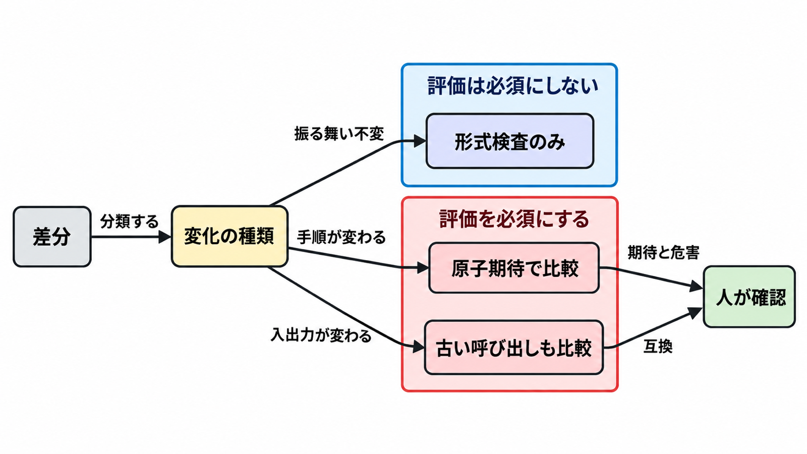

# ダイジェスト: Google の Agent Skills は文言の変更を製品として出荷する

元記事: [google-agent-skills-agent-p1_20261029.md](../../../../../articles/google-agent-skills-agent-p1_20261029.md)

## ひとことで言うと

Google は手順書の文言変更を、版、評価、AI の設計レビュー、人の承認で出荷する。小さいチームが移せるのは、振る舞いが変わる差分だけを、前版（新規は手順書なし）の実行と比べること。

## 核心ポイント

- Agent Skills（エージェントに渡す手順書を、1 ディレクトリとして配る形式）は、起動時に名前と短い説明だけを読み、選んだあとに本文を読み、付属のスクリプトと参照ファイルは必要になったときだけ読む。
- 内部の検査は安い順で、ディレクトリの形、書式（先頭の YAML、フォルダ名、Markdown）、版が落ちると、評価も AI の設計レビューも起動しない。設計レビューは、コマンド列をスクリプトへ、判断を本文へ、参照の下にフォルダを作らないことを見て、人の承認へ進む。
- Google の内部では、版は手順書先頭の引用符付き文字列で、本文、スクリプト、参照が変わって版が上がっていなければ止まる。公開の Agent Skills 仕様（必須は名前と短い説明だけ）も `npx skills update`（手元を上流の中身に合わせる）もこの版を条件にせず、更新は取得時点のフォルダ内容と今の中身を比べるので、版番号では止まらない。
- 評価は、同じプロンプトの結果を原子期待（採点を 1 項目に割ったもの）で比べ、相手は前の版の実行、新規は手順書なしである。1 文に複数条件をまとめた期待は、一部が欠けても合否が揺れる。
- 小さいチームへの読み替えは、Google の内部ゲートの写しではなく、振る舞いも作業を止める条件も変わらない文言は版も評価も必須にしない。新規を公開一覧へ加える承認は、既存の修正とは別である。

## メンタルモデル

形式検査は版の検査とは別で、形式、リンク、目次の再生成だけを見る。手順（作業手順、止める条件、コマンド、参照の順）は同じプロンプトの実行を前版（新規は手順書なし）と比べ、人は期待と危害を見る。入出力（入力、出力、必須ツール）は古い呼び出しも足し、人は互換を壊してよいかも見る。

## 具体例

場所、一様なアクセス制御、ライフサイクル規則を 1 文にしていた期待は、場所、一様なアクセス、30 日超の削除の 3 項目に割る。

## 適用と判断

向く場面:

- 軽い修正と新規を同じ検査で止めると、1 行の誤字が滞るとき。
- 手順書が顧客の本番操作を代行し、失敗の損失が評価費を上回るときも、評価は振る舞いの差分に限る。

確認すること:

- 変更後と基準（前の版。新規は手順書なし）を同じプロンプトで自動実行できない種類は、人のレビューを先にし、できる種類から評価を必須にする。
- モデルは本文を選んだ時点で読むがスクリプトは起動するまで読まないので、読まれないと効かない禁止は本文に残し、起動すれば同じ結果になる処理はスクリプトへ置く。
- 人が毎回見るのは、期待が本番で守るべき失敗を分けているかと、期待外の危害（権限の変更、削除、課金、依存の供給元）である。
- 手元を固定するなら、更新コマンドが比べる取得時点の記録に、取った git の参照を残す。
- 版を上げたことは品質の証拠にならず、版の番号を読んでもモデルが選ぶ手順は変わらない。

## 限界・注意点

- 精度の上げ幅は書いておらず、公開された改善幅としては読めない。
- 公開側に見える定期検査は、月曜のリンク検査だけである。壊れたリンクは所有者ごとではなく 1 件の issue を更新し、失敗してもそのステップはジョブを落とさない。
- 公開物は設計レビューの規則を全件満たしていない。参照がさらにフォルダで分かれた例や、版 1.0.2 でもコマンド列が本文に残る例がある。
- 採点の失敗は実行の失敗とは限らず、Google Cloud Developer plugin の例ではプロンプト 11 本中 3 本がツールは通ったのに自動採点は失敗だった。10月28日の記事は、採点が最終の文面かツール呼び出しの記録かを指定していない。
- どの変更を版の上位・中位・下位にするか、規則を満たす件数、ブランチ保護の有無は、記事と公開 API だけでは確定できない。

## 参考

- 元記事: [google-agent-skills-agent-p1_20261029.md](../../../../../articles/google-agent-skills-agent-p1_20261029.md)
- [Remigiusz Samborski, Behind the scenes, two months later（Google Cloud Blog、2026-10-28）](https://cloud.google.com/blog/topics/developers-practitioners/behind-the-scenes-two-months-later-how-we-ship-google-agent-skills-like-products/)
- [Remigiusz Samborski, Behind the scenes（Google Cloud Blog、2026-08-04）](https://cloud.google.com/blog/topics/developers-practitioners/behind-the-scenes-how-we-build-test-and-scale-google-agent-skills)
- [Casey West, Four evaluation engineering lessons（Google Cloud Blog、2026-10-17）](https://cloud.google.com/blog/topics/developers-practitioners/four-eval-engineering-lessons)
- [Agent Skills Specification](https://agentskills.io/specification)
- [vercel-labs/skills の update.ts](https://github.com/vercel-labs/skills/blob/main/src/update.ts)
