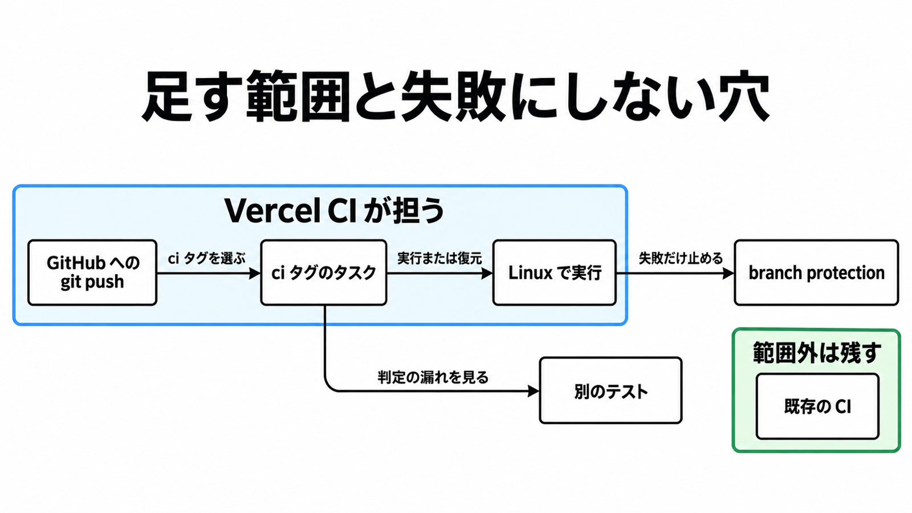

# ダイジェスト: Vercel CIベータが選ぶタスクと残す既存CIの条件

元記事: [vercel-ci-ci-cd-vercel-ci-p3_20261029.md](../../../../../articles/vercel-ci-ci-cd-vercel-ci-p3_20261029.md)

## ひとことで言うと

GitHub の Linux タスクだけ Vercel CI を足し、失敗したチェックだけがマージを止める。影響判定の漏れは別のテストで見る。

## 核心ポイント

- Vercel CI（2026-10-28 のベータ）は、GitHub への git push に対し、`turbo.json`（Turborepo がタスクと依存を書く設定）で `ci` タグが付いたタスクを Linux の別マシンで実行する。同じ入力は Remote Cache（成果物の復元）から戻り、失敗は branch protection（失敗したチェックでマージを止める GitHub の設定）に渡せる。
- 選択の単位は package#task（パッケージ名とタスク名）である。Pro は 1 CPU minute あたり $0.0035（1 CPU が 1 分で 1）で、復元と影響外は課金せず、bootstrap（clone と依存インストール）は課金する。
- 「2〜6 倍速い」と約800万タスクは、比較条件が非公開の自己申告である。採用理由にはしない。
- 復元も、影響外（変更の影響外として走らなかったタスク）も、失敗にしない。GitHub では Success、skipped、neutral は required でもマージを止めず、Vercel CI がスキップ時に付ける区分はドキュメントに無い。
- 足すのは、ソースが GitHub、実行が Linux、起動が git push、リポジトリが単一の Vercel チーム（プロジェクトの所属先）上のプロジェクトに接続済み、タスクを turbo.json で表せ、Pro の単価で見積もれるときだけである。それ以外は既存の CI に残す。

## メンタルモデル

失敗したチェックだけがマージを止める。影響判定の漏れは別のテストで見る。

## 具体例

ドキュメントの最小例では、build に `!ci` を付けて外し、test は build に依存しつつ `ci` を付ける。test が対象なので、外した build も先に走る。

## 適用と判断

向く場面:

- エージェントが増やす pull request に、Linux タスクの失敗を早く返したいとき。
- 小さい差分で、復元とスキップが待ちと CPU minute を同時に下げると見込むとき。

確認すること:

- 最初の pull request に出たチェック名を記録してから required にする。
- inputs（ファイル入力のパターン）の外だけを変え、走らないかキャッシュのまま緑なら、そのファイルは branch protection の対象外と記録する。

ほかの確認は、元記事の「有効化したあとに確認すること」にある。

## 限界・注意点

- ソースは GitHub のみ、ベースイメージは Linux のみ、トリガーは git push のみである。手動起動と定期実行は git push の外、macOS と Windows は Linux の外である。
- Turborepo の `--affected` の既定では、パッケージ内の 1 ファイルの変更で、そのパッケージの全タスクが選ばれる。Vercel CI が同じ規則かはドキュメントに無く、ファイルパターンまで絞っているかも書いていない。
- passThroughEnv（実行時には渡るが、再実行を決めるハッシュには入らない宣言）の値が変わっても再実行されない。inputs から落としたファイルも同様である。
- ブログは all plans と書く。料金ページに Hobby（単価の行が無いプラン）は無く、CLI ページは 2026-10-07 のまま Private Beta と書く。
- 未確認は、fork の pull request、globalEnv（全タスクへ届ける変数）がハッシュに入るか、デプロイ完了を待つ e2e（デプロイ後のテスト）が下流のハッシュを変えるかである。

## 参考

- 元記事: [vercel-ci-ci-cd-vercel-ci-p3_20261029.md](../../../../../articles/vercel-ci-ci-cd-vercel-ci-p3_20261029.md)
- [Introducing Vercel CI](https://vercel.com/blog/introducing-vercel-ci)（Vercel、2026-10-28）
- [Vercel CI](https://vercel.com/docs/ci)（Vercel Docs、2026-10-28）
- [Vercel CI Pricing](https://vercel.com/docs/ci/pricing)（Vercel Docs、2026-10-28）
- [About protected branches](https://docs.github.com/en/repositories/configuring-branches-and-merges-in-your-repository/managing-protected-branches/about-protected-branches)（GitHub Docs）
