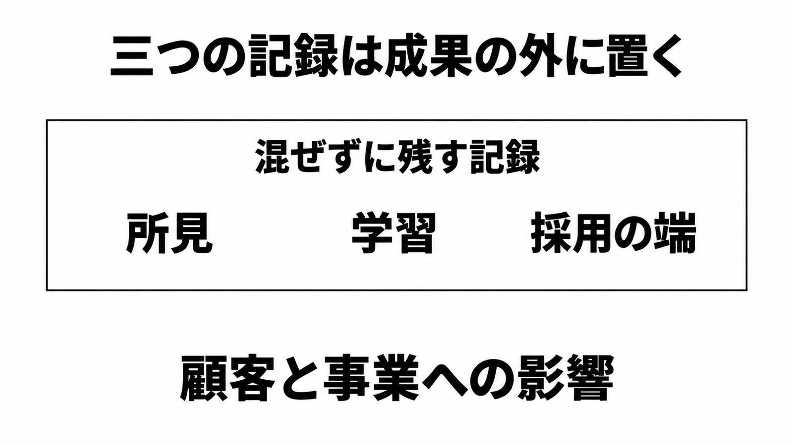

# ダイジェスト: Amazonの開発者メモはAIの所見と採用の端を分けて残す

元記事: [amazon-ai-aboutamazon-company-p1_20261030.md](../../../../../articles/amazon-ai-aboutamazon-company-p1_20261030.md)

## ひとことで言うと

公開メモは、試して役立たなかった作業、まだ適用していない人、採用の両端を、別の記録にする。顧客と事業への影響は、その三つの記録の外にある成果である。

## 核心ポイント

- 2026年10月27日のメモ（Terk Terkowitz。Worldwide Amazon Stores の VP / Distinguished Engineer）は、すぐ古くなる「良い AI 実践」の定義は書かず、焦点を顧客、事業、チームへの影響に置く。AI はソフトウェア工学の実践の中心にある、と書く。
- 所見（本番で今の道具を試して役立たなかった作業）、学習（まだ日常の仕事に適用していない人）、採用の端（AI 採用の下位10%と上位10%で、組織の見方）は、別々の記録である。
- 入力（トークン使用量、AI ツールの採用、コードの変更、レビュー）を標的にすることは深く欠陥がある、とメモは書く。同じ入力を、注意と判断とともにキャリアと組織の成績を考えるときに使うのは適切だ、とも書く。
- 今の道具が役に立たないことは失敗ではなく所見で、理由を文書にして仲間と上長へ渡し、解決を探す。対象は本番で試したあとの作業だけで、まだ試していない人は学習の側に置く。
- 公開メモに、評価票の欄を消したという文はない。Business Insider の「AI の採用を評価の一部」は、メモの文面にはない。

## メンタルモデル

配送とは、顧客と事業へ成果を届けることである。

所見には、本番で試したあとに役立たなかった作業だけを入れる。学習は、まだ日常の仕事へ適用していない人の側である。採用の端は、下位なら効果的に受け入れていない理由、上位なら配送の増加が伴うかを、組織の見方として見る。

## 具体例

同じチームの週次の利用率が下位10%でも、それだけでは個人の成果点にしない。見るのは、なぜ効果的に受け入れていないかである。上位10%でも、利用率だけでは配送が増えたことにはせず、増加が伴うかを見る。

## 適用と判断

向く場面:

- 個人の AI 使用回数を、成果そのものとして扱おうとしているとき。
- 利用率の下位10%を、個人の成果点にしようとしているとき。
- 満足度の平均（2016年の手紙にある、調査の満足 47% とベータテストの満足 55% の例）だけを成果欄に置こうとしているとき。

確認すること:

- 下位10%は効果的に受け入れていない理由を、上位10%は配送の増加が伴うかを、見ているか。
- 利用率の平均だけで、その理由と配送の対応を判断していないか。
- 入力を目標そのものにせず、見るなら注意と判断とともにしているか。
- リーダーは、本番の経験から、役立った作業と役立たなかった作業を一つずつ説明できるか。
- 顧客側で数えるものを自分で選ぶなら、対象の作業のあとで顧客に起きた出来事を1件残しているか（メモは問い合わせ、欠陥、継続利用のどれも選んでいない）。

## 限界・注意点

- 社内の役割ガイドライン原本で、評価票の項目が消えたか残ったかは、公開メモだけでは確定しない。個人の回数を成果点にするか、正式な人事評価に載るかは、公開メモが指定していない。
- 所見の様式、期限、蓄積先、下位10%と上位10%の分母、学習と下位10%の境界は、公開メモが指定していない。
- frontier teams（AI を最も受け入れたチームを、メモがこう呼ぶ）では、生産性と配送が増えているとメモは書く。その増加に、件数、比率、期間はない。
- 2026年5月の報道が伝えた週次の利用目標が、10月27日以降も同じ数値で残っているかは、公開メモが沈黙している。
- 日経クロステックの第2ページは会員の壁の向こうで、元記事は本文を確認していない。第1ページは、活用度で順位付けしなくなったと読んでいる。

## 参考

- 元記事: [amazon-ai-aboutamazon-company-p1_20261030.md](../../../../../articles/amazon-ai-aboutamazon-company-p1_20261030.md)
- [Terk Terkowitz, An update from Amazon engineering leadership（About Amazon、2026-10-27）](https://www.aboutamazon.com/news/company-news/amazon-software-engineer-role-guideline-ai)
- [Jeff Bezos, 2016 Letter to Shareholders](https://www.aboutamazon.com/news/company-news/2016-letter-to-shareholders)
- [中田敦、日経クロステック（2026-10-30、第1ページまで）](https://xtech.nikkei.com/atcl/nxt/column/18/03079/102900047/)
- [Eugene Kim, Ana Altchek, Business Insider（2026-10-27）](https://www.businessinsider.com/amazon-software-engineers-prioritize-results-over-ai-usage-2026-10)
