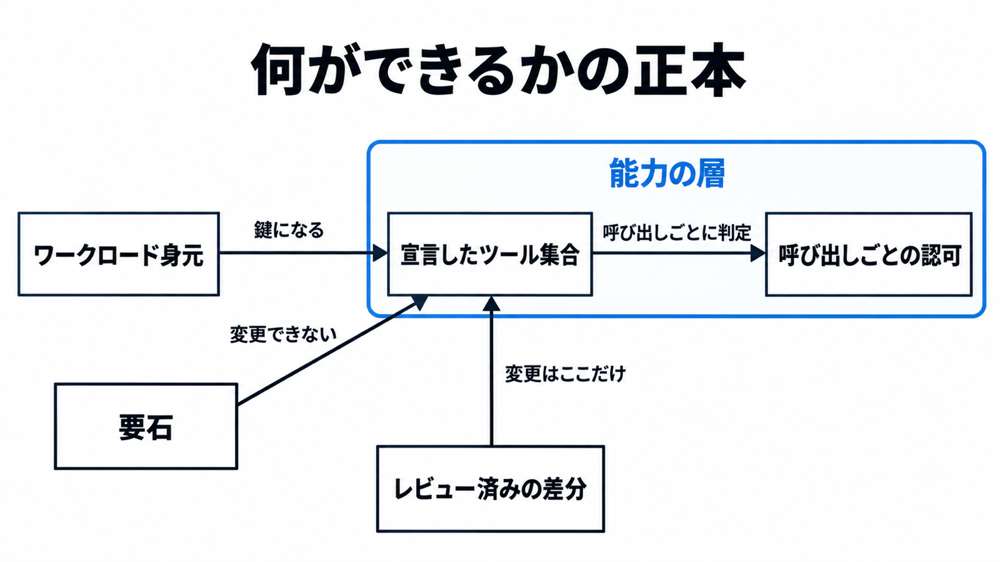

# ダイジェスト: CNCFブログはエージェントの境界を許されたツール集合として整理する

元記事: [cncf-cncf-io-2026-boundary-p6_20261030.md](../../../../../articles/cncf-cncf-io-2026-boundary-p6_20261030.md)

## ひとことで言うと

エージェントが何をできるかの正本は、宣言したツール集合と、その集合への呼び出しごとの認可である。実行中の身元はその定義を書き換えられない。

## 核心ポイント

- 同心円は内側から身元、到達（接続してよい相手）、能力、データ（見てよいレコード）で、外側の環は内側の検証済み身元を鍵にする。能力は、保持してよいツールを宣言して決める関門と、ツールを呼び出すたびに認可する関門に分かれ、一覧に出るかと呼び出せるかはこの二段にある。
- 要石は、権限を定義するオブジェクトを当の身元が書き換えない規則で、変更は人かパイプラインのレビュー済み差分に限る。エージェントに見せる一覧（見える集合）に残すのは、変更案、下書き、推奨、望む状態への pull request を出すツールだけである。
- プロンプトの禁止は意図の記録として残し、何ができるかの正本にはしない。メッシュ（サービス間の通信を仲介し、接続相手を絞る基盤）はどのツールが見えるかの正本ではなく、標準入出力で子プロセスと通信する方式はこの層を通らない。
- Safe Operating Model（有界な自律を、エージェントが走る基盤の性質として置く筆者の名前）は、確認した範囲では CNCF の仕様名でもプロジェクト名でもなく、元のブログ本文は製品名を出していない。この名前の標準としては採用しない。
- Istio と Linkerd（メッシュの実装）の出荷時の既定は、接続を許す宣言が無い相手を拒否することではない。MCP（エージェントが外部ツールを一覧し呼び出すプロトコル）では、認可に従わなくても仕様違反にはならず、一覧から許可外ツールを外すことも義務ではない。

## メンタルモデル

図は能力の層だけである。ワークロード身元（動いている処理へ発行する短命の認証情報）は集合の鍵であり、ツールの中身は決めない。

## 具体例

エージェントの ServiceAccount（Pod が Kubernetes API を呼ぶときの身元）が自分の Role を更新でき、その緩和を含む pull request がレビュー無しでマージされ、Argo CD（Git 上の望むマニフェストをクラスタへ合わせる仕組み）の自動同期がクラスタへ反映すると、提案は権限を定義するオブジェクトの書き換え経路になる。

## 適用と判断

向く場面:

- エージェントへ渡す道具と、その追加や削除の経路を、プラットフォーム側で決めるとき。
- 提案の pull request を境界変更の経路にする前に、必須レビューと自動同期の条件を見るとき。

確認すること:

- 渡しているツールに、マージ、適用、承認、価格決定、資金移動、設定ファイルの書き込み、認可オブジェクトの更新が含まれるか。
- 含まれていれば、それらを見える集合から外し、残す出力を提案と pull request に限ったか。
- 境界を変えるリポジトリで、必須レビュー、バイパス、自動マージ、自動同期を確認し、権限を広げるパスだけ適用前に人の承認が残るか。
- 見てよいデータの範囲を、メッシュに入れた帰結ではなく、データを持つ系の権限として別に置いているか。
- この名前を、CNCF の仕様や、元のブログが名指ししていない製品の推奨として扱っていないか。

## 限界・注意点

- この名前が CNCF リポジトリの全ファイルに無いかは、GitHub の code search が 401 のため言い切れない。
- 許可した集合の内側では、ツールの選択、引数、ツールの説明文と、通過済みのサーバによる実行中の一覧変更が残る。
- RBAC（ロールへ権限を足していく制御）は加算のみで、拒否の規則は無い。昇格防止はロールと、そのロールを誰に付けるかに書かれ、認可ポリシーやツール許可の設定の更新は、その検査の対象としては書かれていない。
- ワークロード身元は、利用者の委任を運ぶ資格情報としては書かれていない。利用者とワークロードと認可文脈を一つのトランザクショントークンで運ぶ案は草案であり、そのトークンはワークロード身元の資格情報ではない。
- どの製品で、エージェントが実行主体のまま自分の MCP クライアント設定を書き換えられるかは、製品マニュアルまで確認していない。

## 参考

- 元記事: [cncf-cncf-io-2026-boundary-p6_20261030.md](../../../../../articles/cncf-cncf-io-2026-boundary-p6_20261030.md)
- [CNCF Blog "The boundary problem in agentic AI is a platform problem"（2026年10月29日）](https://www.cncf.io/blog/2026/10/29/the-boundary-problem-in-agentic-ai-is-a-platform-problem/)
- [MCP tools（2026-07-28）](https://modelcontextprotocol.io/specification/2026-07-28/server/tools)
- [Istio security concepts（latest）](https://istio.io/latest/docs/concepts/security/)
- [Kubernetes RBAC](https://kubernetes.io/docs/reference/access-authn-authz/rbac/)
