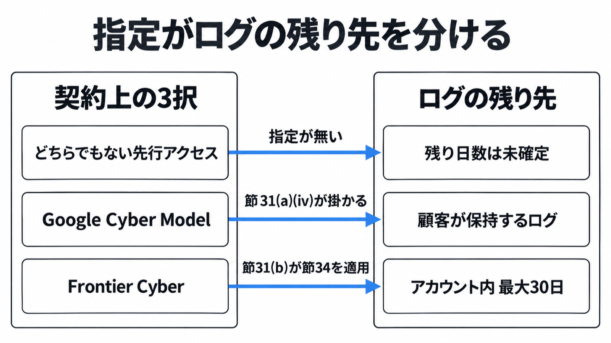

# ダイジェスト: Gemini 4 Carbonの限定提供で防御チームが契約前に切る条件

元記事: [google-gemini-carbon-google-p10_20261030.md](../../../../../articles/google-gemini-carbon-google-p10_20261030.md)

## ひとことで言うと

Gemini 4 Carbon（サイバーセキュリティと長い作業を強めたモデル）は、2026年10月28日の週から一部のサイバー防御者に始まる。使う前に、注文書の指定と、入出力がどこに残るかを切る。

## 核心ポイント

- 外部提供は日付の無い3段階で、第1が一部のサイバー防御者、第2が Fairwind（政府、国家のサイバー当局、重要インフラ、中核技術基盤を優先する限定提供）の追加パートナー、第3がガードレール改修後の開発者、企業、消費者である。先に出た Argon の約2週間（9月30日から10月13日）が弱めるのは、「Carbon はずっと対象外のまま」という読みだけで、Carbon の発表は広げる前にガードレールを直すと書いている。
- 公開のモデル文書が仕様を載せているのは Gemini 4 Argon とその防御版で、Carbon のモデル頁は 404 で、モデル ID は未掲載。節31（指定を受けたモデルの利用条件）と節34（Frontier 指定のとき、アカウント内最大30日）は、管理画面、文書、注文書で指定されたモデルだけに掛かる。
- Frontier Cyber（節31(b)が節34を適用する指定）から先に読めるのは、ログがアカウント内に残る最大30日だけである。顧客がログを保持する条項は Google Cyber Model（節31(a)が掛かる指定）のときだけで、指定が公開文書に無いあいだ、Argon のゼロデータ保持（機能を避ける条件の束で、Carbon の名は無い）は写せない。
- 提供対象外の組織と、許可された利用者以外の部門が、未検証の出力を判断の唯一の根拠にしないのは、2026年10月30日の元記事が勧める暫定の社内ルールであり、公開条項の禁止ではない。公開条項が禁じるのは、モデルを呼ぶ権利の共有と再配布までで、直す相手へパッチや所見を渡すことまでは禁じていない。
- 発表の順位と社内の倍率は、受け取る性能でも、使ってよい範囲でもない。

## メンタルモデル

## 具体例

FrontierCS 2（別評価）では、48課題中の合格は Carbon が 25、Argon が 26 である。両方を提出した 45 課題の平均点は Carbon 57.6、Argon 52.9 で逆であり、25 件のうち 3 件は抜け道である。

## 適用と判断

向く場面:

- 限定提供の申込や注文書の前に、指定の種類とログの残り先を切るとき。
- 防御以外の部門が、転送されたチャットを自分の検証記録にするか、パッチや所見を受け取るかを分けるとき。

確認すること:

- 指定が Google Cyber Model か、Frontier Cyber か、どちらでもない先行アクセスか。
- 防御以外の部門に渡すのが、モデルを呼ぶ権利ではなく、直す相手へのパッチや所見か。
- 許可用途を、Fairwind が Argon に書く脅威シミュレーション、リバースエンジニアリング、防御と学術のマルウェア解析（Carbon の参加条件としては名指しされていない）の外、製品開発一般へ広げていないか。
- 導入価格（100万トークンあたり入力2ドル、出力10ドル、そのあと4ドルと20ドル）の終了日は Carbon の発表に無く、2026年11月30日は公開向け Argon の一般提供ブログの脚注である。

## 限界・注意点

- 社内の「2倍超」「約80%」「26%」「29%」には母数と顧客向け設定が無く、Chrome の「10倍超」には比較相手の名前、課題数、1件の数え方が無い。
- Gray Swan が測った間接プロンプトインジェクションの攻撃成功率 0.0% に、試行回数は無い。
- 発表文の「フロンティアモデル」は、注文書の Frontier とは別である。モデル ID、リージョン、要求数、文脈の長さ、computer use は、2026年10月30日時点で未確認。
- 限定提供の注文書が節31または節34の指定に Carbon を入れているか、一般提供の日、残るガードレールは、公開資料では埋まらない。
- 公式ブログは機関名を置かない。報道が足した機関名は公式ではなく、Fairwind の「650超」は参加組織数であって Carbon を渡した数ではない。

## 参考

- 元記事: [google-gemini-carbon-google-p10_20261030.md](../../../../../articles/google-gemini-carbon-google-p10_20261030.md)
- [Koray Kavukcuoglu, Introducing Gemini 4 Carbon（Google、2026-10-28）](https://blog.google/innovation-and-ai/models-and-research/gemini-models/introducing-gemini-4-carbon/)
- [Gemini 4 Carbon 評価 PDF（DeepMind）](https://storage.googleapis.com/deepmind-media/gemini/gemini_4_carbon_model_evaluation.pdf)
- [Google Cloud Service Specific Terms](https://cloud.google.com/terms/service-terms)
- [Fairwind Program（DeepMind）](https://deepmind.google/fairwind-program/)
- [FrontierCS, Gemini 4 Carbon（2026-10-29）](https://frontier-cs.org/blog/gemini-4-carbon/)
