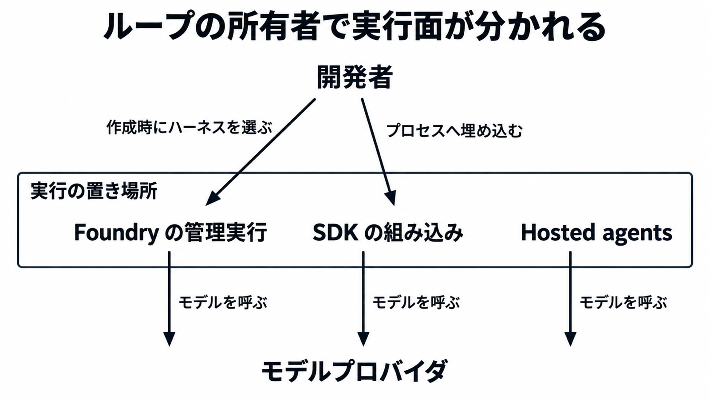

# ダイジェスト: Microsoft Copilot harnessの全社共通化とSDKの二つの実行面

元記事: [microsoft-copilot-sdk-forest-p9_20261030.md](../../../../../articles/microsoft-copilot-sdk-forest-p9_20261030.md)

## ひとことで言うと

Foundry の管理実行がループを持つか、アプリがクライアントを持ち Copilot CLI がループを回すかで、実行面が分かれる。ハーネスは、モデルの外側で指示、文脈、実行環境、制御を渡す層。

## 核心ポイント

- 全社共通化とは、GitHub が作った実行基盤を、全社の Copilot 体験へ採用することである。2026年10月28日に、Foundry の管理実行の公開プレビューと、GitHub Copilot SDK を Microsoft Copilot SDK へ改名する告知が同時に出た。
- Foundry のプレビューでは、Foundry がループと、会話ごとに割り当てる実行環境を運用する。
- SDK では、アプリがクライアントを持ち、Copilot CLI（ツール要求のあいだモデル呼び出しを繰り返す実行ファイル）がループを回す。Hosted agents は、フレームワークとループを利用者が持ち、ホスティングだけを Foundry に任せる別経路である。
- Copilot Studio（ハーネスを載せた製品）の比較数値は脚注ごとに母集団が違い、人手なしの解決率 35% 超は 2026年8月の別事例なので、まとめて全体のタスク成功として扱わない。
- Foundry が会話ごとに割り当てる実行環境の計算課金は 2026年12月1日からで、それより前でもモデル推論、別料金のツール、接続サービスは各料金の対象である。

## メンタルモデル

開発者は、Foundry では作成時にハーネスを選び、SDK ではクライアントを埋め込む。二つは Foundry と SDK で、Hosted agents は別経路。

## 具体例

Foundry の YAML ではハーネス型を microsoft_copilot_preview（プレビューを選ぶ値）にし、Python では MicrosoftCopilotHarness() を渡す。

## 適用と判断

向く場面:

- スキル（`SKILL.md` を持つ手順のまとまり）、ファイル、シェル、サブエージェント（組み込みの委譲先）を Foundry に任せるとき。
- 自社アプリのプロセスから Copilot CLI を呼ぶとき。
- フレームワークとループを自前で持ち、ホスティングだけ Foundry に任せるとき。

確認すること:

- 初期プレビューではハーネスは作成時だけ選べ、別バージョンを作っても変わらず、作成後の切り替えはまだ非対応である。
- Foundry プレビューはモデルデプロイの持込に非対応で、SDK はアプリがプロバイダ設定を渡す別経路であり、API キーだけが渡し方ではない。
- 開き直す ID は呼び出し側が所有し、プロバイダ設定を使ったセッションだけ同じ設定を引数で再指定する（API キーはディスクに残らない）。
- 待ちと時間切れは処理が止まったときとエラーのときを基準にし、モデルが完了とみなす合図はインタラクティブモードでは出ないことがある。
- ツール実行の前に権限ハンドラを置き、省略すると権限要求は手動で解くまで保留になる。

## 限界・注意点

- 公式ブログは、ハーネスのランタイムを Rust へ移植し、セッションのオーバーヘッドと最初のトークンまでの時間が短くなったと述べる。同じ記事に倍率やミリ秒は無い。
- npm の @github/copilot-sdk は 2026年10月30日に 1.0.28 である。他のレジストリ版は同じ日に取り直しておらず、パッケージ名は GitHub 側のままである。
- 自動再開（完了の合図なしでツール利用ループが終わったとき、CLI が合成したユーザメッセージを挿入する動き）は開き直しとは別で、リモートが待つのは処理停止か、その動きが止まった合図である。どの呼び出しがリモート、自動再開、インタラクティブのどれかは参照した記述に入口が無い。
- Foundry が管理する実行環境と、CLI の保存設定 sandbox は別物である。
- README は一般提供と書く。SUPPORT.md は GitHub Issues とコミュニティ対応に限定し、Microsoft の製品サポート契約へ移ったとは書いていない。

## 参考

- 元記事: [microsoft-copilot-sdk-forest-p9_20261030.md](../../../../../articles/microsoft-copilot-sdk-forest-p9_20261030.md)
- [Introducing the Microsoft Copilot harness（Microsoft Blog、2026-10-28）](https://blogs.microsoft.com/blog/2026/10/28/introducing-the-microsoft-copilot-harness-unlocking-the-potential-of-truly-multi-model-agentic-work/)
- [GitHub Copilot SDK is becoming Microsoft Copilot SDK（GitHub Changelog、2026-10-28）](https://github.blog/changelog/2026-10-28-github-copilot-sdk-is-becoming-microsoft-copilot-sdk/)
- [Introducing the Microsoft Copilot harness in Foundry Agent Service](https://devblogs.microsoft.com/foundry/microsoft-copilot-harness-in-foundry/)
- [Use the Microsoft Copilot harness with prompt agents（Microsoft Learn）](https://learn.microsoft.com/azure/foundry/agents/how-to/use-tools-skills-copilot-harness)
