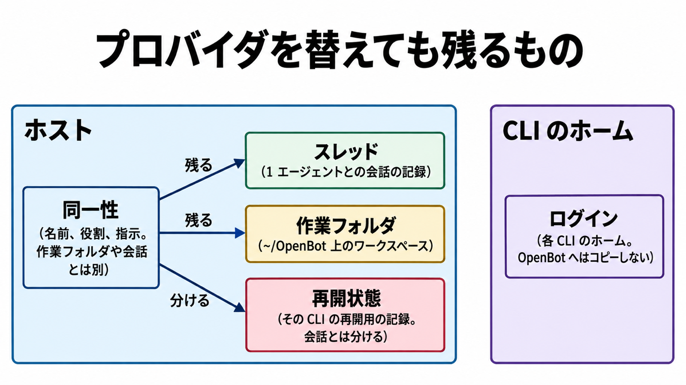

# ダイジェスト: OpenBot のデータの境界

元記事: [open-bot_20261030.md](../../../../../articles/open-bot_20261030.md)

## ひとことで言うと

OpenBot は自前のモデルを持たず、手元の AI CLI を束ねる。会話と作業フォルダはそのコンピュータに残り、ログインは各 CLI のホームに残る。

## 核心ポイント

- OpenBot は自前のモデルを持たない。エージェント（名前、指示、作業フォルダ、会話を持つ常駐の 1 人）の正本はホスト（そのコンピュータ）にあり、選んだ CLI の提供者にプロンプトが届く。
- プロバイダ（裏で動かす AI CLI）を替えても、作業フォルダとスレッド（ホストのデータベースに残す会話の記録）は残り、再開状態（その CLI の再開用の記録）はホスト側で会話とは別である。ログインは各 CLI のホームに残り、ホストのデータベースへはコピーしない。
- 人が離れたあとに動かすなら、自分のコンピュータを起こしたままにするか、ホスト型（OpenBot が用意する実行用コンピュータで、1 台につき 1 つのサンドボックス、自分の機械は常時起動しない）に預ける。ホスト型は活動が途切れると止まり、停止から 14 日でディスクが消える。
- 権限は三段階で、自分の作業フォルダ、共有フォルダ、人が追加したフォルダだけを変える段階と、確認を挟む段階と、フルアクセスがある。自動承認として残るのはフルアクセスだけで、広げられるのは人だけである。
- ライセンスは非商用の PolyForm Noncommercial 1.0.0 で、会社の業務や商用製品への組み込みには別契約が要る。

## メンタルモデル

同一性（名前、役割、指示のまとまりで、作業フォルダや会話とは別）から、スレッドと作業フォルダへは残る矢印、再開状態へは分ける矢印が出る。ログインは CLI のホームの枠にあり、ホストのデータベースへコピーする矢印は無い。

## 具体例

| 場面 | 置き方 |
|---|---|
| 自分の Mac で複数の役割を並行させる | 自分の Mac 上のアプリ。作業フォルダは ~/OpenBot |
| ノート PC を閉じても仕事を続ける | 自分で起こしたままにする Ubuntu、または自分の機械上の Docker |
| 自分の機械を常時起動しない | OpenBot が用意するホスト型。1 台につき 1 つのサンドボックス |

## 適用と判断

向く場面:

- 1 台の自分のホストで、役割の違うエージェントを並行させたいとき。
- ノートを閉じたあとも、同じ会話と作業フォルダで続けたいとき。
- 同僚が同じエージェント群を、1 台のホストの正本に参加して使うとき。

確認すること:

- 定時の仕事（決まった時刻か外からの呼び出しで起動する定型）は、そのホストが起きていて OpenBot が開いているときだけ実行し、スリープ中の逃しは復帰後 1 回、閉じていたときの逃しはスキップか次回起動時に 1 回かを設定で選ぶ。
- 停止したまま 14 日を超えて残したいデータは、ホスト型に置かない。
- 会話はクラウドへ複製しないので、控えは別に取る。
- 外部チャット（Slack、Discord、Telegram）に投稿できる人はエージェントへ仕事を渡せ、届く範囲はホストの三段階の権限で決まる。
- 使う目的が、商用を見込まない個人の研究・学習・趣味か、非営利・教育・公的機関でなければ、別契約が要る。

## 限界・注意点

- 開発プレビューで、同一ホストのエージェントは OS を共有し、共有フォルダ内のデータベースは互いに読み書きできる。エージェントごとに独立したコンピュータがある、とは読まない。
- 設定の値は、概要の README を唯一の根拠にせず、設計の正本 ARCHITECTURE.md を見る。
- 移す先のモデルは、エージェントの設定に最大 8 個まで置く。移せるのは文章やツールの実行前の失敗だけで、横に開いた別会話、共有チャット（外部の Slack 等とは別の、ホスト上で複数エージェントが参加する会話）の依頼、起動失敗は移らない。
- 確認を挟む段階が、ファイルやコマンドのたびに何を聞くかは、設計文書でも言い切っていない。
- Linux デスクトップのデータベースの絶対パスは記事に無い。コンテナは起動手順があっても、コンテナ内のログインなどは未試験である。

## 参考

- 元記事: [open-bot_20261030.md](../../../../../articles/open-bot_20261030.md)
- [nightly-labs/openbot](https://github.com/nightly-labs/openbot)
- [ARCHITECTURE.md](https://github.com/nightly-labs/openbot/blob/main/docs/ARCHITECTURE.md)
- [Hosted servers](https://github.com/nightly-labs/openbot/blob/main/docs/hosted-servers.md)
- [PolyForm Noncommercial License 1.0.0](https://polyformproject.org/licenses/noncommercial/1.0.0)
