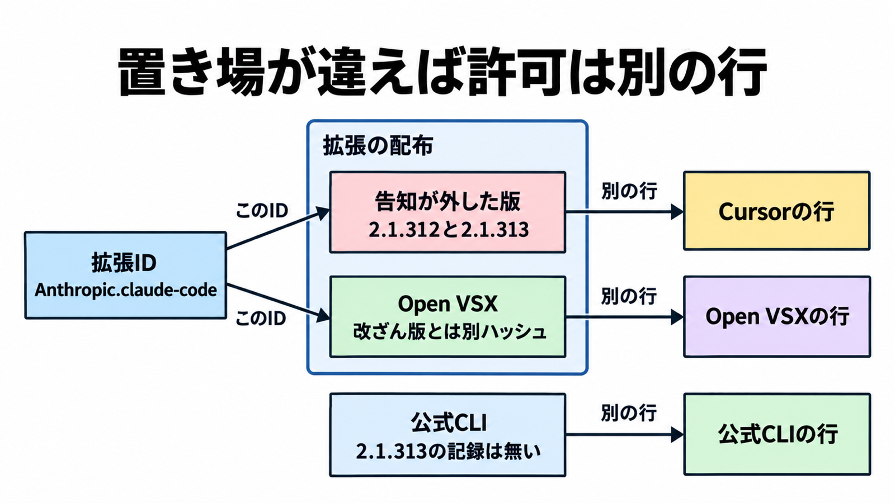

# ダイジェスト: Cursor拡張マーケットの改ざん版Claude Codeを配布元とハッシュで分ける

[元記事](../../../../../articles/cursor-claude-code-2-1-313-p1_20261031.md)

## ひとことで言うと

Cursor の拡張配布先に置かれた改ざん版は、同じ版番号の公式パッケージとは別の許可にする。許すかは、出した場所とファイルのハッシュで分ける。

## 核心ポイント

- Cursor の告知は、拡張マーケット（拡張の配布先）の `Anthropic.claude-code`（拡張の識別子）2.1.312 と 2.1.313 を、Anthropic が開発していない改変版（以下、改ざん版）だと書く。置かれていたのは太平洋時間の 2026年10月29日 2:27ごろから 13:35 までで、検知後に外した。
- Open VSX（この拡張 ID の公開レジストリで、配布元の一つ）の 2.1.312 は、macOS と Windows とも、サイドカー（配布ファイルに添えるハッシュ）が改ざん版と一致しない。GitHub の release、npm、Open VSX に、2.1.313 の公開記録は無い。
- 拡張を消しても永続化（後から残る自動起動）は残り得ると告知は書き、目印は SSH 公開鍵のコメント `svc-telemetry` だとする。多くのホストでトンネル（攻撃者側から端末の SSH へ入る接続）のログインは失敗したが、鍵の追加、永続化、ホスト情報の送信は起きた、とも書く。
- 影響人数の上限と、VS Code 拡張の 2.1.314 への更新指示は Cursor の公式投稿にあり、2026年10月31日の告知 HTML には無い。2.1.314 のリリースノートは、この改ざんも Cursor の拡張マーケットも書いていない。
- 公式 CLI（npm と GitHub の release）、Open VSX、VS Marketplace（Cursor のマーケットでも Open VSX でもない配布元）を同じ対象に上げるのは、そのいずれかが告知と同じバイトを配ったと一次で示されたか、Anthropic のアドバイザリが公式の版をこの件の対象に加えたときだけである。

## メンタルモデル

公式 CLI には 2.1.312 があり、2.1.313 の公開記録は無い。許可の行（配布元・拡張 ID・版・ハッシュの 1 件）は、置き場ごとに分かれる。

## 具体例

Apple Silicon 向け macOS の 2.1.312 では、サイドカーと改ざん版のハッシュが一致しない。

## 適用と判断

向く場面:

- その時間窓に、Cursor のマーケットから `Anthropic.claude-code` の 2.1.312 か 2.1.313 を入れたか更新した macOS か Windows を確認する。
確認すること:

- `svc-telemetry` を告知の手順で探し、ログイン失敗を省く理由にしていないか。
- 修復は、macOS では影響を受けたユーザーとして行い root では行わず、Windows では管理者の PowerShell で行うか。
- 資格情報は、影響を受けたホスト上ではなく、別の信頼できる系統から回すか。
- 2.1.314 への更新を、残る鍵と永続化の確認の代わりにしていないか。
- 上の条件が無いまま、公式 CLI、Open VSX、VS Marketplace をこの件の対象に上げていないか。

## 限界・注意点

- その投稿の “at most 5,000 users” は上限の自己申告で、実数でも下限でもない。
- 告知は、環境変数の名前を収集したと書く。OAuth トークンや API キーの値が最初の送信に含まれた、という文は無く、後日の資格情報アクセスも否定しない。
- 署名が改ざん版を止めたか、拡張を出す権限が盗まれたかは、告知も Anthropic 社員 Felix Rieseberg の投稿も書いていない。同投稿は、会社ドメインのアドバイザリページではない。
- 2026年10月31日の応答では、2.1.314 より後の npm の 2.1.315 は latest（npm が最新として指す版）ではなく、GitHub と Open VSX の同じ版は 404 である。
- 未決なのは、Open VSX が添えたハッシュと配布ファイル本体の計算値が一致するかで、具体例の不一致とは別である。Linux 向け配布の有無と CVE 番号の有無も、告知だけでは決まらず、無いとは断定しない。

## 参考

- 元記事: [cursor-claude-code-2-1-313-p1_20261031.md](../../../../../articles/cursor-claude-code-2-1-313-p1_20261031.md)
- [Cursor のセキュリティ告知](https://cursor.com/blog/claude-code-extension-security-notice)（末尾更新は 2026年10月30日 11:30am PT）
- [Cursor (@cursor_ai) の投稿](https://x.com/cursor_ai/status/2116074289053175808)（2026年10月30日 07:46 UTC）
- [Felix Rieseberg (@felixrieseberg) の投稿](https://x.com/felixrieseberg/status/2116170451466543578)（2026年10月30日 14:08 UTC）
- [Open VSX API 2.1.312](https://open-vsx.org/api/Anthropic/claude-code/2.1.312)
