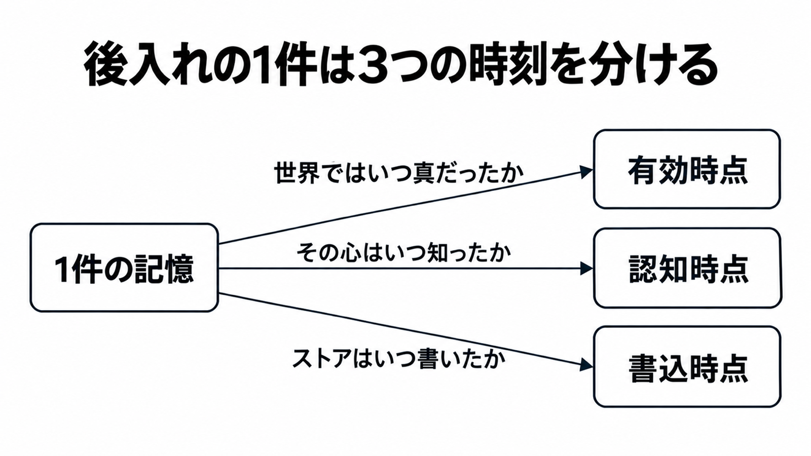

# ダイジェスト: 過去の記録をエージェントの記憶へ入れるとき、出来事・認知・保存の日付を分ける

元記事: [zenn-dev-build-anotherme-p9_20261031.md](../../../../../articles/zenn-dev-build-anotherme-p9_20261031.md)

## ひとことで言うと

過去の記録を記憶へ後から入れるときは、世界で真だった期間、知った時点、保存した時点を、1つの日付にまとめない。

## 核心ポイント

- 後入れ（会話や文書が起きたときよりあとに記憶へ入れること）の1件には、有効時点（世界で成り立っていた期間）、認知時点（心が知った瞬間）、書込時点（ストアが行を書いた瞬間）が付く。心は事実を保持する主体で、会話にいたエージェントと、あとから取り込むストア（データベースやファイル）は別の心である。
- 世界で真だったかには有効時点、そのとき知っていたかには認知時点、監査には書込時点を使う。知っていたかは、その時刻以前に知った行を出したあと、置換（旧規則を置き換える新しい規則）をその時刻に既に知っていたかを見てから答える。
- 保存先が既にあるなら、今の引数がどの問いに答えるかを先に固定し、知った時刻が事柄の起きた時刻でも書いた時刻でもないときだけ、その欄を足す。ライブの取り込みでは知った時点と書いた時点が一致することが多く、3つの欄を常に必須にはしない。
- SurrealDB（エージェント記憶）では、施行日（ルールが効力を持つ開始日）は有効の開始 `valid_from`、心が知った日は観測時刻 `observed_at` に置く。観測時刻を渡すと作成時刻 `created_at` は知った日になり、書いた時刻は行の過去版を残す履歴の側に残る。
- Graphiti（Zep が公開する時系列の知識グラフ）では、後入れの基準日時 `reference_time` を、事柄が起きた時または一連の会話の時刻とし、世界で真だった期間と常に同じにはしない。知った時刻に当たる欄は公開の追加と検索に無く、書いた時は `created_at` に残るので、知っていたかを有効の開始と終了の範囲で代用しない。

## メンタルモデル

## 具体例

新しいストアが10月に、3月の会話を初めて入れる。このストアが知ったのは10月で、3月は会話が起きた時である。認知を3月に置くと、4月時点の読み取りは「このストアは4月に知っていた」と返す。

## 適用と判断

向く場面:

- 過去の会話や社内文書を、起きた日よりあとに記憶へ入れるとき。
- 既にある保存先で、今の引数が有効・認知・書込のどれに答えるかを固定するとき。
- 過去の時点の作業を再生し、その時点より後に知った規則で、当時の規則を止めるかを決めるとき。

確認すること:

- 1つの日付に、世界で真だった期間と、知った時点と、書いた時点のうち2つ以上を載せていないか。
- 新しいストアの認知時点を、元の会話が起きた日にしていないか。
- 再生ではその時点より後に知った置換で当時の規則を止めず、適用は再生でもライブでも判断の対象時刻が有効時点に入るときだけにする。
- 空の日付を、時点の判定や更新日の穴埋めに使っていないか。
- 会話要約の Mem0 では、事柄が起きた日と作成の日を1つの作成時刻に載せず、観測した日時は別欄にする。

## 限界・注意点

- これは全製品の標準機能ではなく、日付を自動で正しく読むことも、取り込む前の記録の正しさも保証しない。
- 事実を指定時点で読むときは、知った時点に加えて有効時点も見る。知った時点だけだと、未来の施行を真と返し、期限切れをまだ真と返しうる。
- Zep の Facts は、有効の開始と終了がソースや抽出した事実の真を確立しない、と書いている。日付の無い文がすべて同じ結果になるとは書かず、日付の無い現在形の公式例では有効の開始は基準日時になる。
- 次の4点は公開文書から決まっていない。Mem0 の観測日と事柄の日が保存後に別欄で残るか、Letta で過去の作成時刻を渡したあとも更新時刻が挿入時の現在時刻を保つか、SurrealDB で複数メッセージをまとめて送る時刻の入り先、Graphiti の追加属性で事実検索を絞れるかである。

## 参考

- 元記事: [zenn-dev-build-anotherme-p9_20261031.md](../../../../../articles/zenn-dev-build-anotherme-p9_20261031.md)
- [谷口「古い記録をAIに渡すとき、3つの日付を分ける理由」](https://zenn.dev/build_anotherme/articles/c433b4055e025d)
- [SurrealDB Tri-temporal model](https://surrealdb.com/docs/agent-memory/architecture/tri-temporal-model)
- [Zep Facts](https://help.getzep.com/facts)
- [Mem0 Memory Timestamps](https://docs.mem0.ai/platform/features/timestamp)
