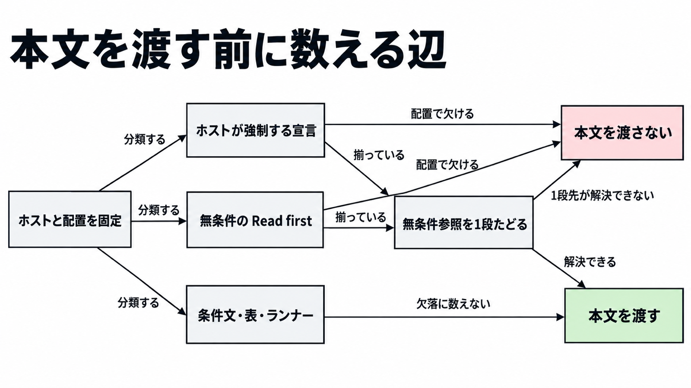

# ダイジェスト: スキル本文を渡す前に数える辺

[元記事](../../../../../articles/cli-agent-skills-zenn-dev-p5_20261101.md)

## ひとことで言うと

スキル本文を渡す前に止めるのは、選んだホストが強制する宣言と、置いた場所で解決できない無条件の「最初に読め」だけです。

## 核心ポイント

- Agent Skills（手順書）の前提の書き場所は、仕様の欄、ベンダーが metadata（仕様外の追加属性）に足した欄、本文、相対リンク、実行コマンドの 5 か所です。すべてを止める対象にはせず、ホスト（スキルを読み込んでエージェントへ渡す側）が最初に受け取るのは名前と説明だけで、本文はそのあと、読むと決めたときに読まれます。
- 仕様と Claude Code は、compatibility（1〜500 字の自由文）も metadata も、本文を拒む理由にしません。Lark CLI（スキルを構成する側）は、配列に書いた兄弟が同じ親に無いと構成を失敗させ、この解釈ではそのとき本文を渡しません。
- 解釈では、無条件の Read first（先頭で、条件なしに別ファイルを読めと求める参照）は、配置（同じ親に複数スキルを並べるか、フォルダ 1 つか）でファイルが無ければ本文を渡しません。
- センサス（2026-10-30 固定のカタログを言語モデルが読んだ結果）の 12.8% の分母は、前提の自由文一覧がある 16,798 件です。15.0% の分母はインストール数で、どちらも全 64,756 件でも、ゲート（本文を渡すかを決める検査）が止める割合でもありません。
- 版やランタイムは、ファイルに書いてあるときだけ見て、満たさないときに渡すかは決めていません。ランナー（実行時にパッケージを取る npx や uvx）の名前は、PATH の欠落に数えません。

## メンタルモデル

辺（前提のつながり）では、図の「宣言」（欠けると本文を渡さないもの）が欠けるときと、解決できない Read first だけを止めます。揃っていれば 1 段たどり、1 段先の無条件の Read first が解決できなければ渡しません。

## 具体例

gws（Google Workspace の CLI）の `gws-gmail-send` をフォルダ 1 つだけで置くと、先頭の `../gws-shared/SKILL.md` は無条件の Read first です。`gws generate-skills` は、導入先の親で実行したとき以外、その相対パスを埋めません。

## 適用と判断

向く場面:

- 渡すホストと配置を固定してから、本文を渡すか検査する。
- 単体コピーを許すとき、無条件の Read first を同梱するか、条件文に変える。

確認すること:

- そのホストが強制する宣言が配置で欠けるなら、本文を渡しません。
- Read first は、選んだ親で解決するかを、無条件参照と metadata.requires.skills の 1 段だけ見ます。
- 条件付きリンク、表、See Also（関連ファイルの列挙）、ランナー、センサスの requiresSkills（ファイル上の requires.skills とは別の識別子）は、欠落に数えません。
- bins（実行ファイル名の配列）を、ホストが PATH を見ていないのに足していないか。
- 版の不一致で止める規則を、ファイルに無いのに足していないか。

## 限界・注意点

- この数え方は仕様の適合条件ではなく、2026-11-01 時点の解釈です。確信度は中程度で、ホストの改訂と、README と SKILL.md の不一致で判定は変わります。
- 記録では OpenClaw の bins はすべて必須、anyBins はどれか一つ、always は bins の検査を飛ばす印です。その演算と、Codex の dependencies.tools が PATH を止めない記録、Cursor に依存解決が無い記録は、開き直していないので未確認です。
- センサスの生データは 2026-11-01 時点で入手できず、比率は再計算していません。空の一覧は、依存が無い証拠ではありません。
- 機械可読の依存欄を仕様が定義しホストが実装したとき、または導入時の相対リンク解決を文書化したときは、止める対象をその欄へ移します。
- 1 段より先は、解決しきったとは言いません。配列に無いコマンドを本文が名指しするときだけ、複数スキルを同じ親に置くか静的抽出の落としを受け入れ、そのコマンドは本文を渡さない理由にしません。

## 参考

- 元記事: [cli-agent-skills-zenn-dev-p5_20261101.md](../../../../../articles/cli-agent-skills-zenn-dev-p5_20261101.md)
- [Agent Skills 仕様](https://agentskills.io/specification)（2026-11-01 取得）
- [センサス](https://skillselion.com/research/agent-skill-dependency-census-2026-10)（データ固定 2026-10-30）
- [Claude Code の skills 文書](https://code.claude.com/docs/en/skills.md)（2026-11-01 取得）
