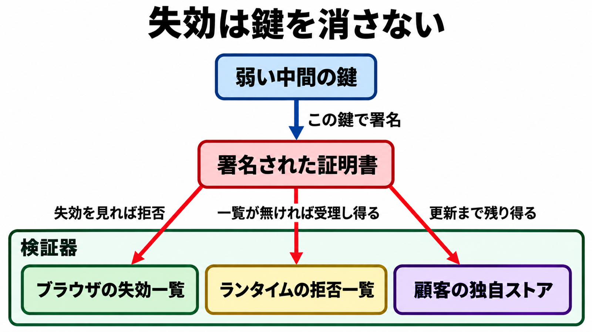

# ダイジェスト: Cloudflareが分けて公開したeMudhra未パッチ接続の残存

元記事: [cloudflare-emudhra-cloudflare-p7_20261101.md](../../../../../articles/cloudflare-emudhra-cloudflare-p7_20261101.md)

## ひとことで言うと

Cloudflare は 2026年10月30日に、自社の修正、外向きの接続試行、閲覧者の受理を別々の計測として公開した。残る単位は弱い鍵の本数ではなく、その鍵をまだ受け入れる検証器である。

## 核心ポイント

- 認証局 eMudhra の中間 CA（終端の証明書へ署名する証明書で、TLS 用 6 本、コード署名用 2 本）8 本は、楕円曲線 P-384 の秘密鍵にあたる整数が 256 未満で、公開の証明書から秘密鍵を復元できる。未更新の検証器（証明書を検証するソフトウェア）が、CT（公開ログに載せる仕組み）の強制（ログに無い証明書を受け取らない条件）を持たないとき、その署名を正規として検証し得る。
- 三つの計測は数える単位が違う。外向きは発信経路 Pingora の接続開始で約 1 週間に約 22,000 件、閲覧者側は直近 1 週間に約 5,000 万回、自社システムは高優先度が修正済みという自己申告である。
- 約 22,000 件は通信の中身を読めた件数ではなく、約 3 分の 2 は試験用サイト、残りのほぼ全部は弱い中間の自分用証明書に見える相手である。証明書を検証する設定にした接続は拒否された、と Cloudflare は書く。
- 約 5,000 万は、Cloudflare が閲覧者へ出した確認用ページから、その中間の署名を受理するかを調べた回数で、ホストの台数でも中間 CA の残本数でもない。大規模なネットワークで過半数がまだ受理するのは、そのページの流量の中の割合である。
- ブラウザの迅速な失効は、失効を見ない言語ランタイムや、同梱した証明書の束を置き換えない。更新と、再起動またはイメージの再配置が別に要る。

## メンタルモデル

失効は鍵そのものを消さず、検証器が失効か拒否一覧を見るまで、その検証器は証明書を受理し得る。

## 具体例

Go が検証時に対象の中間を拒む一覧を入れた修正版は、Go 1.26.10 と Go 1.27.3 である。1.25 系に修正は無く、1.27.0 から 1.27.3 未満も修正前である。ビルド済みは、再ビルドするまで古い検証のままである。

## 適用と判断

向く場面:

- ブラウザ以外の常駐やバッチがインターネットへ出るとき。
- コンテナやアプリに証明書の束を同梱しているとき。
- 顧客が自分の環境へ入れる Cloudflare のソフト、または顧客が Cloudflare へ登録した検証用の CA を運用しているとき。

確認すること:

- 行を、ブラウザ、OS のストア、言語ランタイム、コンテナイメージ、アプリ同梱の束、プロキシ、顧客が自分で入れるソフト、独自の CA に分ける。
- 各行を、修正して再起動または再配置した、試験したが別経路は未確認、未着手、のどれかにし、未確認を対応済みに混ぜない。
- 試験は、そのアプリが実際に使う検証器で行う。
- Go の実行ファイルを、具体例の修正版で再ビルドしたか。
- 証明書エラーを、検証を無効にして消していないか。

## 限界・注意点

- 自社の低影響の作業は残る。
- 外向きのログは 2026年10月21日以降の Pingora からの発信に限られ、このログだけでは特定の相手だけを狙った接続が無かったとは言えない、と Cloudflare は書く。自社の外で起きたかは未確認である。
- 閲覧者側は確認用ページと bot に偏り、JavaScript を実行しないクライアントは母数に入らない。2026年10月29日に流入した bot で修正が進んだように見えた部分は、分類の変化だと Cloudflare は断じている。
- 公表前に CT 強制のブラウザは攻撃され得なかった、というのは Dennis Jackson の対応一覧の主張で、根拠はその期間、当該中間が CT のログに無かったことである。ログ済みは、CT の強制だけでは拒否する保証がない。
- 失効ポインタの無い終端証明書では、終端だけを見る側は中間の失効に届かない。コード署名の 2 本は、TLS 用 6 本の本数に足さない。

## 参考

- 元記事: [cloudflare-emudhra-cloudflare-p7_20261101.md](../../../../../articles/cloudflare-emudhra-cloudflare-p7_20261101.md)
- Cloudflare. [4 real? Tracking exploitation and patching of eMudhra’s weak keys](https://blog.cloudflare.com/emudhra-patching/). 2026-10-30.
- [Mozilla Bug 2083449](https://bugzilla.mozilla.org/show_bug.cgi?id=2083449).
- Dennis Jackson. [eMudhra Intermediate CA Compromise](https://emudhra.we-have-a-problem.com/).
- Go. [GO-2026-6809](https://pkg.go.dev/vuln/GO-2026-6809).
