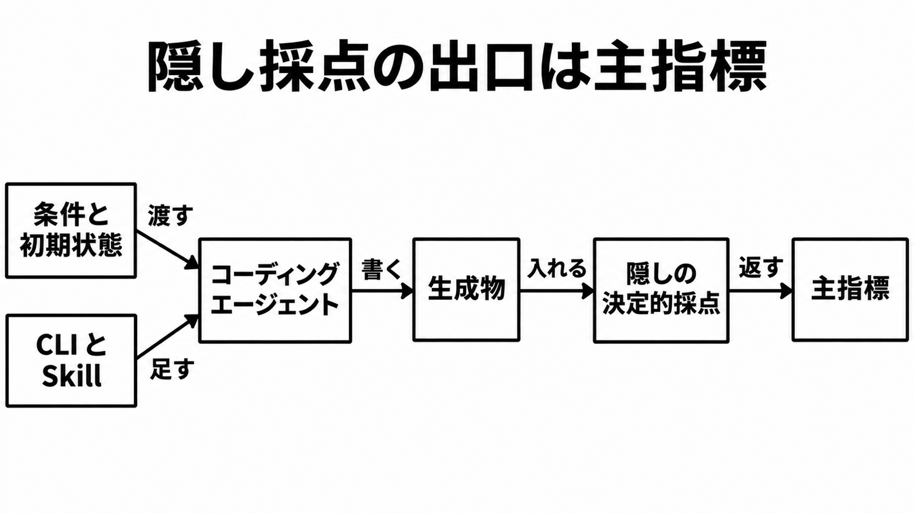

# ダイジェスト: Hono の Agent DX は隠し採点で測る

[元記事](../../../../../articles/hono-agent-dx-zenn-dev-yusukebe-p7_20261102.md)

## ひとことで言うと

Hono（Web フレームワーク）の Agent DX は、選択と足場の効果を、隠した採点で測ります。定義と分母と計測日が揃う数字だけを、同じ強さで読みます。

## 核心ポイント

- Adoption（依頼文に Hono と書かない依頼で何を選ぶか）、Value（素のハンドラと Hono の差）、Practical（既存の Hono プロジェクトへの変更が、レールの有無でどう変わるか）の三段です。素のハンドラは Hono を介さない書き方、レールはエージェント向けの足場で、週次の `cli + skill` は CLI と Skill（エージェントが読む手順）だけを指します。
- 決定的とは、プロジェクト全体ではテスト、型チェック、import の静的解析が合否を決めることです。Practical の公開分は `tsc --noEmit`（型検査）と非公開の検査スクリプトだけで、言語モデルには尋ねず、テストと import 解析がその中にあるかは分かりません。
- 主指標は成功率、トークン、時間、書いた行数です。選んだフレームワークと CLI を呼んだかは診断で、成功率とは別の欄です。
- Value（2026-09-06、`claude-haiku-4-5`、各 10 回、週次ではない）の行数減は、shop 約 39%、notes 約 34% です。shop は素のハンドラ 2/10、Hono 4/10 で、成功率が半分を超えた意味ではありません。
- 記事の「フレームワークを使えと言うと Node.js でも Hono」は、Node.js × framework の 2026-09-04 から 2026-10-26（Hono の割合は 0%）と食い違います。2026-10-26 のその履歴では、Opus（`claude-opus-5`）は 5 回とも Express です。

## メンタルモデル

条件と初期状態を渡し、Practical の `cli + skill` のときだけ CLI と Skill を足します。生成物だけを隠し採点へ入れ、成功率、トークン、時間、行数を返します。

## 具体例

Practical の週次では、2026-10-26 の `claude-haiku-4-5`、各 5 回で、開発サーバー課題の baseline（CLI も Skill も無い側）が成功率 80%、69 秒、cli + skill が 100%、25 秒です。

## 適用と判断

向く場面:

- 社内ライブラリの足場を、固定した課題の成功率、トークン、時間で数える。

確認すること:

- 隠したテストの成功率、ハングと巻き添え（他プロセスの停止）、人間用の短いコマンド（`dev` など）への追従を、一列にまとめない。
- 福岡の講演（2026-09-12）が CLI を勧めるのは、量が多い確認と、同じ会話で仕様が続く変更に限り、一行の `GET /health` に足す根拠はそこに無い。
- 発見面（依存や、エージェントへの指示ファイル `AGENTS.md` のように、探さずに目に入る場所）に無い機能は使われない、と agent-dx の README の範囲で読む。
- 2026-11-02 時点で、安定版 Workers テンプレートの `dev` は `wrangler dev` で `AGENTS.md` も CLI も無く、next 版は `cf dev` に `AGENTS.md` と CLI があるので混ぜない。
- 外部の Pull Request を閉じるかは、この採点の点数に入れない。

## 限界・注意点

- 約 700 run と約 $200 は福岡（2026-09-12）の自己申告で、請求資料と突合できません。44 回中 24 回の巻き添え停止は Hono Conference（2026-10-11）の自己申告で、公開された表の分母と突合できません。
- 2026-10-26 の haiku では、refactor-routes は baseline が 100%、178k トークン、cli + skill が 80%、328k トークンです。
- `package.json` に `hono` を置いて Hono を選んだ回数は、Workers と Node.js がそれぞれ 5/5 で、週次の表に無く、再実行していません。

## 参考

- 元記事: [hono-agent-dx-zenn-dev-yusukebe-p7_20261102.md](../../../../../articles/hono-agent-dx-zenn-dev-yusukebe-p7_20261102.md)
- [Yusuke Wada「Agent DX」（2026-11-01）](https://zenn.dev/yusukebe/articles/3d3dc6605ca1b1)
- [公開結果](https://agent-dx.hono.dev)
- [honojs/agent-dx の README](https://github.com/honojs/agent-dx/blob/main/README.md)
- [Node.js × framework の履歴](https://agent-dx.hono.dev/adoption/node-js/framework)
