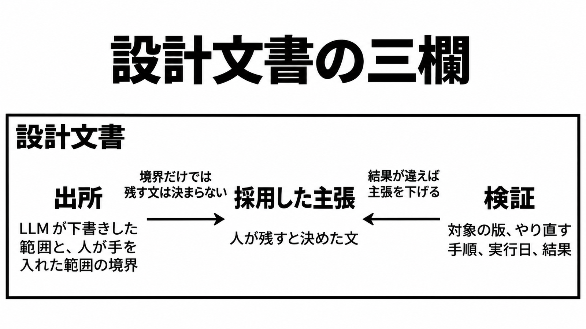

# ダイジェスト: 試験の記録と予測と修正宣言を分ける

[元記事](../../../../../articles/jepsen-llm-simonwillison-p8_20261102.md)

## ひとことで言うと

試験の記録、予測、修正を語る文は分けて受け取ります。検証は版・手順・実行日・結果が揃うまで埋めません。

## 核心ポイント

- Jepsen（データベースを試験して公開する分析）は、Orkes のデータベース ParticleDB の 1.1.4 から 1.1.18.11.rc-22 で問題 96 件を報告し、うち 3 件を除き、故障を意図的に起こさない健全な単一ノードで起きた、と書きます。終わりの版 1.1.18.11.rc-22 では 10 件を除き解消したように見え、後続版は未評価です。
- 分析の節 4.5 は、開発で使った LLM（大規模言語モデル）の道具が、未修正のバグを修正済みと繰り返した、と断言します。続く、文書とソフトウェアと組織への信頼が削れるという予測は業界の測定ではなく、採用した主張（人が残すと決めた文）にも入れません。
- Simon Willison の引用は、その予測と二つの問いを掲げ、分析が正しさが要るところで得失を認め、緩和すべきだと呼びかけた文を省きます。
- この 96 件は LLM 起因の件数ではありません。分析の節 4.3 の三つの “Perhaps” は、リリース前に試験を走らせていない、試験は走ったが基本機能を踏んでいない、技術者が試験を LLM に任せた、という原因の候補です。
- 「すべて対処した」のデータベースの版は、Orkes のブログが書いた 1.1.19、分析が伝える Orkes の主張 1.1.19-rc.13、2026-11-02 に開いて見たリリース履歴の現行 1.1.19-rc.16（rc.13 は後継に置き換わった）で、同じ完了宣言ではありません。

## メンタルモデル

出所は、LLM が下書きした範囲と、人が手を入れた範囲の境界です。その境界だけでは、採用した主張（人が残すと決めた文）は決まりません。検証は版、やり直す手順、実行日、結果が揃ったときだけ埋まり、結果が違えば主張を下げます。

## 具体例

出所に書くのは、開いて見たリリース履歴、ベンチマーク文書、Orkes のブログに、LLM の工程の開示が見当たらない、という事実です。採用した主張に残すのは、成熟の合図（長い文書、強い標語、形式的に検証済みという文言）は以前より偽造しやすい、という予測までで、信頼が削れるという文は入れません。検証に書くのは、既定の occ（ロックを取らず進める同時実行）が通常運転でコミット済み書き込みを失ったことと、serializable（並行しても一つの順序と同じ結果になる最も強い隔離）が内部異常（一つの処理の中の読み取りが互いに合わない）と 更新の喪失を許したことです。

## 適用と判断

向く場面:

- データベースの文書を、試験の記録、予測、修正を語る文に分けて受け取る。
- 設計文書に、出所、採用した主張、検証の三欄を置く。
- 正しさが要る文書に限り、この記事が分ける例はデータベースだけです。

確認すること:

- Jepsen が ParticleDB の導入を止めて別のデータベースへ移るよう勧めた理由は、データを失うか壊す誤りの程度と、それを出した過程の両方です。
- 複製方式は未試験で、分析は現行版を再試験していません。
- 修正宣言は、版、手順、実行日、結果が揃うまで採用した主張へ上げません。
- 検証はその版、その手順、その日の結果に限り、問題を見つけなかったことは、問題が無い証明にはなりません。
- 個別の GitHub issue の自己申告は、その追記試験の報告として読み、96 件全体の確認にはしません。

## 限界・注意点

- 未修正を修正済みと言った断言に、ツールのログ、プロンプト、特定の issue へのリンクはありません。追試できるのは、手順つきの個々の SQL です。
- 分析の脚注16は、完全な正しさを要しない用途もある、と範囲を狭めます。どの用途かは一覧にしていません。
- 開いて見た公開面に LLM の工程の開示は見当たらず、他のページは見ていません。
- 資金は Orkes で、倫理のページは報酬が好意的な結論への圧力になると認め、公開分析の最終的な編集権は Jepsen にあると書きます。開示は利害の表示で、観察の自動的な無効化でも実証でもありません。
- 現行版の安全性（データを失うか壊すこと）は、この分析の範囲外です。“other databases” がどの分析を指すかは、本文から特定できません。

## 参考

- [元記事](../../../../../articles/jepsen-llm-simonwillison-p8_20261102.md)
- [Kyle Kingsbury, ParticleDB 1.1.4](https://jepsen.io/analyses/particledb-1.1.4)
- [Simon Willison の引用](https://simonwillison.net/2026/Nov/1/kyle-kingsbury/)
- [Orkes のブログ](https://orkes.io/blog/particledb-database-built-for-ai-agents)
- [ParticleDB のリリース履歴](https://particledb.ai/installation/releases/)
