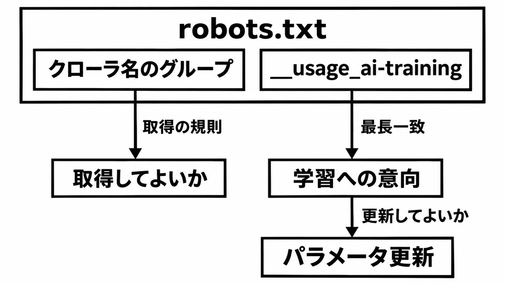

# ダイジェスト: 学習意向は別の User-Agent グループ

[元記事](../../../../../articles/openai-robots-txt-openai-p3_20261102.md)

## ひとことで言うと

`__usage_ai-training` は、ページを取ってよいかとは別に、生成モデルの学習済みパラメータを更新してよいかを robots.txt で示す名前です。

## 核心ポイント

- robots.txt（クローラにパスごとの取得可否を伝えるファイル）では、クローラ名とは別の User-Agent グループ（`User-Agent` 行と、その相手への Allow・Disallow）にこの名前を書きます。新しい文法は無く、同じパスに複数が当たるときは、より長い指定（最長一致）を採ります。
- この名前が無ければ、この名前の意向はありません。`User-Agent: *` の Disallow は取得の規則のままで、この名前には一致しません。
- 参照、引用、技能プロンプト（パラメータを更新せず本文を渡す使い方）、グラウンディング（応答の材料にすること）は、この名前の外です。
- 2026-11-02 に開いた一次（発表本文・草案・製品文書で、発表日は 2026-10-30）は、完了報告ではなく、これからの実装か実装開始の本人の文です。OpenAI は今後数カ月で実装し、Google は 2027 年の対応を目標にし、Microsoft は 2027-02-01 からクロールした分を尊重し始める、と書いています。
- Google は Google-Extended（学習と応答の材料の両方の製品トークン）の明示を優先する計画です。Microsoft のページ単位（各ページの meta か応答ヘッダ）はこの名前より先で、GPTBot（OpenAI の学習用クローラ）との優先は未記載です。

## メンタルモデル



1 つの robots.txt に、クローラ名のグループと `__usage_ai-training` が並びます。前者は取得してよいか、後者はパラメータを更新してよいかです。

## 具体例

草案の 3 行は、サイト全体を学習への反対、`/press-kit/` 以下を賛成と読みます。`/blog/post` は `Disallow: /`、`/press-kit/logo.png` は `Allow: /press-kit/` が最長です。

```text
User-Agent: __usage_ai-training
Disallow: /
Allow: /press-kit/
```

## 適用と判断

向く場面:

- クロール拒否と、パラメータ更新への意向を分けて書きたい。
- 公開ウェブを取得して重みを更新するとき、取得時に残す記録を決める。
- Google-Extended の明示や Microsoft のページ単位と、共通の名前の優先を読む。

確認すること:

- クローラ名の許可と、このグループの最長一致を別々に残しているか。グループが無いことを拒否にしていないか。
- `User-Agent: *` の Disallow を、学習拒否にしていないか。
- Google の明示と Microsoft のページ単位を共通の名前より先にし、GPTBot との優先は未記載のままにしているか。
- 参照、引用、技能プロンプトをこの Disallow で止めず、グラウンディングは Google の計画だけ別扱いにしているか。
- 各社の開始を 1 日にまとめて待たず、取得済みを消す条件にこの発表を使っていないか。

## 限界・注意点

- 定義の草案は IETF 未承認で、2026-10-30 に公開され、2027-05-03 に切れます（各社の終了日ではない）。OpenAI は任意の取り組みと呼び、守られる保証も監査も救済もありません。
- 付く意向は取得時点の robots.txt で、取得済みには遡りません。意向だけの巡回は、反対の資源を取らなくてよいだけで、取得を必ず止める規則ではありません。
- Microsoft は学習とグラウンディングを分け、どちらも未設定なら Allow です。
- Cloudflare の Content-Signal（`User-Agent: *` の下の別行）は、この名前に一致しません。
- Google の「2027 年」と「2027 年初め」の関係は未記載で、著者メールは Anthropic の実装開始を述べ、製品文書の掲載と学習用クローラの優先は未確認です。検索許可が学習許可まで開く読みは合意前なので、社内規則へは自動では落としません。

## 参考

- 元記事: [openai-robots-txt-openai-p3_20261102.md](../../../../../articles/openai-robots-txt-openai-p3_20261102.md)
- Kelley（2026-10-30）[Machine-Readable Training Preference Signal](https://www.ietf.org/archive/id/draft-kelley-aipref-training-preference-signal-00.html)
- OpenAI（2026-10-30）[Making it easier for websites to express AI training preferences](https://openai.com/index/helping-websites-express-ai-training-preferences)
- Google Search Central（2026-10-30）[Supporting a shared AI training control for websites](https://developers.google.com/search/blog/2026/10/ai-training-control)
- Microsoft Bing（2026-10-30）[Your content, your choice](https://blogs.bing.com/search/2026/10/your-content-your-choice-clearer-preferences-for-training-and-grounding/)
