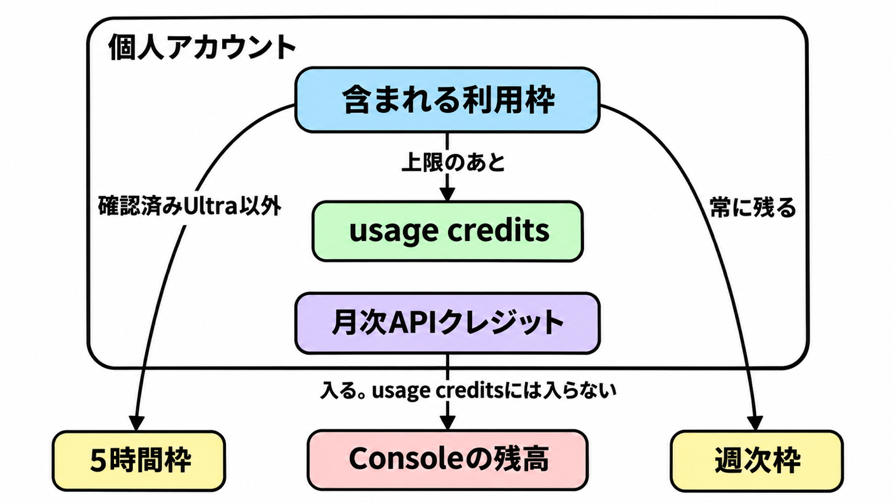

# ダイジェスト: 確認済み Ultra だけ 5 時間枠が無い

[元記事](../../../../../articles/anthropic-claude-max-x-ultra-p3_20261103.md)

## ひとことで言うと

Claude の確認済み Ultra（旧 Max 20x）だけ 5 時間枠が無く、週次の上限は残ります。

## 核心ポイント

- 2026-10-30 に Max 20x は Ultra、Max 5x は Max へ改名され、ウェブ月額は 200 ドルと 100 ドルのままです。既存契約の手続きは不要です。
- 確認済み（Settings > Usage に、5 時間枠を示す Current session のバーが無い状態）の Ultra だけ 5 時間ごとの上限が無く、Ultra の週次は確認の有無によらず Pro（比較の基準になる個人プラン）の 10 倍です。未確認の 5 時間側の倍率は書かれておらず、Max は 5 時間も週次も Pro の 5 倍です。
- 含まれる利用枠は claude.ai、デスクトップ、モバイル、公式 Claude Code（公式のコーディング用クライアント）で分け合い、上限のあとは有効にした usage credits（別請求の従量）で続き、月次の支出上限か残高で止まります。月次 API クレジット（Max 100 ドル、Ultra 200 ドル。新規は加入 7 日後）は Console（API の組織画面）へ入り、usage credits には入りません。
- Fable 5 と Fable 5.1（Ultra と Max のモデル名）は週次の 50% まで含まれ、他のモデルより速くその割合に達します。
- 「20 倍が 10 倍に削られた」は、2026-10-06 の料金ページの保管（その日の公式ページの記録）が、5 時間あたり Pro の 5 倍または 20 倍と書き、週次の 20 倍とは書いていないことと合いません。週次の絶対量が改名の日に変わったかは未確認です。

## メンタルモデル

含まれる利用枠から出るのは、確認済み Ultra 以外の 5 時間枠と、常に残る週次枠です。上限のあとは、有効にした別計算の usage credits に切り替わり、月次 API クレジットは Console の残高へ入って usage credits には入りません。

## 具体例

公式 Claude Code を常駐させると、含まれる利用枠は、確認済み Ultra では週次で、未確認の Ultra と Max では 5 時間と週次の先に達した方で止まります。有効にした usage credits があれば同じクライアントで従量が続き、月次の支出上限か残高で止まります。

## 適用と判断

向く場面:

- 個人の Ultra か Max に公式 Claude Code を載せるとき、止まる単位を決める。
- 「5 時間制限が外れた」を、自分の Usage の Current session と照合する。

確認すること:

- Current session が無い Ultra だけ、含まれる利用枠の止まる単位を週次にし、バーがある Ultra と Max は 5 時間と週次の両方を見る。
- 週次の外で回すジョブは API キーへ移し、商用契約、1 分あたりの件数とトークン、月間支出上限を見る。

同じ契約への同時利用、ログインの共有、モデル名が Fable のときの週次 50% は、元記事の判断の節で見ます。

## 限界・注意点

- 5 時間制限が外れるのは確認済み Ultra だけで、電話番号の確認だけでは外れません。公式 X は対象を most existing subscribers とし、外れたらメールと書いていますが、2026-11-03 の Ultra ヘルプはどちらも繰り返していません。
- 週次やモデル別などの追加上限は裁量で掛かりえます。2026-11-03 に取得した消費者向け利用規約は可用性を AS IS とし、途切れないサービスは保証せず、本文に Ultra の名はまだありません。
- API のレート制限は別文書です。サブスク枠と同じプールだとする記述は無く、支出上限の例は自分の組織の保証値ではありません。
- 日本では 2026-09-10 以降に買った usage credits が、購入から 6 か月で失効します。確認の日数、バーが無いアカウントの別上限、日本のストア価格は未確認です。

## 参考

- 元記事: [ClaudeのMax 20xはUltraになり、確認済みなら5時間枠が外れる](../../../../../articles/anthropic-claude-max-x-ultra-p3_20261103.md)
- [公式 X `@claudeai`（2026-10-30）](https://x.com/claudeai/status/2116220869479428500)
- [料金ページ](https://claude.com/pricing)
- [Ultra とは](https://support.claude.com/en/articles/17728952-what-is-the-ultra-plan)
- [利用上限と長さ制限](https://support.claude.com/en/articles/11647753-how-do-usage-and-length-limits-work)
- [月次 API クレジット](https://support.claude.com/en/articles/17154008-monthly-api-credits-for-max-ultra-and-team-plans)
