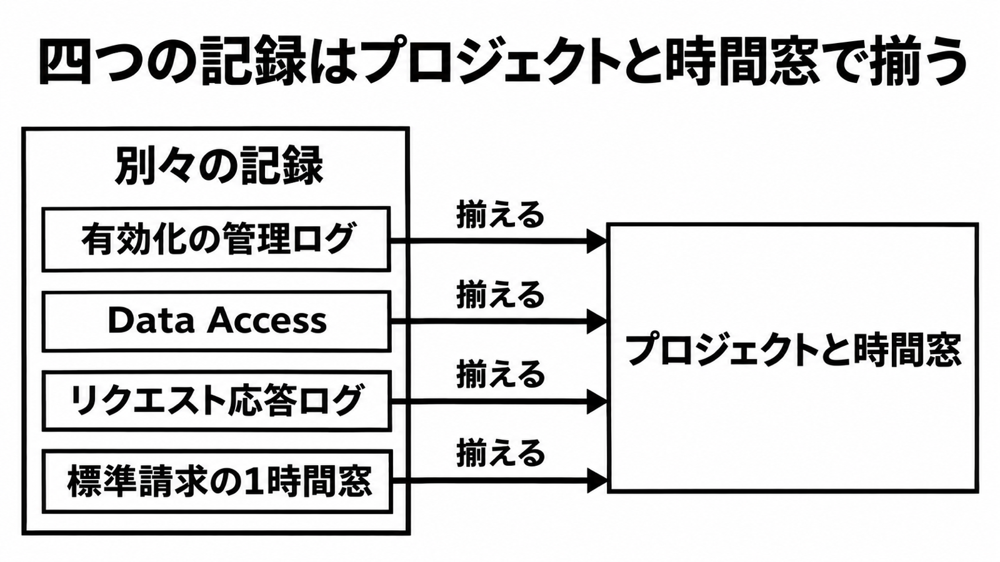

# ダイジェスト: Google Cloud では四つの記録を揃えて範囲を切る

[元記事](../../../../../articles/google-cloud-llmjacking-cloud-p1_20261103.md)

## ひとことで言うと

Google Cloud では、利用枠の転売は一つのログで範囲が切れません。API の有効化、推論、モデル名、金額を、同じプロジェクトと時間窓へ並べます。

## 核心ポイント

- LLMJacking（モデルへの到達を奪い、利用枠を収益化し、請求を被害側に残す手口）では、LLM Mixer（購読者へ割り当て、呼び出し元を隠す中継で、引用は LiteLLM と同じとは書いていない）を使います。足がかりは、公開されたモデルの入口よりも、漏れたクラウド認証情報が多い、と報告されています。
- 有効化のログは Service Usage（API 有効化のサービス、名前は serviceusage.googleapis.com）の管理操作です。監査表に載る推論は Agent Platform（aiplatform.googleapis.com）の Data Access（読み書きの監査）で、この記録を有効化するまで書かれません。
- 「Data Access を開けば内容生成がトークン数つきで残る」は、2026年11月3日時点の監査表からは言えません。GenerateContent と StreamGenerateContent の行は、監査表のうち読み取り操作の一覧に無く、行が無いことは未記録の証明にはなりません。
- リクエスト応答ログにトークン数の列は無く、JSON 内の利用量はそのページだけでは確定できません。同じ1時間に正規の利用と不正利用があれば金額と使用量だけでは分かれないので、被害側の利用増と、項目名がブログに無い LLM Mixer で推定します。
- LiteLLM の CVE-2026-40217 は、ブログの /key/regenerate で鍵をマスター資格へ上げる説明と、advisory の /guardrails/test_custom_code（既定では proxy-admin の資格が要るサンドボックス脱出）で揃いません。

## メンタルモデル

左の四つは別々の記録で、右のプロジェクトと時間窓へ揃えて範囲を切ります。標準請求は、資源ごとの費用を含みません。

## 具体例

ある主体は、8時間未満に50万回を超える API 呼び出しを行い、トークン費用のほぼ100万ドルを被害組織へ回しています。

## 適用と判断

向く場面:

- 侵害後に、使われたサービスと課金を、プロジェクトと時間窓で範囲に入れます。
- モデル名が要る調査の前に、リクエスト応答ログを有効にしておく。
- LiteLLM を置くなら、この CVE の版を先に見る。

確認すること:

- Service Usage の管理操作ログは既定で有効で、無効にはできません。
- Data Access が侵害前に有効だったかを確認し、無効だった期間は後から埋まりません。
- モデル名が要るなら、中身が残り得るリクエスト応答ログを事前に有効化し、保存先と保持を決めます。
- 請求の急増は、調査の開始にとどめます。
- LiteLLM が 1.81.8 以上かつ 1.83.11 未満なら、proxy-admin の露出と、advisory 本文の 1.83.11 以降への更新を先に見ます。

## 限界・注意点

- 金額は、独立した会計監査の数字ではありません。
- GenerateContent が監査表以外で残るか、JSON のトークン数が安定するかは確定していません。
- 詳細エクスポートが Gemini のリクエスト単位になるか、その resource がエンドポイントやモデルまで落ちるかは、案内からは確定できません。
- 同名の GenerateContent は別サービス Business AI Code の表にあり、Agent Platform の推論ログではありません。
- 有効化された側のサービス名は、引用では特定していません。AWS と Azure の操作名は、ブログの検知候補で、現行 API とは未照合です。

## 参考

- [元記事](../../../../../articles/google-cloud-llmjacking-cloud-p1_20261103.md)
- [GTIG（Google の脅威情報）/ Mandiant. The Rise of LLMJacking（2026-11-03）](https://cloud.google.com/blog/topics/threat-intelligence/llmjacking-monetizing-compromised-cloud-models/)
- [Agent Platform audit logs](https://docs.cloud.google.com/gemini-enterprise-agent-platform/machine-learning/general/audit-logging)
- [Request-response logging](https://docs.cloud.google.com/gemini-enterprise-agent-platform/models/capabilities/request-response-logging)
- [GHSA-wxxx-gvqv-xp7p（CVE-2026-40217 の advisory）](https://github.com/advisories/GHSA-wxxx-gvqv-xp7p)
