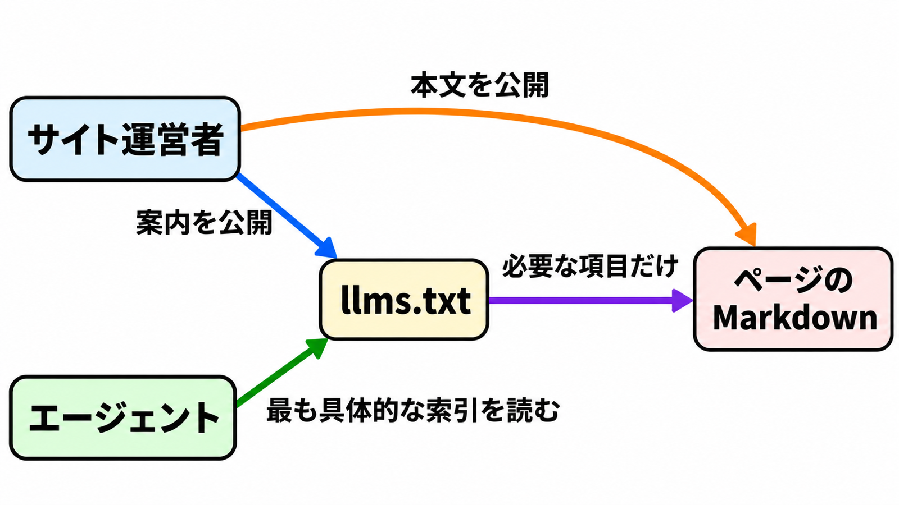

# ダイジェスト: エージェント向けの短い索引 llms.txt

[元記事](../../../../../articles/llms-txt_20261103.md)

## ひとことで言うと

`llms.txt` は、エージェントが今の質問に必要な Markdown だけを辿る短い索引です。Google 検索の順位要因にはなりません。

## 核心ポイント

- 必須は H1（プロジェクト名）だけで、要約と補足（最初の H2 より前）と H2 のリンク集は任意です。参照実装のパーサ（`llms-txt` 0.0.7）は、要約も補足も無いファイルを読めません。
- 1 ファイルはそのパス以下が対象で、重なるときは最も深いパスを使います。エージェントは節とリンク行末尾のメモから項目を選び、索引のページを全部は取りません。
- 取得の可否は示しません。`robots.txt` が取得可否、`sitemap.xml` が網羅、`llms.txt` は入口の選別で、全文連結の `llms-full.txt` は仕様にありません。
- v2（2026-08）は、最も深いパスの規則と発見用リンクを足しました。HTML の link か Link ヘッダで、本文は `rel="alternate" type="text/markdown"`、そのページを覆う索引は `rel="describedby"` です。
- Google Search はこのファイルを使いません。Ahrefs（検索の計測会社）では、ルートの `/llms.txt` が 200 の Markdown だった約 38,000 ドメインの 97% は、2026-05 に誰からのリクエストも 0 件でした。

## メンタルモデル

運営者は索引と本文を分け、エージェントは最も具体的な索引から必要な Markdown だけを取ります。

## 具体例

OpenAI Developers の実ファイル（2026-11-03 取得）は、製品ごとの `llms.txt` と作業ページの `.md` を分け、ルートからより具体的な索引へ進みます。

## 適用と判断

向く場面:

- API やライブラリのドキュメントを、コーディングエージェントに必要なページだけ辿らせる。
- Ahrefs の 2026-05 の対象ログでは、無い `/llms.txt` を AI ボットが当て推量で取った例は無く、索引の URL はドキュメントやツール設定で明示する。
- 検索向けサイトと開発者ドキュメントで、完了条件を分ける。

確認すること:

- 必須のページを、節名 `Optional`（後回しにしてよい二次リンクで、大文字小文字まで一致）に置いていないか。
- 参照実装のパーサに通すなら、H2 の下はリンク行だけにし、メモは同じ行の `: メモ`、先頭の BOM（バイト順マーク）は無しか。
- リンク先は自組織の Markdown URL（`.md`、または末尾に `.md` を足した `.html.md`）で 200 を返し、`robots.txt` が拒否していないか。
- HTML の link か Link ヘッダで、本文は `type="text/markdown"` の `alternate`、そのページを覆う索引は `describedby` か。
- 学習の拒否を `llms.txt` に書かず、`robots.txt` に書いているか。

## 限界・注意点

- IETF、W3C、ISO の標準ではなく、コミュニティ提案です。
- v2 は `Optional` から機械的な意味を外しました。索引を展開する CLI は、節名が `Optional` と完全一致する節だけを既定で外し、ほかの節は残します。
- Ahrefs の 137,210 ドメインのうち約 28% がファイルを公開し、同社は技術寄りの上限だと注記しています。取得は、読まれた証拠ではありません。
- Anthropic と Gemini の掲載例は仕様から外れます。前者の索引は転送後に散文と `###` があり、後者のリンク先は `.md.txt` です。
- SE Ranking（検索の調査会社）では、300,000 ドメインの 10.13% がファイルを持ち、有無は AI 引用の予測に役立ちませんでした。そのデータ内の相対的な重要度です。

## 参考

- 元記事: [llms-txt_20261103.md](../../../../../articles/llms-txt_20261103.md)
- Jeremy Howard（v2、2026-08）[The /llms.txt file](https://llmstxt.org/index.md)
- [AnswerDotAI/llms-txt](https://github.com/AnswerDotAI/llms-txt)
- Ahrefs（2026-05）[llms.txt のリクエスト計測](https://ahrefs.com/blog/llmstxt-study/)
- Google [生成 AI 機能向け最適化ガイド](https://developers.google.com/search/docs/fundamentals/ai-optimization-guide)
