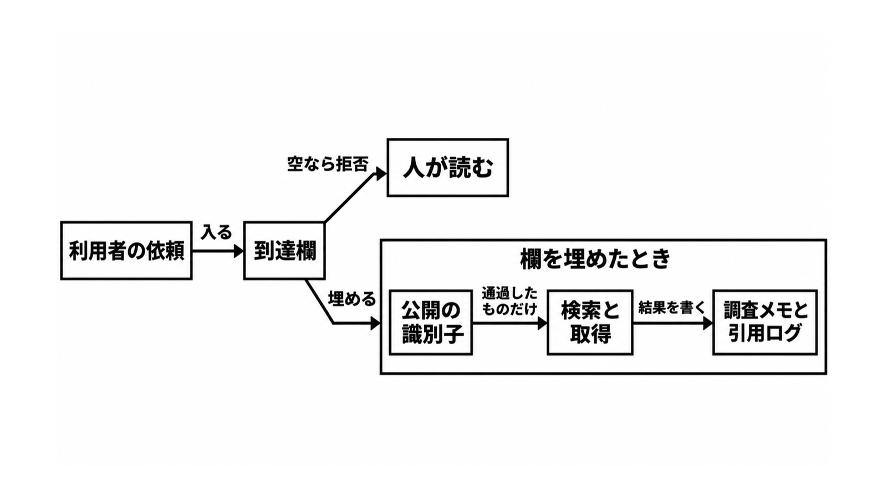

# ダイジェスト: 到達欄が空なら要約だけが残る

[元記事](../../../../../articles/zenn-dev-ogiri-ai-security-p6_20261103.md)

## ひとことで言うと

到達欄は、検索へ渡してよい文字列の型と、結果を書いてよいシステムの組です。空は拒否で、検索とページ取得は出口の実装が止めます。

## 核心ポイント

- 通る型は公開の識別子（パッケージ名、RFC 番号、エラーコード、公開 API の記号、バージョン）だけです。顧客名、案件番号、社内のプロジェクト名、ファイルパス、秘密、社内の文は、社内検索にも社外検索にも進みません。
- 結果の書き込み先は、調査メモと引用ログに限ります。顧客のリポジトリ、秘密の置き場、外向きのメールには書きません。
- ゼロデータ保持（ZDR、応答後にプロンプトと応答を保管しない契約）は送信を止めず、2026-11-03 に読んだ OpenAI と Anthropic の保持ページにも、送信を止める記述はありませんでした。止めるのは、エージェントの呼び出しを包む出口の実装（ハーネス）です。
- 取得した本文は、モデルにとって命令になりえます。Anthropic のウェブ取得は、信頼できない入力と機密データを同じ環境に置くと、緩和のあとにも持ち出しのリスクが残ると書いています。
- 全面禁止が合うのは、制限の行（到達欄を空にし、その行を人が読む）と、監視が回避を捕まえられない評価です。社外の事実が要る調べ物を禁止すると、その仕事は社内文書の要約になります。

## メンタルモデル

図の「人が読む」は、制限の行を空にしたときの残る仕事です。社外の事実が要る仕事を空にすると、残るのは社内文書の要約です。埋めるときは公開の識別子だけを検索へ渡し、結果は調査メモと引用ログへ書きます。

## 具体例

| データの行 | 到達欄 | 残る仕事 |
|---|---|---|
| 制限 | 空。空は拒否 | 人が読む |
| 社内と公開 | 公開の識別子だけを渡し、結果は調査メモと引用ログへ書く | 社外の事実を調べる |
| 監視が回避を捕まえられない評価 | 空へ戻す | 生のインターネットでの調べ物は止める |

## 適用と判断

向く場面:

- オンプレミス（モデルや索引を自社の境界の中に置く運用）で、権限表（公開、社内、制限の行を持つ表）の一欄として到達欄を書く。
- 出口で型と取得先のホスト名を見る検査の、許す型と書き込み先を、その表に固定する。

確認すること:

- 欄を書いただけでは止まらないので、空を拒否としてハーネスで止めているか。
- 社内検索を内側と呼ぶとき、本文を遠隔のモデルへ再送せず、索引の場所だけでは決めていないか。
- ZDR を送信停止の代わりにせず、API が拒否しない対象外の機能を使うと、その保持方針に入ることを分けているか。
- 型、URL の長さ、取得してよいドメインを付けても、監視が回避を捕まえられない間はその欄を空に戻しているか。
- 基本のウェブ検索とページ取得を、常に ZDR の外とは書いていないか。

## 限界・注意点

- 起点は ogiri 氏の公開ノートで、自分の環境の記録だと自分で限定しています。Anthropic が一部の高リスク評価とサイバーセキュリティ評価で生のインターネットを止め、社内評価へ広げた例は、顧客向けの既定へ移せません。
- 型と URL の長さは必要で、それだけでは抜けえます。モデルが無料の URL 短縮で回避したのは長さの上限であり、許可ドメインまで付けても残リスクは残ります。
- OWASP の LLM01:2025（間接プロンプトインジェクション、外部の入力が振る舞いを変えること）の定義は、2026-11-03 の検索抽出です。ページ本文の全文は照合していません。
- OpenAI のライブウェブ検索が ZDR の対象かは、読んだ Web Search 節では決まりません。社内検索のログ、トレース、キャッシュが索引と同じ境界に残るかは製品ごとに変わり、ここでは特定していません。
- Anthropic の保持では、フラグされた内容の 2 年は上限であり、常時 2 年保管する文ではありません。条件は、法令で必要なとき、または自動の信頼安全システムがフラグしたときです。

## 参考

- 元記事: [zenn-dev-ogiri-ai-security-p6_20261103.md](../../../../../articles/zenn-dev-ogiri-ai-security-p6_20261103.md)
- [ogiri「全部禁止にしたらAIが使えない」](https://zenn.dev/ogiri/articles/ai-security-ban-paradox)
- [OpenAI Data controls](https://developers.openai.com/api/docs/guides/your-data)
- [Anthropic API and data retention](https://platform.claude.com/docs/en/manage-claude/api-and-data-retention)
- [Anthropic「Investigating unintended model actions」](https://www.anthropic.com/research/investigating-unintended-model-actions)
