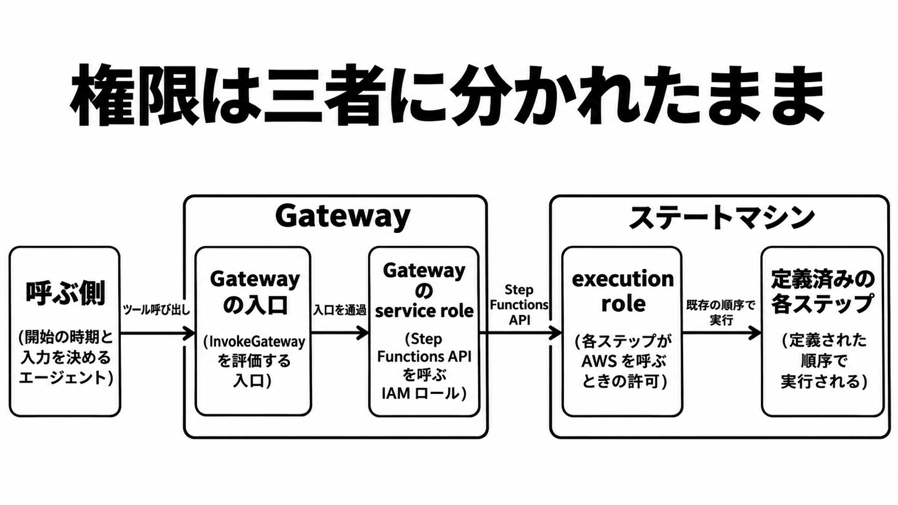

# ダイジェスト: 既存の Step Functions は定義を変えずにツールになる

[元記事](../../../../../articles/aws-step-functions-aws-amazon-p5_20261104.md)

## ひとことで言うと

既存の Step Functions は、定義を変えずにエージェントのツールにできます。開始の時期と入力はエージェント、順序はステートマシンが決めます。

## 核心ポイント

- 公開に使うのは Amazon Bedrock AgentCore Gateway（外の操作をツールとして発見し、呼び出す入口）の組み込みコネクタで、識別子は states、発見と呼び出しの手順は MCP（Model Context Protocol）です。この公開のためだけに Lambda や自前の MCP サーバは書きません。
- 権限は三者で、呼ぶ側は Gateway を呼べるか（許可は InvokeGateway）、API を呼ぶのは Gateway の service role（Gateway がその API を呼ぶ IAM ロール）、各ステップは作成時の execution role（ステートマシンのステップが AWS を呼ぶ IAM ロール）です。呼ぶ側の IAM が execution role に引き継がれる、とは確認した手順にありません。
- 操作は 10 個で、開始、同期開始、実行の一覧、定義の説明の 4 つは ARN を pin し（固定値は Gateway が毎回付ける）、実行の説明、停止、履歴と待ちの成功、失敗、生存確認の 6 つは service role の範囲です。「220 を超えるサービス」は、Step Functions が編める AWS サービスの説明であり、この 10 個ではありません。
- 実行の一覧、実行の説明、履歴、停止は Standard（実行履歴が残るワークフロー）だけで、Express（5 分以内の短い実行）は開始後に実行 ARN でたどれず、その非同期の結果は CloudWatch Logs です。開始の応答は実行 ARN であり、業務の完了ではありません。
- 人間の承認を残すなら、タスクトークン（待ちを再開する権利）の届け先は今の人間側のままにします。届け先がそのエージェントで、対象をステートマシンに絞れない待ちの完了操作を呼べるなら、完了者はそのエージェントになります。

## メンタルモデル

時期と入力は呼ぶ側、順序とステップの許可はステートマシン側です。

## 具体例

発表の返金例では、適格確認、上長承認、返金が定義された順序で毎回走ります。

## 適用と判断

向く場面:

- 順序と今の execution role を残せるなら、エージェント専用の API を新しく足す前に、既存のステートマシンをツールにする。
- 履歴、停止、人間の承認待ちが要る手続きを Standard で出す。
- 5 分以内の同期応答だけを、Express の同期開始にする。

確認すること:

- 全データを指定すると入出力や定義が入る実行の説明と定義の説明は、読ませないなら出さない。
- pin できる操作は、空にせず pin を置く。
- service role の届く範囲が違うワークフローは、Gateway を分ける。
- Standard は実行中でなくなるまで実行の説明を見る。
- 同期 Express は、HTTP 200 ではなく応答の状態で成否を見る。

## 限界・注意点

- pin が version や alias 付きの ARN を受けるかは手順にありません。付いていない ARN は、最新リビジョンで始まります。
- 同期 Express の HTTP 200 かつ失敗が、ツールエラーになるかは、コネクタのページにありません。
- Gateway の稼働率の数値は見つかっていません。Step Functions の 99.9% を、経路全体の約束として読まないでください。
- 呼ぶ側の IAM をステップの条件にしているワークフローは、この公開だけではその IAM を受け取れません。
- Gateway 経由の同期 Express が 60 秒で切れるか、5 分まで待つかは、特定できていません。

## 参考

- [元記事](../../../../../articles/aws-step-functions-aws-amazon-p5_20261104.md)
- [states コネクタ](https://docs.aws.amazon.com/bedrock-agentcore/latest/devguide/gateway-target-connector-step-functions.html)
- [What's New: Step Functions workflows as AI agent tools（2026-10-29）](https://aws.amazon.com/about-aws/whats-new/2026/10/step-functions-workflows-ai-agent-tools/)
- [チュートリアル: Step Functions を AgentCore Gateway のターゲットにする](https://docs.aws.amazon.com/step-functions/latest/dg/tutorial-agentcore-gateway.html)
- [StartExecution](https://docs.aws.amazon.com/step-functions/latest/apireference/API_StartExecution.html)
