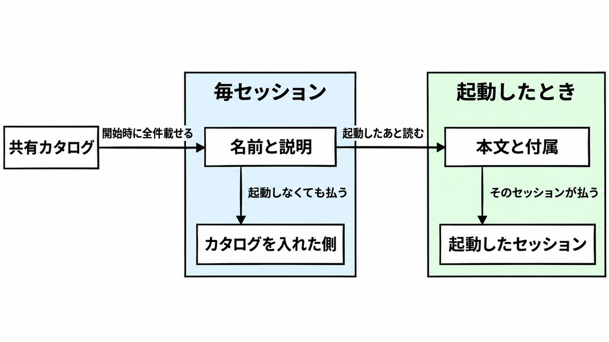

# ダイジェスト: 共有カタログへ入れる前に説明の量を測る

[元記事](../../../../../articles/google-cloud-cloud-google-p2_20261104.md)

## ひとことで言うと

手順書を共有カタログへ入れる前に、説明の長さと、手順が有る状態と無い状態の差を PR に書きます。起動しなくても毎セッションに載るのは、名前と説明です。

## 核心ポイント

- エージェントスキル（ディレクトリ 1 つと `SKILL.md` を単位にする手順書）を、共有カタログ（リポジトリやワークスペースの共通の置き場で、利用者がまとめてインストールする一覧）へ入れます。チャットで一度通った手順を、その共有の main へ入れる操作は、全員のコンテキストを占有する変更として扱います。
- 読み込みは三段です。Level 1 は名前と説明で開始時に全スキル分が載り、Level 2 の本文は起動後に、Level 3 のスクリプト、参照、付属は、そのセッションが必要なときに読みます。
- 本文を短くしても、説明が長ければ、一覧に載せられる文字は減ります。
- 差は、同じ評価課題で手順が有る状態と無い状態を採点し、有る側から無い側を引いた値です。ブログの効果量は自己申告で追試データは公開されておらず、差をいくら未満で不合格にするかは、測る前に自分で PR へ書きます。

## メンタルモデル

左の名前と説明は、手順が一度も起動しなくても毎セッション載ります。右の本文と付属は、起動したセッションだけが読みます。

## 具体例

インシデント時の権限確認のように、平常のデプロイ課題では一度も呼ばれない手順は、平常の差が 0 でも残します。その場合も説明は短くします。説明の長さは、呼ぶ頻度が低くても一覧の文字を使います。

## 適用と判断

向く場面:

- 手順書を共有カタログへ採用する人が、マージ前の条件を書きます。
- モデル更新のあと、差が 0 に戻った手順を消すか残すか決めます。
- 個人の一時メモで、共有カタログに入らないときは、マージ前の確認は過剰です。

確認すること:

- 説明の文字数と、検索スコアで比べた類似の上位候補を書き、その類似は誤って別の手順を起動した率ではないと添えます。
- 実際に使う、試行を流して採点する仕組みで、有る状態と無い状態を 3 回以上測って両方の実行を残し、有る状態で一度も起動しない課題は、本文の前に説明を直します。
- 「入れない」か、重大な検出を人が見ずに残すなら採用せず、偽陽性として残すときは理由を書きます。
- 差がほぼ 0 で消すのは、課題セットが手順の主張する振る舞いを含んでいて、かつ稀な高損害の手順ではないときだけです。
- Claude Code では、skill-reach の説明にある一覧の予算が約 30,000 文字（100 万トークンの文脈）または約 8,000 文字（20 万トークンの文脈）で、説明 1 件の上限 1,024 文字とは別です。

## 限界・注意点

- 3 回の成功率（採点器が、試行は条件を満たしたと判定した割合）は 0、1/3、2/3、1 の刻みで、一回の成否で差が動きます。
- 差が 0 であることは、その課題セットで差が出なかったことです。課題に入っていない高損害の手順が不要である証明ではありません。
- skill-reach（どの手順を起動するか）、SkillEvaluator（採点）、SkillSpector（静的なセキュリティ検査）は、同じ品質としては扱いません。
- 検査の通過だけでは、実行時の安全は証明されません。

## 参考

- [元記事](../../../../../articles/google-cloud-cloud-google-p2_20261104.md)
- [Karl Weinmeister, Alan Blount. Five rules for evaluating agent skills before they bloat your context window. Google Cloud Blog](https://cloud.google.com/blog/topics/developers-practitioners/evaluate-agent-skills-before-they-bloat-your-context-window/)
- [Agent Skills specification](https://agentskills.io/specification)
- [Remigiusz Samborski. Behind the scenes, two months later. Google Cloud Blog, 2026-10-29](https://cloud.google.com/blog/topics/developers-practitioners/behind-the-scenes-two-months-later-how-we-ship-google-agent-skills-like-products)
- [google/skill-reach](https://github.com/google/skill-reach)
