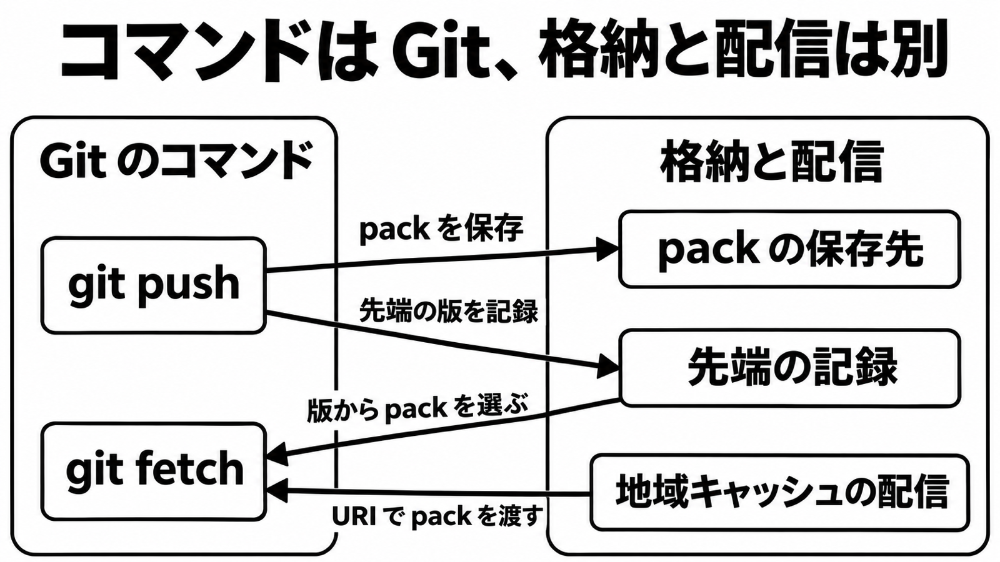

# ダイジェスト: Git のコマンドを残し、格納と配信だけを替える

[元記事](../../../../../articles/openai-codex-git-pando-openai-p1_20261104.md)

## ひとことで言うと

OpenAI の Pando は、Git のコマンドを残し、pack の保存と先端の記録と配信だけを別実装にします。
エージェントの作業範囲は、同時ブランチ数と、同じ履歴の取得回数から見積もります。

## 核心ポイント

- コマンドは `git push` と `git fetch` のままです。サーバは **pack**（オブジェクトをまとめた転送ファイル）を **blob store**（バイト列の保存先）へ、**ref version**（ブランチ先端の版の記録）を別の保存先へ書き、無関係なブランチの push は並列、同じ **ref**（ブランチとタグの名前）への push だけが直列です。
- fetch は **have**（既に持つコミット）と **want**（欲しいコミット）から保存済み pack を選び、**packfile-uri**（応答へ埋め込まず URI で渡す仕組み）で配ります。応答に同梱する pack は空です。
- 新規の feature ブランチ（作業用ブランチ）への push では、クライアントへ返すブランチ名は、既定で **trunk**（本線）だけです。積み上げブランチ（前の上に次を積む使い方）と同一ブランチの連続 push では、クライアントが trunk に無いオブジェクトを送り直します。
- Git のコマンドを残せるのは、OpenAI の自社モノレポでの選択で、「台数だけ見れば差し替えで足りる」には一般化できません。Anthropic は、部分クローンとミラーを使い切ったあと、Git クライアント互換をモノレポの条件から外しています。
- この作業範囲の見積もりに、Pando の導入は含めません。サーバは未公開で、提供は検討の表明までです。

## メンタルモデル

図の配信層の名前は **Express** です。

## 具体例

一点時刻が無い例です。フルクローンの交渉中に `foo` と `bar` が両方動くと、一方は foo の版1と bar の版2を見ます。もう一方は、逆の組み合わせを見ることがあります。

## 適用と判断

向く場面:

- 並走ごとにブランチか **worktree**（同じリポジトリの別ディレクトリ）を分けます。
- CI とエージェントが同じ commit を何回 fetch するかを、モデルの呼び出しとは別に数えます。

確認すること:

- 見る単位は、同時ブランチ数と、同じ ref へ同時に push する回数です。
- fetch が先に詰まるなら、作業範囲を広げる前に取得回数を減らします。
- 履歴で詰まるなら、履歴を浅くする取得、一部のパスだけの取得、必要なオブジェクトだけの取得を使い、Pando はこれらをサーバ機能として保証していません。
- GitHub なら、台数を増やす前に、推奨の読み取り（リポジトリあたり 15回/秒）と、強制の push サイズ（2 GB）に当たるかを見ます（Pando の測定ではない）。
- 採否は、認証、フック、LFS、部分クローン、**stock Git**（既定では packfile-uri を要求する引数を出さない公式 Git）での fetch 仕様の公開後に判断します。

## 限界・注意点

- 所要時間の nearly 5x 短縮と nearly 80% 減は、同じ自己申告の median push で、別の改善として足せません。絶対値、テイル、移行後の merge 成功率と、作り替え前に時として 90% を下回った信頼性の分母と対象操作は非公開です。
- 一点時刻を前提にする処理（監査やミラー）は黙って壊れることがあり、中心なら Pando のような Git 互換のバックエンドへ移る判断は保留します。OpenAI の記事は、一点時刻が無いことを、利用者は気にしないものとして書いています。
- 速い fetch は、packfile-uri を要求し、空の同梱 pack を理解できるクライアントが前提に読めます。既定の stock Git へ通常の pack を返すのか、空 pack のまま失敗するのかは記事にありません。
- フック、LFS、部分クローン、リモート認証は保証の一覧にありません。記載が無いことを非対応とは断定できません。
- 記事中の比較図は教材であり、本番値ではありません。比較相手は、リポジトリ全体の一貫性を緩めた設定です。

## 参考

- [元記事](../../../../../articles/openai-codex-git-pando-openai-p1_20261104.md)
- [OpenAI, Scaling Git at OpenAI（2026-11-02）](https://openai.com/index/scaling-git-at-openai)
- [Git Documentation, packfile-uri](https://git-scm.com/docs/packfile-uri)
- [Anthropic, Redesigning source control at Anthropic（2026-10-13、2026-10-15 更新）](https://www.anthropic.com/research/redesigning-source-control)
- [GitHub Docs, Repository limits（2026-11-04 に確認）](https://docs.github.com/en/repositories/creating-and-managing-repositories/repository-limits)
