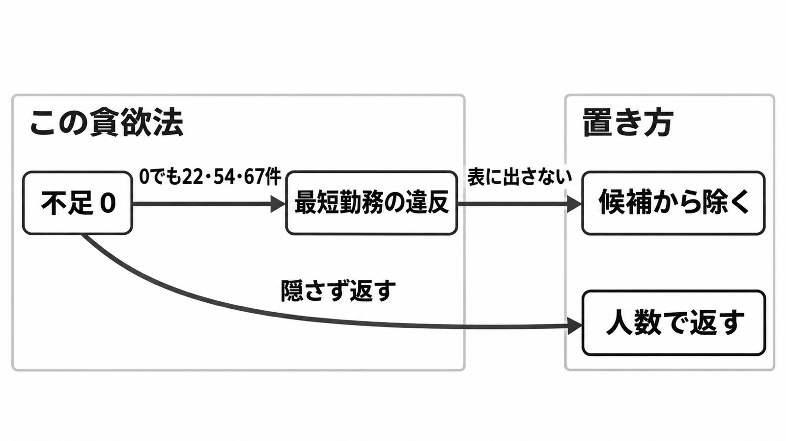

# ダイジェスト: 不足ゼロが最短勤務の違反を隠す

[元記事](../../../../../articles/zenn-dev-playpark-shift-llm-p7_20261104.md)

## ひとことで言うと

シフトを順に埋めた 3 つの規模では、不足が 0 でも、最短勤務の違反が 22件、54件、67件と報告されています。別の置き方では、短すぎる勤務は営業時間そのものが短い日を除き候補を作らず、不足は時間帯と人数で返します。

## 核心ポイント

- 比べたのは、美容室の 1 か月のシフトを組む三つの作り方（LLM の下書き、貪欲法、混合整数計画）です。貪欲法（スロット＝時間帯ごとの必要人数の枠を、中身が非公開の得点が高い順に埋める手続き）の 3 つの規模は不足 0 のまま、最短勤務（長さが下限を下回る勤務。下限の時間は非公開）の違反を 22件、54件、67件と報告しています。
- LLM は月間案を YAML（字下げのテキスト）で出し、読めたものだけを貪欲法の初期値にします。1 枠でも必要人数に届かなければ捨て、生の案がそのまま出荷する表になる道はありません。
- 混合整数計画（0 か 1 の変数と一次式で解を探す方法）では、必要人数はソフト制約（破れても解を返し、破った量を罰則にする。足りない 1 人時は不足 1 つに置く単位で、重みは 1000、勤務 1 時間の重みは 1）です。短すぎる勤務は、営業時間そのものが短い日を除き、候補（その日の開始と終了の組）を作りません。
- 式と検査を書く側への指示では、「違反 0」と「必要人数はソフト」は、人が足りない月では両立しません。不足を違反の件数に入れて 0 を完了条件にすると、不足つきの表がテストの失敗になります。
- 検査が最短勤務を見ていても、組み立てる側が下限より短い勤務を出せるなら、その勤務は表に残ります。数える指標を増やしても、その勤務をまだ出せる間は足りません。

## メンタルモデル

図の左は、この貪欲法の報告です。不足が 0 でも最短勤務の違反は残り、不足だけを見ると気づきません。右は別の置き方で、短すぎる勤務は営業時間そのものが短い日を除き候補から除き、不足は時間帯と人数で返します。

## 具体例

2026年10月の 1 か月です。人数の違う 3 つの規模で、不足は 0 のままです。

| 規模 | 不足 | 最短勤務の違反 |
|---|---:|---:|
| 5人 | 0 | 22件 |
| 15人 | 0 | 54件 |
| 40人 | 0 | 67件 |

## 適用と判断

向く場面:

- 割当の完了条件を、種類を混ぜた「違反 0」の 1 本にしている。
- 業務テストを、表に出してはいけない形と、人数の不足（0 でなくても表にしてよい）に分ける。

確認すること:

- 表に出たら不合格の形は、候補を作る段階で除外し、例外の名前（この比較では、営業時間そのものが短い日）を書いているか。
- 人数の不足は、時間帯と人数で返し、件数は別の検査にしているか。
- 不足 0 を、最短勤務の検査の代わりにしていないか。
- 人が足りない月で、ソフトな不足を違反件数の 0 に混ぜていないか。
- LLM の案を、必要人数の不足が残ったまま出荷する表にしていないか。

## 限界・注意点

- 使える範囲は、この貪欲法の 3 つの規模と、記事が書いたソルバ（式を解くプログラム）の手順までです。貪欲法一般へ広げると弱く、別の公式例（Google OR-Tools の従業員スケジューリング）は短い勤務を変数に出しません。
- 3 つの規模の入力、得点の中身（定数 25 個）、最短勤務の下限の数字は公開されていません。件数は再計算できません。
- 「必ず守る」と「同じ結果（時間切れを除く）」は本文より強く、必要人数は不足へ逃がせます。返る割当は、時間切れ、ギャップ（上界と下界の相対差がこの割合以下なら探索を終えてよい）、罰則と勤務時間の合計が同じ別案、ソルバの版で変わりえます。
- 紹介ページが生成前の制約として書く休憩、連勤上限、週次労働時間は、この比較の式に入っている証拠ではありません。店長の上書きは、別の記事の話です。

## 参考

- 元記事: [zenn-dev-playpark-shift-llm-p7_20261104.md](../../../../../articles/zenn-dev-playpark-shift-llm-p7_20261104.md)
- [playpark「LLM vs 貪欲法 vs 混合整数計画」](https://www.playpark.co.jp/blog/shift-scheduling-llm-vs-greedy-vs-mip-solver)
- [Zenn の転載](https://zenn.dev/playpark/articles/shift-scheduling-llm-vs-greedy-vs-mip-solver)
- [OR-Tools 従業員スケジューリング](https://developers.google.com/optimization/scheduling/employee_scheduling)
- [シフト製品の紹介](https://www.playpark.co.jp/blog/shift-bud)
