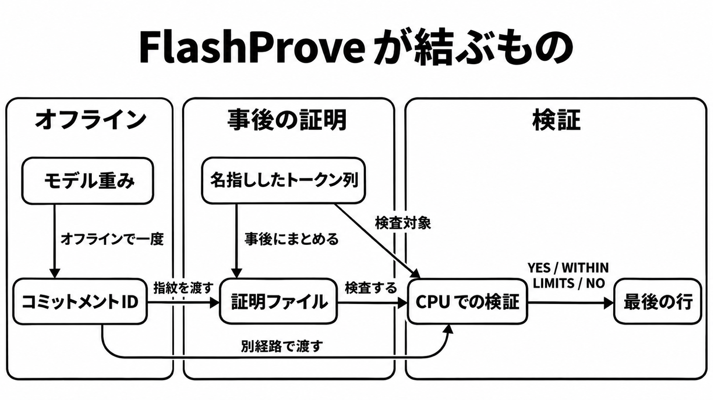

# ダイジェスト: 重みの指紋と名指ししたトークンを事後に結ぶ

[元記事](../../../../../articles/anthropic-anthropic-research-p2_20261105.md)

## ひとことで言うと

FlashProve は、公開した重みの指紋と名指ししたトークン列を、事後の短い証明で結びます。公開された速度は、次の 1 トークンを検査した条件の数字です。

## 核心ポイント

- 証明ファイルは zkSNARK（短く、CPU で検査でき、重みも中間値も漏れない、と研究ブログが説明する方式）です。結ぶのはモデル名ではなく、コミットメント ID（オフラインで一度作る重みの指紋の識別子）と、名指ししたトークン列です。
- 証明は事後で、終わったテキストをまとめて読み、バッチで証明します。研究ブログは、研究の途中経過の共有だと書いています。
- 公開された速度とサイズは、長い返答の全文を 1 つの証明が覆った費用ではありません。条件は、4bit の Llama 4 Maverick で、1024 トークンのプロンプトに対する次の 1 トークンを検査し、生成しないことです。
- YES は、検査した各トークンが整数モデル（主測定の 4bit モデルを整数演算で動かし、第一候補を選ぶ）の第一候補であることです。WITHIN LIMITS は、clipped-gap（完全一致より緩く、定めた限度を満たせば受理するポリシー）の限度を満たすことしか言わず、終了コードは YES と同じく 0 です。
- 2026-11-05 時点で確認した Messages API（Claude の応答を返す公式 API）、Amazon Bedrock、Google Cloud 上の Claude、Microsoft Foundry には、証明もコミットメント ID も付くとは書かれていません。signature（Thinking が返す思考ブロックに付く、思考過程の暗号化した写し）は思考の再送用で、重みの証明ではありません。

## メンタルモデル

オフラインで重みの指紋を一度作り、事後に証明します。検証は重みも GPU も持たず、コミットメント ID とトークン列と証明ファイルを受け、最後の行を返します。NO が不合格か検査不能かは、確認した文書に書かれていません。

## 具体例

| 見ること | 数字 |
|---|---|
| 24 件の証明 | 約 223 秒、1 件 18.78 MB。毎秒約 110 はプロンプト 1024 トークンを数え、生成は数えない |
| 検証 | 24 スレッドで 17 秒。オフライン段階の検査を含む。指紋の 39 分とは別 |
| 指紋のファイル | 約 6.5 MB（識別子とは別）。約 39 分 |

## 適用と判断

向く場面:

- 監査ログに、モデル名とは別の計算の識別欄を先に足す。
- 自前の公開重みで、後から検査できる欄を試す。
- 上の応答先の本文を、計算した重みの証明として扱ってよいか決める。

確認すること:

- コミットメント ID は、検査するサーバ以外から受け取ります。
- 完全一致か clipped-gap か（後者は限度も）を残し、結果は YES か WITHIN LIMITS を残します。
- 上の測定では、証明 1 件が十 MB 級、GPU 時間は推論の数十倍です。
- 検証成功を完了条件にするのは、ホスト済み API がコミットメント ID と検査範囲と証明参照を応答か取得できる台帳に載せるか、使うモデルとポリシーの証明を自前で残し、最後の行を完了記録に含め、その費用を引き受けるときです。
- signature を、重みの証明の欄へ入れません。

## 限界・注意点

- 検査していない位置は覆いません。証明は、依頼した人も時刻も名指ししません。
- 整数モデルの第一候補は、比較相手の 16bit モデル（公開の 4bit 版そのものとは書かれていない）と 6.81% の位置で違い、その差は証明の外です。6.81% は、速度を測った重みが証明対象からずれる意味ではない（Python 実装）。
- 限度が緩い、または重みが平坦なら、WITHIN LIMITS ではほぼ任意の出力が通り得ます。二つの既存エンジンの正直な返答 96 件ずつはどれも完全一致を通らず、採点は整数モデルの Python 実装で、証明されておらず、リリースされたプログラム上ではありません。
- C++ の検証器と CUDA の証明器自体は証明されていません。Lean（性質を機械検査した証明支援系）と論文と実行コードの一致も保証されず、リポジトリは研究物で、保守せず。
## 参考

- 元記事: [FlashProveは重みの指紋で応答トークンの出所を事後に示す](../../../../../articles/anthropic-anthropic-research-p2_20261105.md)
- [Progress on provable inference for large language models](https://www.anthropic.com/research/provable-inference)
- [anthropics/FlashProve](https://github.com/anthropics/FlashProve)
- [Responsible Scaling Policy updates](https://www.anthropic.com/responsible-scaling-policy/updates)
- [Thinking](https://platform.claude.com/docs/en/build-with-claude/thinking)
