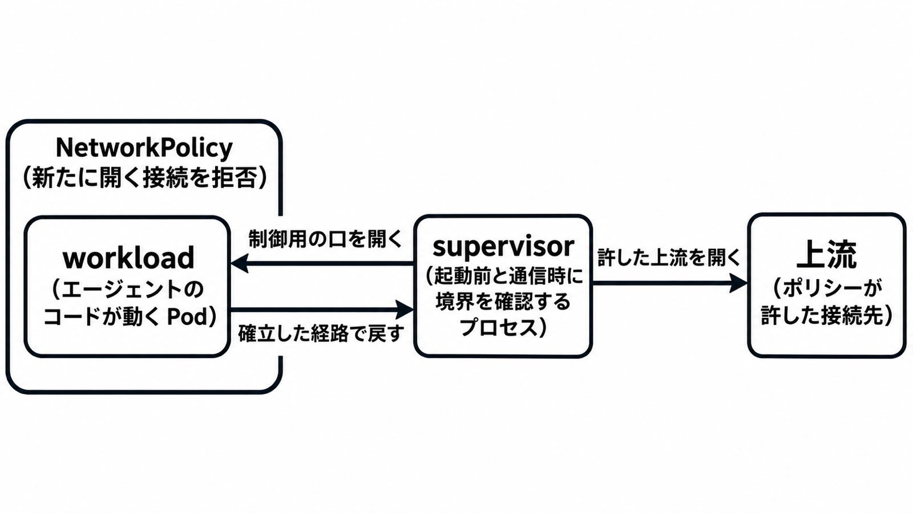

# ダイジェスト: OpenShellをKubernetesに載せるときの境界とレビュー項目

元記事: [cncf-openshell-kubernetes-p6_20261105.md](../../../../../articles/cncf-openshell-kubernetes-p6_20261105.md)

## ひとことで言うと

OpenShell（エージェントのコードを閉じ込める実行環境）の境界は4層で、ファイル、プロセス、ネットワーク、資格情報である。Pod の標準と通信の許可は、HTTP の中身と、秘密を実値に換えることを表せない。

## 核心ポイント

- ファイルは Landlock（パスを読む側と書く側に分ける仕組み）で縛り、カーネル側の版（ABI v3）が無いと起動せず、内部ディレクトリ `/.openshell` は必ず隠し、設定では見せない。プロセスは root にせず、プロセスに足す権限は持たず、システムコールを絞る。
- ネットワークは規則が無いとき外向きを拒否し、規則は実行ファイル、ホスト、ポートを名指しする。秘密の実値は、許した接続先だけに supervisor（境界を確認するプロセス）が差し込む。
- 既定では許した接続先の中の違反を記録して通す（audit）。適用できない追加のファイル規則だけを外して起動し得る（best_effort）。
- Restricted（最も厳しい Pod の標準）と NetworkPolicy は、root、プロセスに足す権限、システムコール、強制されるホストとポートまでである。実行ファイル、HTTP メソッド、書けるパス、秘密の実値化は OpenShellのポリシー側である。
- 公開ドキュメント v0.1.7 では、supervisor が workload（エージェントの動く Pod）へ接続する。Kubernetes driver（資源を作る部品）の新しい動かし方では、workload から対の supervisor への TCP を 1 本だけ通し、任意の外部ホストには通さない。

## メンタルモデル

図は公開ドキュメントの向きである。許した接続先は supervisor が開き、workload が新たに開く接続は NetworkPolicy が拒否する。

## 具体例

メソッド制限のデモは、規則に合わない要求を拒否するモード（enforce）の動作である。既定の audit は、許した接続先の中の違反を記録して通し、接続を許す規則が無いホストは通さない。

## 適用と判断

向く場面:

- curl のようなツールの名前と、出られるホスト、書けるパス、秘密の載り方を分けて見るとき。
- 作業ファイルを次の実行に残したくないとき。
- 本番の秘密を扱う前に、Restricted だけでは HTTP と秘密の境界になるか見るとき。

確認すること:

- 接続先の中の違反を拒否するモード（enforce）にし、既定の audit のままメソッド制限を期待していないか。
- ファイル規則を欠かしたくないなら hard_requirement（適用できないとき起動を拒む）を検討し、ABI v3（OpenShift は 4.19 以降）と NetworkPolicy の強制を前提にしたか。
- 秘密は provider（サービスと保管した秘密を対応させる部品）に載せ、環境変数（中の全プロセスから平文で読める）や workload への注入を避けるか。
- 作業ファイルを残したくないなら、停止（`/sandbox` は残る）ではなく削除か終了後の削除を選んだか。
- gateway（制御の入口）の ServiceAccount と、sandbox の名前空間で Pod や NetworkPolicy を作る権限を、OpenShell のポリシーとは別に絞ったか。

## 限界・注意点

- 接続の向きは v0.1.7（デモは0.1.3）と Kubernetes driver の README で分かれ、リリースノートの明記は未確認である。
- 削除の完了待ちは README の本文では未確認。`/tmp` が Pod の終了や停止で空になるかも未確認。
- 固有の脆弱性番号と gateway API の呼び出し制限は、2026-11-05 時点で未確認である。
- カーネルは共有のまま。別ランタイム（gVisor や Kata）はランタイムを名指ししたときだけ付き、利用者番号のずらしは既定で無効。
- 遅延、密度、アイドル時の規模では Agent Substrate（別プロジェクト）を混ぜない。その提案は 2026-11-05 時点で未完了。

## 参考

- 元記事: [cncf-openshell-kubernetes-p6_20261105.md](../../../../../articles/cncf-openshell-kubernetes-p6_20261105.md)
- [CNCF Blog: OpenShell on Kubernetes: A Guide for Platform Engineers](https://www.cncf.io/blog/2026/11/04/openshell-on-kubernetes-a-guide-for-platform-engineers/)
- [OpenShell Architecture（Latest v0.1.7）](https://docs.nvidia.com/openshell/about/architecture)
- [Kubernetes driver README（main）](https://github.com/NVIDIA/OpenShell/blob/main/crates/openshell-driver-kubernetes/README.md)
- [Pod Security Standards](https://kubernetes.io/docs/concepts/security/pod-security-standards/)
