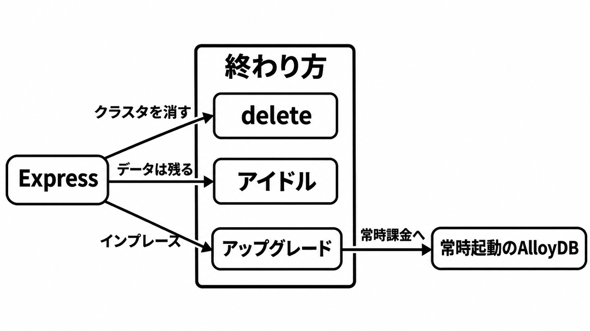

# ダイジェスト: 破棄は delete。アイドルはデータを残す

[元記事](../../../../../articles/google-postgresql-alloydb-p4_20261105.md)

## ひとことで言うと

AlloyDB Express は、使わないあいだコンピュートをゼロにする PostgreSQL 18 の Preview です。1 サイクルに作成と破棄を入れてよいのは、条件が同時に揃うときだけです。

## 核心ポイント

- 約 2 秒は、公開 DNS（公開 IP の代わりに、自分のネットワークの外からつなぐ DNS 名）の接続受付だけです。Private Service Connect（以下 PSC、許可したネットワークのエンドポイント経由で、公開インターネットには出さない）の接続受付と、止めたコンピュートを戻す再開は、どちらも約 20 秒で、クラスタとインスタンスの 2 段の作成とは別です。
- アイドルはコンピュート課金だけを止め、データとストレージ課金は残します。消えるのは明示的な delete だけです。
- 東京（asia-northeast1）の 2026-11-05 時点は、1 CU（1 vCPU 対 4 GB）あたり $0.147 / 時、ストレージ $0.384 / 1 Gibibyte Month です。地域を書かない $0.115 は us-west1 なので、東京には使いません。
- 通常の AlloyDB へ上げると、接続文字列は維持され、常時起動の料金になります。Express へは戻れず、上げただけで HA が付くとは書かれていません。
- 1 サイクル（作業を始めてから終えるまでの 1 回）に作成と破棄を入れてよいのは、合成データ、本番に届かない専用プロジェクト、作成と削除に足りてアップグレードと本番ネットワークの変更を含まない権限、終了時の delete、秘密を残さない接続が、同時に揃うときだけです。

## メンタルモデル

消えるのは delete だけです。アイドルはデータを残し、アップグレードだけが常時起動の料金に移ります。

## 具体例

英語の価格ページの計算例は、US_CENTRAL1（us-central1）、1 CU、1 日 5 時間、ストレージ 10 GB で合計 $0.674 です。この地域は対応一覧に無く、コンピュートは 5 時間分、ストレージは 24 時間分です。例の単位は GB、表は Gibibyte Month です。

## 適用と判断

向く場面:

- AlloyDB 独自の拡張（ベクトル検索や、SQL から Gemini を呼ぶ関数）が検証対象のとき。
- 結果を残さず、上限 20 GB、同時接続 200（固定）以内の試作。

確認すること:

- 本番に届かない専用プロジェクトで、作成・削除と、アップグレードおよび本番ネットワークの変更が分かれるか（分ける事前定義ロールの名前は作成手順に無く、分けるならカスタムロール）。
- 終了が delete を呼び、アイドルを破棄の代わりにしないか。
- 初期パスワードと IAM アクセストークン（パスワードの代わりに入るトークン）が、履歴、ログ、リポジトリに残らないか。
- 公開 DNS を使うなら、必要な CIDR だけを許すか（既定は全拒否で、更新はリスト全体の置換）。
- 東京の見積もりが、上の $0.147 / 時と $0.384 の行か。

## 限界・注意点

- HA、バックアップ、ポイントインタイムリカバリ、SLA、顧客管理の暗号鍵が要る検証には使いません。Pre-GA で SLA が無いので、必須 CI の床にはしません。
- Terraform での再現が採用条件なら使いません。対応は未確定なので、対応とは扱いません。
- pause（コンピュートをゼロにするアイドル）までの分数は、2026-11-05 に読んだ overview では未確定です。『50 compute units』（請求先あたり最初の 12 か月の毎月、ストレージ 2 GB 付き）が 50 CU・時を指すか、課金開始の文言（2026-12）との重なりも価格ページだけでは閉じず、通常版の 30 日試用はこの無料枠ではありません。
- 300 万 queries per second などは、本番側の器の主張であり、Express（サイズは 1 vCPU か 2 vCPU、上限 20 GB）の話ではありません。
- 標準の PostgreSQL だけで足りる検証は、手元の使い捨てにします。データを外へ出さず、プロセス終了で捨てられます。

## 参考

- [元記事](../../../../../articles/google-postgresql-alloydb-p4_20261105.md)
- [AlloyDB Express overview](https://docs.cloud.google.com/alloydb/docs/express-overview)
- [Express の作成と管理](https://docs.cloud.google.com/alloydb/docs/create-manage-express-clusters)
- [価格（英語）](https://cloud.google.com/alloydb/pricing)
- [発表ブログ（2026-11-04）](https://cloud.google.com/blog/products/databases/introducing-alloydb-express-for-rapid-testing-and-prototyping/)
