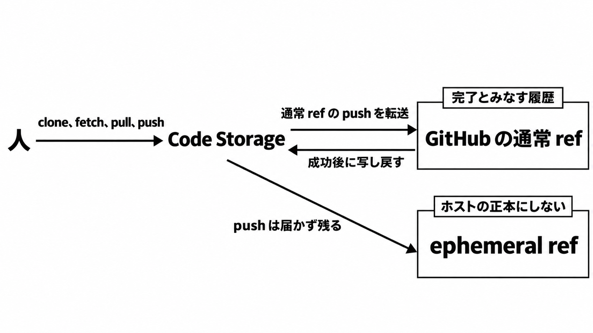

# ダイジェスト: 履歴とレビューの完了は、自社の手順に残す

[元記事](../../../../../articles/openai-pierre-codex-openai-p1_20261105.md)

## ひとことで言うと

2026-11-04、OpenAI は Pierre（エージェント向け Git 基盤の会社）の買収合意を発表しました。
その発表がいまの利用として名指しするのは、Codex のファイル閲覧と差分です。

## 核心ポイント

- Pierre の **Code Storage**（Git でコードと履歴を置く API）を **Codex**（ファイルを見て変更をレビューする OpenAI のアプリ）へ取り込むのは、**クロージング**（買収の完了）のあとです。それまでは両社は別会社で、買収発表が名指しするいまの利用は **Trees**（ファイルツリー）と **Diffs**（差分）です。
- GitHub App の同期では、**ephemeral ref**（作業スナップショットなどの一時的な ref）以外の **通常 ref** について、Code Storage の GitHub Sync の文書が GitHub を **source of truth**（履歴の基準に置くホスト）と呼びます。人が叩く remote は Code Storage で、通常 ref の push は GitHub へ転送し、成功後に GitHub から Code Storage へ写し戻します。
- ephemeral ref への push は GitHub に届かず、Code Storage に残ります。**generic HTTPS**（設定した外部ホストへの転送）の転送先を、完了の履歴とする文はありません。
- レビューの完了は、**source provider**（Codex の文書がレビューの送信先として書くホスト）へ投稿したあとの状態です。チャット上の指摘、**Diffs 上の reject**（差分の編集を却下する操作）、**Git note**（履歴を書き換えずに付けるメタデータ）は、その完了に入れません。
- 完了条件は自社の手順に書きます。製品の画面や既定値は、その手順を上書きしない入力として置きます。

## メンタルモデル

## 具体例

手順では却下を、指摘を投稿しない、差分の一塊を戻す、note を消す、の 3 種類に分けます。
どれを監査に残すかは手順が指定し、製品は消したあとの残り方を保証しません。
Diffs 上の reject が、この 3 種類のどれかとは書いてありません。

## 適用と判断

向く場面:

- コーディングエージェントの手順を持つテックリードが、完了条件と基準ホストを自社手順に残すかを決めるとき。

確認すること:

- GitHub App の双方向同期では、完了の履歴を GitHub に届いた通常 ref にしているか。
- **public mode**（起点と先は「取り込み」としか書いていない）を、ホストへ自動で戻る継続同期として書いていないか。
- ephemeral ref と、そこだけの **Git LFS**（大きいファイルをポインタで置く仕組み）を正本にしていないか。
- レビュー完了を source provider への投稿後に置いているか。
- テスト、branch protection、required approvals を残し、**Code Review Rules**（Codex へのレビューの案内）をその代替にしていないか。

## 限界・注意点

- クロージング後に Codex へ入る Code Storage の機能が、同期時の source of truth を変えるかは、買収発表がどちらとも書いていません。
- 削除した Git note の過去が却下の監査として残るかは、保持方針が書いてありません。未投稿の指摘が、Codex の Code review と Review GitHub pull requests 以外に残るかは、見た範囲では未記載です。
- **Pando**（OpenAI の社内モノレポ用の Git backend。2026-11-02 の記事）と Pierre の買収発表は、顧客向けの git 層の担当を、どちらも書いていません。
- 買収発表の「顧客は Code Storage を使い続けられる」は、終了時のリポジトリ書き出しや、契約が改定されないことを意味しません。

## 参考

- [元記事](../../../../../articles/openai-pierre-codex-openai-p1_20261105.md)
- [OpenAI, OpenAI to acquire Pierre（2026-11-04）](https://openai.com/index/openai-to-acquire-pierre)
- [Code Storage, GitHub Sync](https://code.storage/docs/repos/github-sync.md)
- [Codex, Code review](https://learn.chatgpt.com/docs/code-review.md)
- [Codex, Review GitHub pull requests with Codex](https://learn.chatgpt.com/docs/third-party/github.md)
- [OpenAI, Scaling Git at OpenAI（2026-11-02）](https://openai.com/index/scaling-git-at-openai/)
