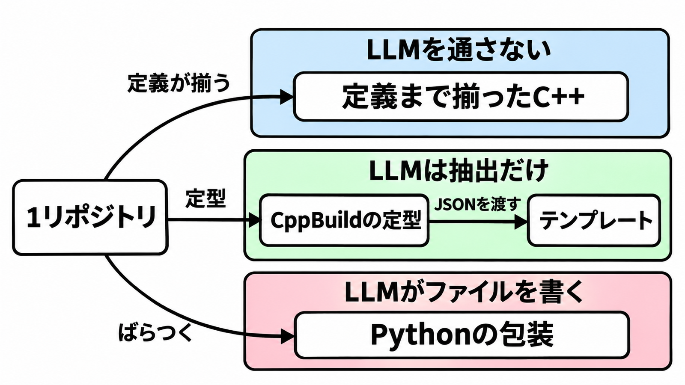

# ダイジェスト: 移行の見積もりは段階と成果物で分ける

[元記事](../../../../../articles/bloomberg-llm-arxiv-abs-p6_20261106.md)

## ひとことで言うと

Automated Uplift は、決定的な段階と、LLM が書いてよい成果物とを、型ごとに分けます。

## 核心ポイント

- 決定的な処理（LLM を呼ばず、同じ入力に同じ手順を適用する処理）に固定するのは、型への分類、文脈の収集、プロンプトの組み立て、検証です。検証の規則はモデルに渡さず、検証に落ちたらエラーを文脈に足して LLM へ戻し（上限 3 回）、合格後の PR 説明も LLM が書きます。
- 成果物の形はアーキタイプ（ビルド記述の揃い方で分けた型）で変わります。会社の定義まで揃った C++ は決定的な生成器だけ、CppBuild（CMake へ移す前の C++ ビルド方式の仮名）の定型は LLM が JSON を抽出しテンプレートが CMakeLists を書き、Python の包装（依存や設定を含め、配布できる形にまとめること）は LLM がファイルを直接編集します。
- 抄録の 729 件（表の 31 と 698）は、2026-06-30 のマージ件数です。評価対象 2,333 件の過半数は判断が無い（まだ開いているか、更新が無く自動で閉じたもので、開発者が拒否して閉じた件数とは別）状態です。
- PR を出さない判断と、未完成のまま出す判断は、再実行とは別です。前者は、データ収集が安全に移行できないと示したとき、後者は件数の少ない型で、起点 PR（未完成とラベルし、所有チームが仕上げる前提の PR）を出します。
- 人日は、構築チーム（このパイプラインを作った著者たち）の見積もりで、C++ がタスクあたり約2人日、Python が 1〜2人日です。同じリポジトリの人手時間の前後も、所有チームの人日も、測っていません。

## メンタルモデル

揃い切った型は LLM を通さず、定型は JSON まで、ばらつく包装だけがファイル編集です。

## 具体例

2026-04-30 までに開いた PR を、2026-06-30 に数えた帰結です。C++ の列は、図の 1 つの型ではなく、評価対象の C++ の PR（2,039 件）です。

| 帰結 | Python の包装 | C++ のビルド系 |
|---|---:|---:|
| マージ | 31（10.5%） | 698（34.2%） |
| 開発者が未マージで閉じた | 64（21.8%） | 165（8.1%） |
| 開発者の判断が無い | 199（67.7%） | 1,176（57.7%） |

## 適用と判断

向く場面:

- リポジトリが分かれ、所有チームが PR を受け取り、正しさをパイプラインの中でかなりのところまで検査できる移行を発注する。
- 形式が揃い、PR の前にビルドとテストが通る型と、ばらつく型を、見積もりの行で分ける。

確認すること:

- 約 20 リポジトリ以下の型は、専用パイプラインを作らず、起点 PR か人手にする。
- 触ってよい差分は、組んだ文脈の中のファイル編集か、スキーマ付きの抽出に限り、検証は LLM の自己判断に含めない。
- 再実行の上限、PR を出さない条件、起点 PR は別箇条にし、「失敗したら決定的な処理へ戻す」とは書かない。
- 費用は、生成の計算時間と、所有チームのレビュー、テスト、配備に分け、後者はこの論文の数値では埋まらない。
- 上の人日を単価に使うなら、実測ではないと欄外に書く。

## 限界・注意点

- 根拠は、対照実験のない 1 社の経験報告です。仮説検定も信頼区間も無く、データとソースは公開されていません。
- 候補（母集団の概数）は揃っていません。C++ は約 6,700 とタスク合計 6,121 で、PR 列の合計 2,137 と評価対象の C++ 2,039 も、差の説明がありません。
- 論文の導入が引用する 91.3% と 15.3% は、別論文のベンチマークの平均合格率で、この移行のマージ率ではありません。
- Python と C++ の差は、検査の深さだけでは分かれません。開始時期、リスクの見え方、レビュー支援、母集団の揃い方が同時に違います。
- 1 つの変更が影響箇所へまとめて入るモノレポ（複数コンポーネントを 1 リポジトリに置く構成）では、リポジトリごとの PR 着地は同じ形になりません。

## 参考

- 元記事: [Bloombergのリポジトリ移行は決定的処理とLLMを段階で分ける](../../../../../articles/bloomberg-llm-arxiv-abs-p6_20261106.md)
- Corchero ほか. Hybrid LLM–Deterministic Pipelines for Enterprise-Scale Code Migration at Bloomberg. arXiv:2611.05457v1, 2026-11-03. [抄録](https://arxiv.org/abs/2611.05457)
