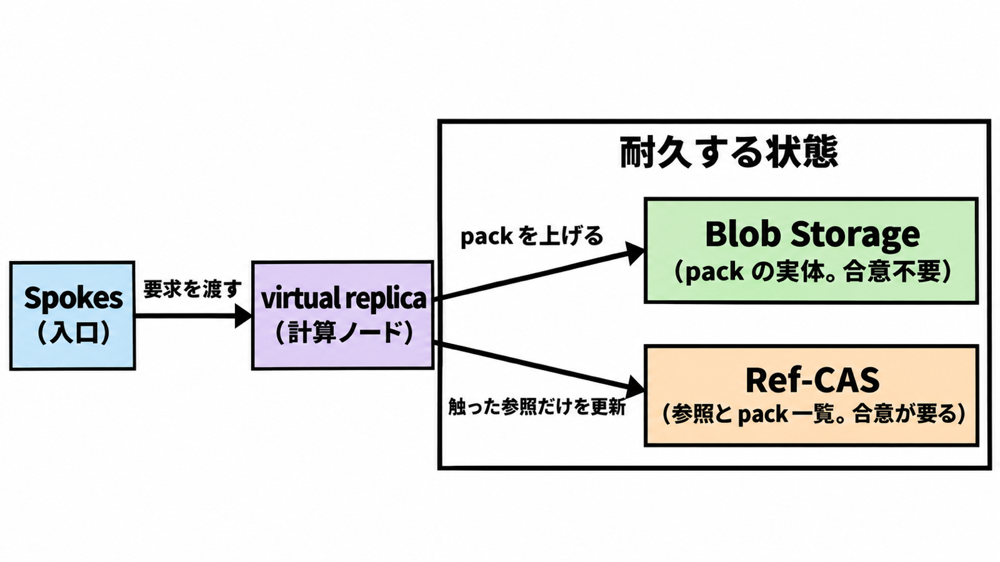

# ダイジェスト: GitHubが単一リポジトリの同時push向けに再設計したGit格納

元記事: [github-push-git-github-inside-p1_20261106.md](../../../../../articles/github-push-git-github-inside-p1_20261106.md)

## ひとことで言うと

Project Rubicon（同時push向けのGit格納）はpack（オブジェクトをまとめたファイル）の保存と参照更新を分ける。同じ参照への同時更新は、記録に残るのが1本だけ。

## 核心ポイント

- Spokes（Git、API、Web の要求を渡す入口）の下で、耐久する状態は二箇所である。pack の実体は Azure Blob Storage、参照（ブランチやタグが指す先）と pack 一覧は Ref-CAS（現在値と一致するときだけ更新する格納）にある。
- virtual replica（使い捨ての計算ノード）は pack を索引して Blob へ上げ、その後 Ref-CAS へ一覧の追記と参照更新を 1 回確定する。ロックは触った参照だけで、Ref-CAS がその更新を記録するログの複製の過半数が記録すると可視になる。
- 直列の境界は参照である。trunk（本線）、release train（リリースへ載せる変更を 1 本に乗せる運用）、merge queue（チェック後にマージするキュー）はすべての merge を 1本の参照へ戻し、ブランチを分けても直列は残る。
- 5,000 同時エージェントと毎秒 7,200 push は 2026-11-05 の内部試験で、本番の最忙は毎秒数十件の書き込みの短いバーストだ。別の文の毎秒数万件は参照状態だけの処理で、push の完了数ではない。
- 人のレビューは Ref-CAS のロック時間としては書かれておらず、保護ブランチと必須レビューは残る。速くなった倍率はレビューが短くなった証拠にならず、所要時間の前後は無い。

## メンタルモデル

Git オブジェクトは内容アドレス（中身から決まる識別子）で不変なので、pack の保存に書き手の合意は要らない。合意が要るのは、上げたあとの参照更新だけである。

## 具体例

エージェント A が `feature-a` へ、B が `feature-b` へ push すると、参照が別なので互いを待たせない。同じ `main` への同時の 2 本は、fast-forward（先端の子孫として進む更新）でも、ログに載るのは 1 本である。

## 適用と判断

向く場面:

- ブランチを分ける前に、受信側の直列を書くとき。
- 毎秒 7,200 push を一般提供の容量にする前。
- push の応答と、保護ブランチのレビュー待ちを別のカウンタにするとき。

確認すること:

- 分離単位を、push が更新する参照にしているか。
- 本線、release train、merge queue への merge が 1 本に戻ることを、ブランチ分割では消せない、と書けているか。
- 容量の前提に、内部試験、本番の最忙（毎秒数十件の短いバースト）、limited private preview（記事公開時点の提供）を並べているか。
- 失敗した push を、同期応答と保護ブランチのレビュー待ちで別に数えるか。
- lookup（pack からオブジェクトを探す処理）が pack 数で少し高くなる話に、pack をまとめて数を減らす上限の数値（記事に無い）を混ぜていないか。

## 限界・注意点

- 7,200 と 5,000 は内部試験で、pack の大きさ、同一参照の割合、遅延のミリ秒、本番かは本文に無い。10月6日の書き込み速度の最大35倍（基準の件数は本文に無い）と、10月21日の別参照への書き込みの3〜4倍は、7,200とは足せない。
- 失敗時のエラー文字列と、監査に残るかは、参考の GitHub ブログ 3 本に無い。non-fast-forward（先端を上書きせずには進めない更新）の GitHub Docs が同じ文字列を返すとも書いていない。
- ログに載らなかった pack をその場で消すとは書いておらず、到達できないオブジェクトの消し方も本文に無い。
- 入った秘密を探す検査を push 応答の外へ出した待ち時間は、本文に無い。
- 提供は limited private preview で、どのリポジトリが Rubicon かは分からない。99.99999% は Azure と自社データセンターの両方にコピーがあるリポジトリの割合で、展開率ではない。

## 参考

- 元記事: [github-push-git-github-inside-p1_20261106.md](../../../../../articles/github-push-git-github-inside-p1_20261106.md)
- [Inside GitHub's new Git storage architecture](https://github.blog/engineering/architecture-optimization/inside-githubs-new-git-storage-architecture/)（2026-11-05）
- [The bridge to agent-scale Git infrastructure](https://github.blog/engineering/architecture-optimization/the-bridge-to-agent-scale-git-infrastructure/)（2026-10-21）
- [Building Git infrastructure for agent-scale development](https://github.blog/engineering/architecture-optimization/building-git-infrastructure-for-agent-scale-development/)（2026-10-06）
- [Managing a merge queue](https://docs.github.com/en/repositories/configuring-branches-and-merges-in-your-repository/configuring-pull-request-merges/managing-a-merge-queue)
