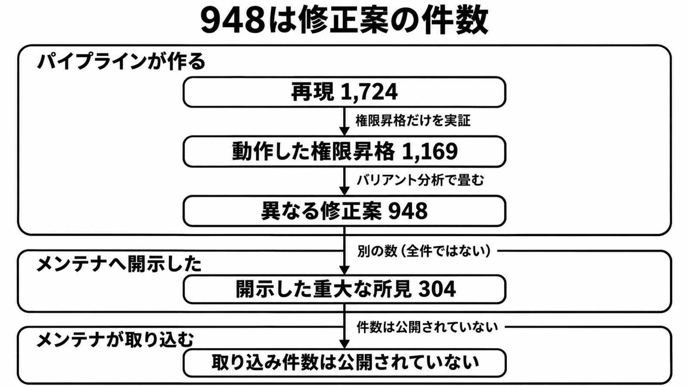

# ダイジェスト: OpenAIがLinuxカーネルで数えた権限昇格の修正案948件

元記事: [openai-linux-948-openai-index-p4_20261106.md](../../../../../articles/openai-linux-948-openai-index-p4_20261106.md)

## ひとことで言うと

948は、ローカル権限昇格（低い権限から強い権限へ上がる欠陥）が動いた本数ではない。1,169本を畳んだ修正案の件数で、開示304件や取り込みとは別である。

## 核心ポイント

- 11月4日の記事の見出し、要約、ファネル図は、948を動作したエクスプロイトとも呼ぶ。1,169本と異なる修正案948件を分けているのは、詳細節だけである。
- 情報漏えいの実証291件は、隔離した環境で再現した1,724件から分かれた別の枝で、1,169本との差ではなく、948にも入らない。948は、権限昇格1,169本をバリアント分析（似た欠陥を、異なる修正案の件数へまとめる段）で畳んだ数である。
- 重大な所見（11月5日の記事が開示数に使う呼び方）304件は、修正案つきでメンテナ（カーネルの変更を本線へ取り込むかを決める人）に開示した数である。948全件を送ったとは書いておらず、取り込み件数でもない。
- 修正案を作った側が報告前に見ることは、メンテナが本線へ取り込むことの代わりにならない。前者は外に出す前の関所、後者は差分と、いつ開示するかも決める関所である。
- 仮の賞金額（受け取った賞金ではなく、競技の1件あたりの額を948回掛けた評価額）には、満額を足す条件が規則に無いことを置く。約45倍（kernelCTF、すなわち対象カーネルと報酬を規則で定める競技、に合わせた別実行で、受理されれば約150万ドルという評価をその費用で割った比）には、その実行でメモリ割り当ての緩和を外したことと権限昇格21件の満額受理とは書いていないことを、5倍超（948件と、7月の重複を除いた権限昇格166件との比）には、費用もカーネルの時点も件数の定義も揃っていないことを、置く。

## メンタルモデル

上の枠は、再現1,724、動作した権限昇格1,169、異なる修正案948である。304はメンテナへ開示した数で、取り込み件数とは別である。

## 具体例

引用は次の一文に揃える。OpenAIは、2026年10月中旬の実行で、動作したローカル権限昇格1,169本から異なる修正案948件を作り、2026年11月5日時点で重大な所見304件を修正案つきで開示した、と自ら書いている。取り込み件数は公開されていない。

## 適用と判断

向く場面:

- 948を、動いたエクスプロイトの件数として引用しそうなとき。
- 開示304件を、送付の完了や採用率の分子にしそうなとき。
- 費用や賞金の倍率を、条件のない成果として並べそうなとき。

確認すること:

- 948は修正案、1,169は動作したエクスプロイト、として分けたか。
- 送付数は304件だけを引用し、11月4日の記事が書く数百件の報告と修正案を304に足していないか。
- スキャンと手動分析が10日で終わった時点の観測（本線でパッチ済みの61、本線の前のパッチ43、公開の場で報告または議論されている299）を、OpenAIの修正案が取り込まれた数として置いていないか。
- 仮の賞金には満額を948回足す条件が規則に無いことを、約45倍にはメモリ割り当ての緩和を外したことと21件がそれぞれ満額で受理されるとは書いていないことを、5倍超には費用とカーネルの時点と件数の定義が揃っていないことを、それぞれの文に置いたか。
- カーネルの版、レビュー件数、数の包含が未知でも、948を修正案として引用することは止めず、止めるのは採用率、送付完了、賞金収入、モデルの単価比較である。

## 限界・注意点

- 人が行単位で見た差分の件数、受理率、却下率は、記事に無い。
- 10月の実行のカーネル commit と、デスクトップのディストリビューション名は、記事に無い。
- 61、43、299、304、948が互いに含まれるかは、記事が結んでいない。
- 11月4日の記事はこの実行のモデルを upcoming cyber model（これから出るサイバー向けモデル）と呼び、11月5日の記事は同じ948と1,724を GPT-6 Cyber の成果として書く。snapshot の ID は、どちらの記事にも無い。
- 2026-11-06に公開の議論の場を検索した範囲では、メンテナが948件を確認した、または取り込んだ、という記事は見つからなかった。全メールを読み切った証明ではない。

## 参考

- 元記事: [openai-linux-948-openai-index-p4_20261106.md](../../../../../articles/openai-linux-948-openai-index-p4_20261106.md)
- OpenAI. [A thousand fewer paths to root](https://openai.com/index/a-thousand-fewer-paths-to-root). 2026-11-04.
- OpenAI. [Introducing GPT-6 Cyber](https://openai.com/index/introducing-gpt-6-cyber/). 2026-11-05.