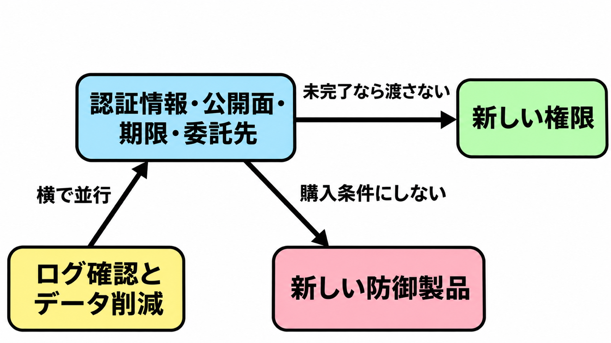

# ダイジェスト: 到達範囲を広げる前の残件は購入条件にしない

[元記事](../../../../../articles/ai-soumu-go-jp-menu-kyotsuu-p2_20261107.md)

## ひとことで言うと

国家サイバー統括室は基本対策の不足を名指しする。この記事は、到達範囲（自組織のAIエージェントに渡す権限と、その権限で触れるシステムの範囲）を広げる前の確認を、新しい防御製品の購入条件にしない。

## 核心ポイント

- 国家サイバー統括室の2026年11月5日の注意喚起は、運用・管理、設計・開発、サプライチェーンの3本柱で、モバイルアプリ開発時の対策不足、ウェブサイト等の設定不備、既知脆弱性とサポート終了の未対応を、自組織または委託先の基本対策の不足として複数確認した、と書きます。総務省は翌日、同じ文書を所管の事業者と関係団体へ伝えています。
- この記事は、到達範囲を広げる前に4つの残件を見える化し、未完了なら新しい権限を渡しません。認証情報の置き場、管理画面・デバッグ・検証環境の公開、インターネットから到達する既知悪用脆弱性とサポート終了の期限、委託先の接続経路と保守アカウントです。
- この確認は購入条件（その製品を買う前に必ず終える関門）にはしません。一次資料は、確認と購入のどちらを先にするかを決めていません。
- ログの確認と、必要な範囲を超えた個人データの削減は、4つの残件の確認と並行します。「4項目だけで十分、検知は後」は、情報通信研究機構が優先するログ確認とも、別文書である緊急対策パッケージの脅威ハンティング（侵入の痕跡を能動的に探す活動）とも両立しないので、文書からは導けません。
- 攻撃側のAI利用は可能性であり、個々の漏えいでの確定とは書かれていません。ソフトウェアの部品表の継続運用、ゼロトラスト（設計と委託先アクセスの考え方）、委託先評価制度（委託先を評価する制度）は、残件の棚卸しのあとの別計画です。

## メンタルモデル

「未完了なら渡さない」は、4つの残件から新しい権限への関係です。「横で並行」は、ログ確認と個人データの削減を、4つの残件と同時に行うことです。「購入条件にしない」は、新しい防御製品への関係です。

## 具体例

認証情報は、アプリ、リポジトリ、パイプラインにあるAPIキー、トークン、秘密鍵、接続情報の置き場を見ます。インターネットから到達する資産では、悪用が確認された脆弱性とサポート終了の期限を切り、直らない間は緩和策とログ確認を残します。

## 適用と判断

向く場面:

- 社内のシステムやデータへアクセスするAIエージェントに、新しい権限を渡す前。
- 個人情報を扱うウェブサイトやモバイルアプリで、基本対策の残件を棚卸しするとき。
- 委託先の接続経路と保守アカウントを自社の完了条件に入れ、費用負担と実施方法を協議し、一方的な負担の押し付けにしないとき。

確認すること:

- 4つの残件に期限と担当があり、未完了のまま新しい権限を渡していないか。
- その確認を、新しい防御製品の購入条件にしていないか。
- 情報通信研究機構の注意喚起が優先期間とした2026年8月以降のアクセスログ、APIログ、認証ログを、侵害の痕跡として照合する指標との一致だけでは侵害と断定せずに見ているか。
- 必要な範囲を超えた個人データの削減を、同じ時期に進めているか。
- 防御側のAIの評価を残件の自動判定にするとき、人が最終確認しているか。

## 限界・注意点

- 統括室はモバイルアプリ開発時の対策不足、設定不備、既知脆弱性とサポート終了の未対応を「複数確認」と書き、翌日の別文書である緊急対策パッケージは同じ3つを「多くみられる」と書きます。どちらも割合の数値はありません。
- 4つの残件へ全件を帰す根拠は弱いです。2026年10月8日公開の別の注意喚起は、原因の全体像は断片的で、すべての事案が同じ手法ではない、と書いています。
- 統括室の注意喚起の末尾は、インターネット上に露出した機器、標的型メール、大量通信でサービスを止める攻撃、今後のAI悪用を、別途対策が必要だとして残します。保有しすぎた個人データも4項目の外です。
- 個々の漏えいが開発、運用、委託のどれにどの割合で分かれるかは、一覧がありません。日経クロステックの無料で読める範囲では、どの対策例を指すかは有料本文まで分かりません。
- 委託先評価制度の申請受付は2027年3月開始予定で、選定基準として実効があるかは受付前には判断できません。個人情報の安全管理措置のガイドライン改正は2027年1月中の施行予定で、個人情報保護法第25条の委託先監督を改正済みとは書いていません。

## 参考

- 元記事: [ai-soumu-go-jp-menu-kyotsuu-p2_20261107.md](../../../../../articles/ai-soumu-go-jp-menu-kyotsuu-p2_20261107.md)
- [国家サイバー統括室の注意喚起（2026年11月5日）](https://www.cyber.go.jp/pdf/press/261105_taiou.pdf)
- [サイバーセキュリティ緊急対策パッケージ（2026年11月6日）](https://www.cas.go.jp/jp/seisaku/cybersecurity_kakuryokaigi/pdf/countermeasure.pdf)
- [情報通信研究機構がログ確認を優先する注意喚起（2026年10月13日）](https://cynex.nict.go.jp/pdf/library/lettice/261013-01.pdf)
- [JPCERT/CC の注意喚起（2026年10月8日公開）JPCERT-AT-2026-0030](https://www.jpcert.or.jp/at/2026/at260030.html)
