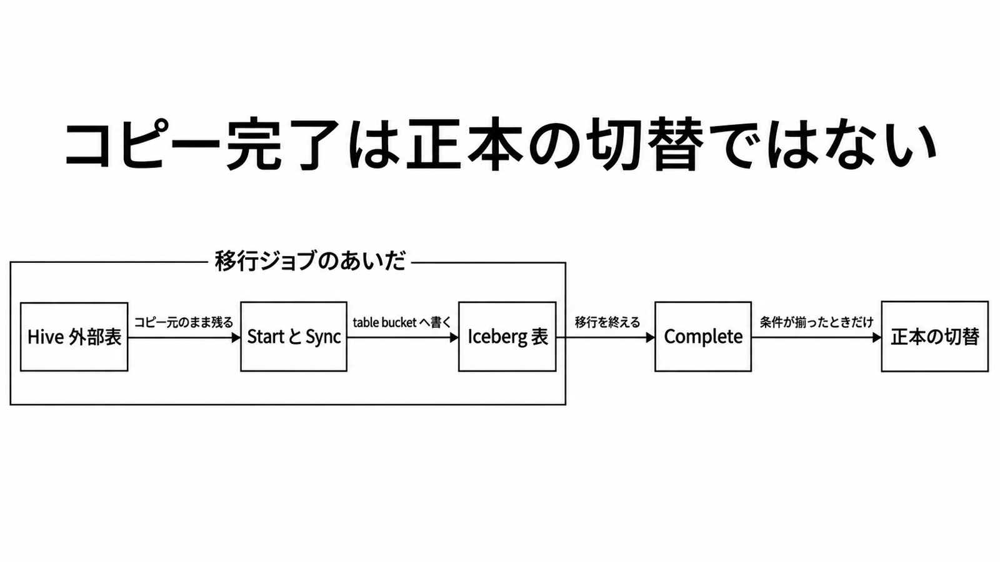

# ダイジェスト: コピーが終わっても、読み書きの正本は Hive のまま

[元記事](../../../../../articles/aws-hive-s3-tables-iceberg-p10_20261107.md)

## ひとことで言うと

S3 Tables は、Hive 外部表のデータを、時点の記録を持つ Iceberg 表へコピーします。コピーが終わっても、読み書きの正本（実際に読み書きする表）は移っていません。

## 核心ポイント

- 操作は三つです。Start は宛先を作ってコピーし、Sync は差分を足し、Complete は読み書きと、ファイルのまとめ・分割と未参照ファイルの削除を有効にして、以後の Sync を止めます。
- 移行のあいだ、元のファイルは動かさず、元の表は読み書きできます。宛先は Complete まで問い合わせ専用で、書き込みと上のファイル処理は無効です。
- 宛先のスキーマに無い列や、変換できない値があると、既定ではそのファイルで移行全体が失敗します。一度移したファイルをあとから上書きすると、中身が同じでも Sync は失敗します。
- succeeded は、計画したファイルの移行が終わった状態で、列を落とす指定や値を null にする指定でも成功しえます。Complete は失敗やキャンセルのあとでも呼べ、そこまでのコピーが読み書き可能になり、以後の Sync はできません。
- 正本を移すのは、切り替えるときに、あとの確認が揃っているときだけです。パーティション（値で表を分ける単位）を、クエリに書かなくてもメタデータ側で分ける設計へ変える作業はしません。

## メンタルモデル

左が移行中の正本、右端は条件が揃ったあとの切替です。table bucket は宛先専用の置き場です。

## 具体例

掲載例は、米国東部（バージニア北部）で、1 TB の Parquet 25 万個を 4 か月で移し、合計 1.0082 ドルです。内訳は書き込みリクエストと無料枠を超えた Sync だけで、保管料は入っていません。

## 適用と判断

向く場面:

- 同じアカウント・同じリージョンの Hive 外部表を、計算資源なしで S3 Tables へコピーする。外部表は、定義が Glue Data Catalog（表定義のカタログ）にあり、データが汎用バケット上の Parquet（列指向ファイル）にある表です。
- 移行中も元の表を読み書きしたまま、差分を Sync で足す。
- 分け方は値のままでよく、設計のやり直しは要らない。

確認すること:

- 最新の移行が succeeded で、失敗したファイルは 0 である。列を落とす、または値を null にするなら、何が欠けるかを明示して受ける。
- 行数、パーティション数、値のサンプルが元と宛先で合う。行数だけでは、落とした列や null にした値は見えません。
- 移し済みファイルを上書きする書き手を止めてあるか、最後に成功した Sync が最後の上書きより後である。移行中の書き込みそのものは止めなくてよい。
- Complete の成功は HTTP 204 で、競合や形式違反の例外だけでは完了としない。
- Complete のあと、書き手を元の表に残さず、読み書きする側の参照先を Hive から Iceberg へ移す。

## 限界・注意点

- 「切替時の数分」は発表文の表現です。何分で、どの操作が書き手を止めるかはユーザーガイドになく、Complete も書き手を止めません。
- 1 ファイル 10 GiB 超、取り出す前に復元が要る保管クラス、Parquet 以外、ソース表の Lake Formation（表のアクセス制御）登録、別アカウント、別リージョン、毎回鍵を渡す暗号化は対象外です。宛先を Lake Formation で制御することは別です。
- 列の照合は大文字小文字を区別しませんが、スキーマを指定しない推論が Glue の列名をそのまま使うなら、大文字が残りえます。その場合、Glue 経由の Athena（問い合わせ経路の一つ）から表が見えない可能性があり、これは公式記述からの推論で、実測ではありません。
- 宛先の最新スナップショット（その時点のファイル一覧）は、元の表の今の中身と同じではありません。残す記録の既定は最小 3 本、最大年齢 120 時間で、Start で指定し、後の Sync では変えられません。
- ファイルを消し、新しい名前で書く更新が、すべての Hive の置き方で Sync の成功条件を満たすかは未確認です。

## 参考

- [元記事](../../../../../articles/aws-hive-s3-tables-iceberg-p10_20261107.md)
- [英語 News Blog（2026-11-04）](https://aws.amazon.com/blogs/aws/amazon-s3-tables-now-offer-managed-migration-of-apache-hive-tables-to-apache-iceberg/)
- [How it works](https://docs.aws.amazon.com/AmazonS3/latest/userguide/s3-tables-migrate-how-it-works.html)
- [Prescriptive Guidance: Migrating existing tables to Iceberg](https://docs.aws.amazon.com/prescriptive-guidance/latest/apache-iceberg-on-aws/table-migration.html)
- [CompleteTableMigration](https://docs.aws.amazon.com/AmazonS3/latest/API/API_s3Buckets_CompleteTableMigration.html)
