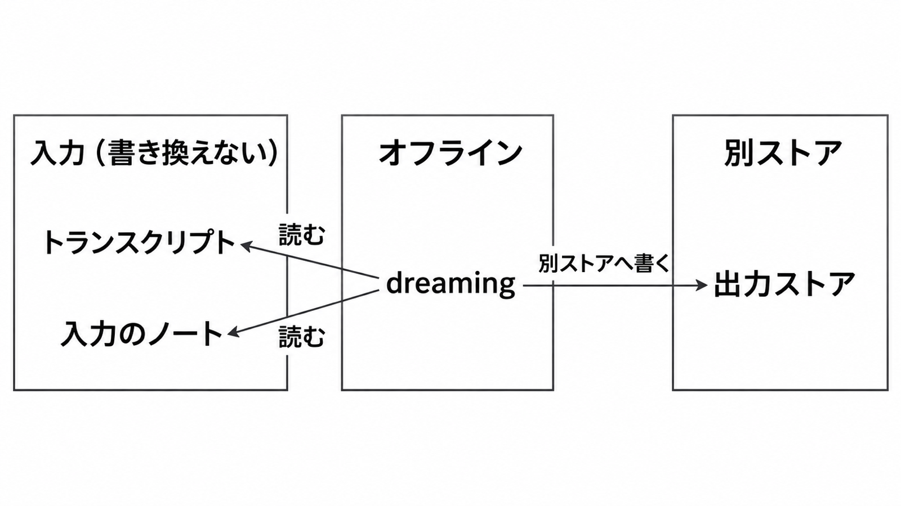

# ダイジェスト: Anthropic のエージェントメモリの4層構造と Dreams API の使い方

元記事: [components-of-agent-memory_20261107.md](../../../../../articles/components-of-agent-memory_20261107.md)

## ひとことで言うと

エージェントメモリ（セッションをまたぐコンテキスト）は4層に分かれる。Dreams（別ストアへ再構成するジョブ）は入力を書き換えない。

## 核心ポイント

- 4層は、トランスクリプト（検索できるログ）、メモリノート（観察と規則）、記憶表現（相互リンクしたページ群、例は wiki）、注入コンテキスト（毎セッション先頭の索引）である。重みの更新は定義の外で、同じ会話の中の学習や要約はセッションを越えない。
- 記憶は、将来のセッションが再び必要とするものの予測である。CL-Bench のデータベース課題（記憶だけを持ち越す）で失敗だけを記録させると、平均報酬の上乗せは、その指定が無いときと比べ、Claude の Opus 5 で 0.234、Opus 4.7 で 0.150 減った。
- 社内文書 25 問では、wiki 単独は 48% までで検索ツールだけの 53% を下回り、再構成を増やすと wiki と検索の併用は 54% から 61% へ上がった。合併の 24 問で、複数文書の結合や判断や計算を要する項目の成績は、wiki 参照 87% と検索のみ 73% で、これは併用の点数ではない。
- memory tool（`/memories` をアプリが操作するツール）と、Managed Agents（実行基盤）の memory store（`/mnt/memory/` の文書集合）は、パスの違うメモリノートである。記憶表現は Dreams が別ストアへ書き、注入の上限（先頭 200 行または 25 KB）は Claude Code の `MEMORY.md` だけが持つ。
- ストア用ヘッダ `agent-memory-2026-07-22` とセッション用 `managed-agents-2026-04-01` を同時に付けると 400 になる。Dreams は後者へ `dreaming-2026-04-21` を足し、各文書は 100 kB、1 ストアは 1 万件まで、セッションに付けるストアは作成時だけ最大 8 個である。

## メンタルモデル

dreaming（Dreams）は、トランスクリプトと入力のメモリノートを読み、再構成を別の出力ストアへ書く。入力は変えず、次のセッションへ付け替えることと、先頭の索引へ上げることは別である。

## 具体例

Pokémon Red（記憶フォルダだけを持ち越す課題）では、洞窟の誤ノートが回復地点を東と書き、探索済みだった。未訂正は崖を 3 回落ちて手前の街で終わり、照合して直すと 1,935 行動で次の街に着いた。

## 適用と判断

向く場面:

- セッションを分けても、同じ利用者や文書群へ戻る仕事。
- 画面やツールから再計算できない規則を残す仕事。
- 複数文書を横断する質問。

確認すること:

- 強いモデルには目的だけを伝え、失敗だけを記録する固定を置いていないか。
- 画面から毎ターン読める値を、メモに残していないか。
- 採用まで本番が読むストアを変えず、Dreams の指示は方針だけにしているか。
- ストアを作るとき、セッションを作るとき、Dreams を作るときで、機能を開くヘッダを混ぜていないか。
- 欠けると結果が変わる項目を、1 文書につき 1 つの書き手が 1 ページへ原文のまま残し、同じページへ同時に書いていないか。

## 限界・注意点

- 数値は社内実験で、公開の単一スコアではない。
- 投稿は再構成を 2 から 128 セッションと書き、その図の横軸はトークン 2M から 128M で、換算は無い。1 文書の検索で足りる仕事に wiki は足さない。
- 投稿はセッション中のノートを書き換えると書くが、Dreams は入力を変えない。文の置換は対象外で、失敗や中止の出力には止まった時点までが残る。
- 注入は誤ったノートも運び、載っても守られるとは限らない。`MEMORY.md` は上限を超えても書け、次に読むとき超えた分は載らず、この上限は CLAUDE.md（4 MiB 以下なら全文）には当てない。
- その場で書くと本作業から注意がそれ、遅らせると出力はすぐ使えない。環境が変わると記憶は陳腐化し、Dreams の記録は削除まで残る。

## 参考

- 元記事: [components-of-agent-memory_20261107.md](../../../../../articles/components-of-agent-memory_20261107.md)
- [The components of agent memory](https://www.anthropic.com/research/components-of-agent-memory)（Lance Martin、2026-11-06）
- [Dreams](https://platform.claude.com/docs/en/managed-agents/dreams)
- [Using agent memory](https://platform.claude.com/docs/en/managed-agents/memory)
- [How Claude remembers your project](https://code.claude.com/docs/en/memory)
