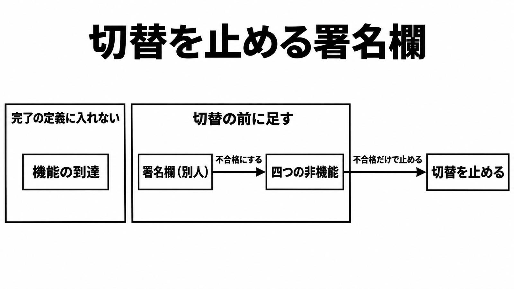

# ダイジェスト: 年間数億円規模SaaSの本番置換は非機能の引き受けが条件になる

元記事: [saas-zenn-dev-ttake-p9_20261107.md](../../../../../articles/saas-zenn-dev-ttake-p9_20261107.md)

## ひとことで言うと

年間数億円規模と書かれた SaaS の本番置換でも、完了は機能の消化では切らない。切替の前に、実装を指示した人とは別の人が、性能、セキュリティ、運用、デプロイの不合格だけで止められる欄を置く。

## 核心ポイント

- たけ氏の記事は、旧 SaaS の実行エンジン（登録済みスクリプトを、利用者の操作に応じてサーバーで動かす部分）を、開発1人と事業担当1人、実装は Claude Code（指示に沿ってコードを書く AI エージェント）で半年かけ本番まで進めた自己申告である。条件は、非機能（画面や出力の項目一覧とは別に、本番で耐えられるかを分ける性質）を人間が制御し続けたことと、旧挙動を知る事業担当である。
- 旧利用料の「年間数億円」と、生成 AI を使う前に社内で取ったリプレイス見積もりの「数年ｘ数億円規模」は、別対象の自己申告で、社名も原票（裏づけの社内記録）も無い。前後比較は旧利用料と置換後の AWS 費（年間数百万円）だけで、人件費、AI の利用料、外部診断費は入っていない。
- 三井住友ファイナンス＆リースの公式 PDF は、顧客別の画面を足す手法を、プロンプト入力時の制御、非機能の確定、生成後の独自検証など、と定義する。企業固有の画面や機能の開発を、6人で約半年を要すると想定したものと、1人で1週間で実現したものとして比較し、対象により異なると断っている。
- 「コードをほぼ読まない」と、人が仕様、テスト、境界（仕様と非機能を分ける線）を持ち続ける、は同じ記事に並ぶ。事業担当の役割は受け入れテストで、非機能の不合格を返す権限ではない。
- 「振る舞いは100%一致させなければならない」は要求として書かれ、一致率の測定値は無い。互換の差分は実行エンジン側で吸収し、登録済みスクリプトは直さない。

## メンタルモデル

署名欄（その名前の人が、非機能の不合格だけを理由に切替を止められる契約上の記入欄）が不合格にするのは、その四つだけである。たけ氏の記事では、設計と切替が開発者本人に重なる。この欄は、たけ氏の記事と公式 PDF が満たした条件の写しではなく、発注側が切替の前に足す。

## 具体例

たけ氏がデプロイと並行運用で踏んだとする三件のうち、管理系の大量処理が利用者画面を詰まらせた件は性能、古い JavaScript による 404 はデプロイに当たる。同時実行による重複記録は、四つのどれか一つとは記事が書いていないので、署名欄の不合格理由には足さない。

## 適用と判断

向く場面:

- 外部 SaaS の実行エンジンを自社へ置き、切替の定義を契約に書くとき。

確認すること:

- 署名欄の名前が、実装を指示した人とは別か。
- 不合格の対象が、性能、セキュリティ、運用、デプロイの四つに揃っているか。
- たけ氏の金額と診断結果を、原票が無いのに見積もりや契約の根拠にしていないか。
- 公式 PDF に書いてあることと、会見報道を、一つの出典に混ぜていないか。

## 限界・注意点

- 署名欄に、実装を指示した人とは別の名前が無いと失敗する、という反例は今回の資料に無い。記事は、本番稼働まで進んだと書く。
- 納品前のソースコード診断と、内部のソースを前提にしない侵入試験の「緊急・高はゼロ」は、本人の要約である。ベンダー名、診断基準、中・低の件数、開始前から不合格にする権限が契約にあったかは書かれていない。
- v1.0.0 以降、約5か月で62回の本番リリースがある、と記事は書く。障害対応か計画リリースかの内訳と、トラブル三件が切替の後かは不明である。
- 決定論的テスト（同じ条件なら同じ結果になるテスト）と人手の最終確認は、公式 PDF ではなく ITmedia の会見報道にある。非機能を確定する人が、プロンプトを書いた人と別人かは、公式 PDF からは決まらない。
- ＠IT 訳の 2025年6月原稿は、自然言語で意図を伝え生成 AI に実装を委ねる開発を、現段階では本番に出さないよう推奨する。英語原文が 2026-11 の現行文面かは未確認で、たけ氏のシステムを検査した文書でもない。

## 参考

- 元記事: [saas-zenn-dev-ttake-p9_20261107.md](../../../../../articles/saas-zenn-dev-ttake-p9_20261107.md)
- [たけ「年間数億円のSaaSを、開発者一人バイブコーディングでリプレイスして感じた達成感と危機感」](https://zenn.dev/ttake/articles/0b6c8f887b160e)（Zenn、2026-11-06）
- [三井住友ファイナンス＆リース「企業向けパーソナライズ型 SaaS」を発表](https://www.smfl.co.jp/news/assets/261104.pdf)（2026-11-04）
- [エンタープライズSaaSにもバイブコーディングの波](https://www.itmedia.co.jp/aiplus/article/2611/06/2000002933/)（ITmedia、2026-11-06）
- [バイブコーディングの可能性と課題：Gartner Insights Pickup（414）](https://atmarkit.itmedia.co.jp/ait/articles/2509/12/news002.html)（＠IT、2025-09-12。原稿は2025年6月）
