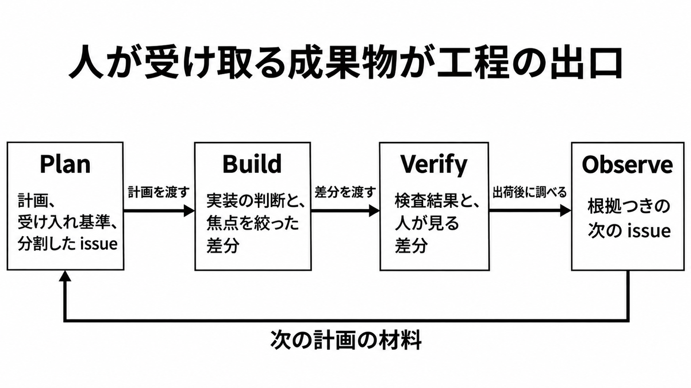

# ダイジェスト: 4工程の出口は受け取る成果物

[元記事](../../../../../articles/github-github-ai-ml-copilot-p3_20261108.md)

## ひとことで言うと

GitHub Copilot の4工程は、人が受け取る成果物で工程を区切る見出しです。週次のコミット数、400%、441% は、工程を終えたことの数値にしません。

## 核心ポイント

- 4工程は、Plan（計画）、Build（実装）、Verify（差分の確認）、Observe（出荷後の調査）です。受け取るものは、順に、計画と受け入れ基準と分割した issue、実装上の判断と焦点を絞った差分、検査結果と人が見る差分、根拠つきの調査と、次の issue の草案です。
- 承認してから実装へ渡すと書いているのは Plan だけで、Build は席を外してもクラウドサンドボックスで続き、Observe は人が何を変えるかを決めます。Verify では、設定次第で検証通過後に Copilot がマージしうるため、人の確認を必須と読むのは弱まります。
- 設定は、人を出口に残す側と外す側に分かれます。残すのは issue の属性を全件保留する Full control、計画だけの承認（計画を承認して実行しない）、Copilot の承認を必須レビューに数えない既定で、外すのは Issue 自動化（issue の属性を書き換える機能）の既定 Cautious（確からしさが高い変更だけ人を待たない）、Visual Studio Code の Local で確認を自動で通す Start with Autopilot、必須承認がゼロ、Copilot の承認を必須レビューに数える設定です。
- Agent Merge（選んだ障害でクラウド上の Copilot が作業を始める機能）を有効にしても、auto-merge（必要なレビューとチェックのあとでマージする機能）は有効になりません。選べる障害は、失敗した GitHub Actions とマージ競合です。
- 導入の完了は、生成が速くなったことでは置きません。成果物がチームの手順の出口に入ったことで置きます。

## メンタルモデル

計画が実装へ渡り、差分が確認へ渡ります。出荷後の調査は、次の計画の材料になります。

## 具体例

終えてよい条件の例です。Plan は受け入れ基準が文章になり人が計画を承認したとき、Build は範囲を絞った差分が渡ったとき、Verify は意図と壊れうる点へ人がコメントしたとき（確認は必須とは限りません）です。Observe は根拠、受け入れ基準、回帰テストが issue に入り、回帰テストが無ければ無いと書いてあるときです。

## 適用と判断

向く場面:

- 4工程を自チームの手順の見出しにするとき。
- コミット数や生成の速さを、導入の完了条件に置こうとしているとき。
- 自動変更、自動承認、必須承認、auto-merge の向きを手順に書くとき。

確認すること:

- 各工程に、成果物の名前と、終えてよい条件が1行あるか。
- 差分以外を出口にするなら、その成果物の名前を書いたか。
- 人を出口に残すか外すかを手順に書き、必須承認がゼロならその旨があるか。
- auto-merge でも人が必須承認を満たすならその旨を書き、Agent Merge と分けたか。
- 1.2 billion、400%、441% を、工程を終えたことの数値にしていないか。

## 限界・注意点

- 解説は、2026年10月の1週間のコミットが12億件超、前年の同じ時期より400%超、2025年の全コミットより多い、と書いています。下限と5倍より多いはこの記事の読みで、集計方法も図もリンクも、2025年通年の定義もありません。
- 441% は、各組織の中で AI 採用が最も低い期間と最も高い期間を比べた、Faros AI（開発テレメトリの研究）の、レビューに留まった時間の中央値 441.5% の丸めで、GitHub は中央値と書いていません。
- Agent Merge がレビューコメントも直す、という解説は、公式手順（失敗した GitHub Actions とマージ競合）とずれます。
- Issue 自動化の承認はサーバ側の境界ではなく、境界にするならリポジトリとエージェントの権限を使います。属性を書き換えるしきい値と、issue を Copilot に割り当てる条件が同じかは未記載です。
- 速度を完了にして問題が無かった事例は、参照した記録では見当たりません。論文はレビュー負荷の増加を記録し、品質コストは除外できないとしています。

## 参考

- 元記事: [github-github-ai-ml-copilot-p3_20261108.md](../../../../../articles/github-github-ai-ml-copilot-p3_20261108.md)
- Nick Liffen, Philip Holleran. [Beyond code generation: A developer’s guide to agentic engineering](https://github.blog/ai-and-ml/github-copilot/beyond-code-generation-a-developers-guide-to-agentic-engineering/). GitHub Blog. 2026-11-06.
- Faros AI. [AI Acceleration Whiplash: Takeaways](https://www.faros.ai/blog/ai-acceleration-whiplash-takeaways). 2026-04-12.
- GitHub Docs. [Getting pull requests ready to merge with Agent Merge](https://docs.github.com/en/copilot/how-tos/copilot-on-github/use-copilot-agents/watch-and-fix-pull-requests).
- Hao He ほか. [AI Writes Faster Than Humans Can Review](https://arxiv.org/html/2607.01904). arXiv:2607.01904v2. 2026-10-27.
