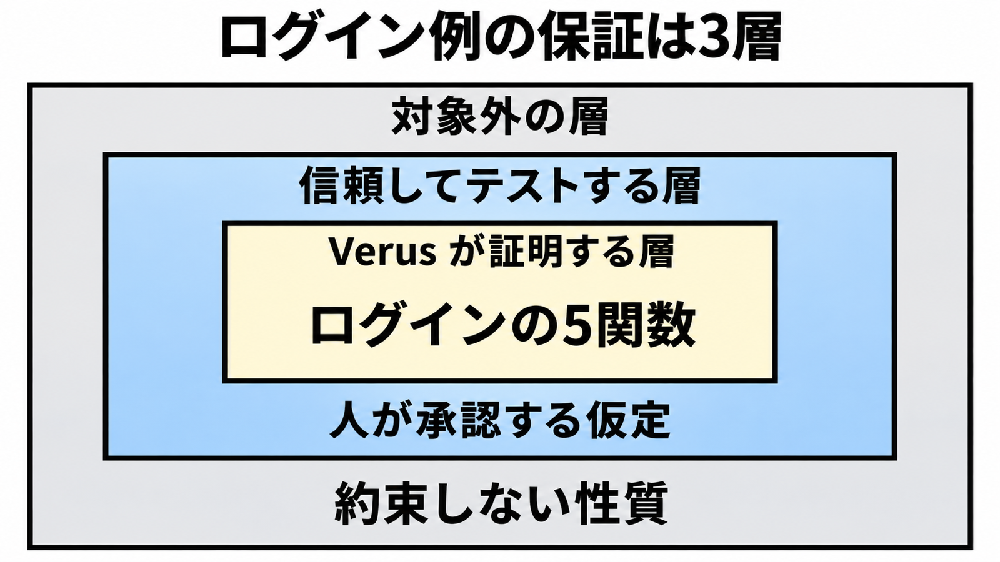

# ダイジェスト: 検査が届くのは、承認した仕様だけ

[元記事](../../../../../articles/github-next-pdd-kit-ai-explain-p2_20261108.md)

## ひとことで言うと

PDD Kit（証明駆動開発）は、人が意図と仕様を先に承認し、形式化できた性質だけを検証器が全入力で検査します。証明が届かない部分は仮定として承認し、実装前の質問や一覧はその証明とは別です。

## 核心ポイント

- 人が先に承認するのは意図と仕様で、証明の外の仮定は別に承認します。Rust の検証器 Verus が検査するのは承認した事後条件（戻るときに成り立つ条件）で、仕様が意図と違えば証明は通ってもコードは間違ったままです。
- 証明する5関数の外に、行の取得そのものとパスワード照合の本体があります。ログインの流れの事後条件は8つで、うち4つは頼んでいない現行の拒否です。
- 保証は3層で、全入力の証明は内側だけです。中間は人が承認してテストする仮定、外側は実装前の計画（範囲と対象外を書いた文書）が外した性質で、応答の完了や試行のレート、他の入口の権限の読み方を含みます。
- 止まるのは、事後条件が破れる、要求に証明も経験的な確認も無い、仕様が矛盾する、固定版の Verus で非同期を書けない、1つの条件がそれだけを壊す変更を拒否できない、の5つです。矛盾は人へ戻り、非同期を書けないときは同期へ逃がさず、契約（事前条件と事後条件）を弱めず、質問で止まります。
- 合否を決めるのは Verus の実行です。証明も経験的な確認も無い要求を探す言語モデルは、合否を決めません。

## メンタルモデル

内側の枠だけが、ログインの5関数を全入力で検査する層です。中間は、パスワード照合の本体と行の取得そのものなど、人が仮定として承認する層です。外側は、計画が約束しない性質です。

## 具体例

公開例は、自作の Pet Store のログインです。最初の要求は「正しいパスワードのときだけトークンを出す」「admin のアカウントだけが admin のトークンを得る」の2文で、前者だけでは全員拒否も通るので、例は「正しいパスワードならトークンが出る」も選んでいます。事後条件では、admin の権限はメールが無いときのユーザー名の管理者行だけが持ち、メールのトークンは必ず顧客です。

## 適用と判断

向く場面:

- Rust で、承認した仕様に対する全入力の証明が要る範囲を、実装の前に切りたい。
- パスワード照合やトークン署名のように証明が届かない処理を、人が仮定として承認し、テストを残せる。

確認すること:

- 意図どおりかは、計画と信頼の承認で別途見る。
- パスワード照合の本体、トークンへの署名、期限を読む時計は、公開例では仮定です。
- メールとユーザー名の行取得を2件と数えると信頼は6件になり入口はその外に残り、もう一方の数え方は入口を6件目に含めるが、どちらの数え方でも証明する5関数ではありません。
- パスワード照合のテストは、公開手順では実行前の予定です。
- 同名で入る pdd-kit は、製品モデルの Markdown を置く手法か、プロンプトをソースにする手法で、この PDD Kit ではありません。

## 限界・注意点

- 段階は Research Prototype です。2026-11-08 の gh 検索では githubnext と microsoft に PDD Kit のリポジトリは 0 件で、インストール手順も、PDD Kit を載せる Chopin の一般向け実行環境もありません。
- レビュー時間、欠陥件数、削ったテスト本数の表はありません。見出しの「世界のソフトウェアの50%」は、脚注の職種割合であり、ソフトウェアの量ではありません。
- 信頼の重みの大半はパスワード照合と2つの行取得にあり、テストは支えるが証明はしません。Verus 自身、Rust のコンパイラ、証明の検査に使うソルバ、Verus の標準ライブラリも証明の外です。
- At a glance の既存バグは想定例で、症状・入力・差分の一覧は無く、変異チェックとは別の欠陥かは未決です。パスワード照合のテストが実行済みの記録へ更新されたかと、非同期を書けずに戻した版も、公開ページから決まりません。
- デモに、第三者の本番採用を示す語はありません。

## 参考

- [元記事](../../../../../articles/github-next-pdd-kit-ai-explain-p2_20261108.md)
- [GitHub Next. PDD Kit.](https://githubnext.com/projects/pdd-kit/)
- [Microsoft Research. Formally verifying agent-written full-stack web apps with PDD Kit.](https://www.microsoft.com/en-us/research/blog/formally-verifying-agent-written-full-stack-web-apps-with-pdd-kit/)
- [itai-gendler/pdd-kit（Product-Driven Development）](https://github.com/itai-gendler/pdd-kit)
- [promptdriven/pdd（Prompt Driven Development）](https://github.com/promptdriven/pdd)
