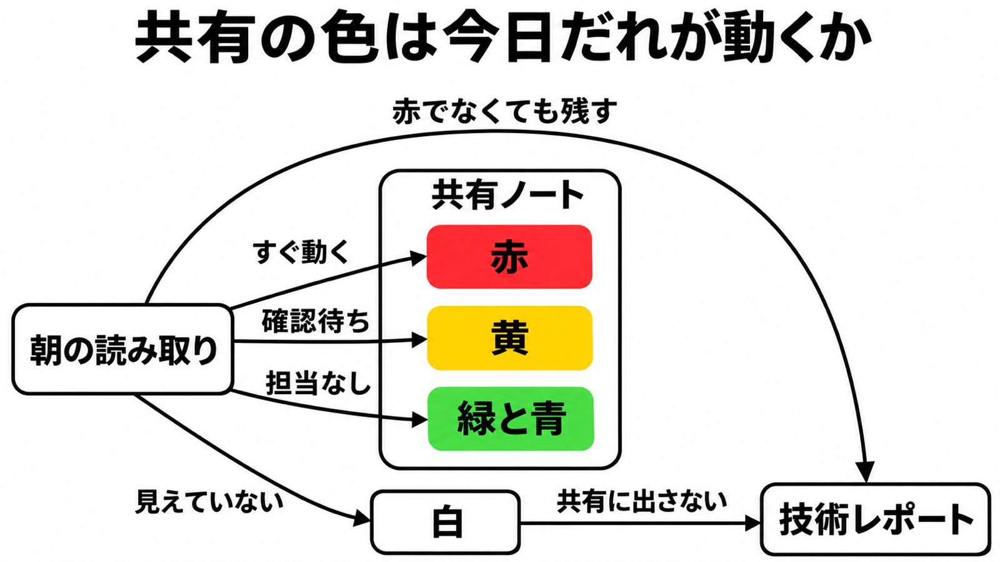

# ダイジェスト: 朝の色は今日だれが動くか

[元記事](../../../../../articles/zenn-dev-stock-inc-ai-daily-p7_20261108.md)

## ひとことで言うと

朝の攻撃兆候の報告は、色を「今日だれが動くか」に揃え、検知の全件は赤でなくても別の記録に残します。

## 核心ポイント

- 朝の読み取りは、平日の朝に、許可された読み取りだけを行う仕組みです。読むのは監視の数値とアラーム履歴、ログの検索、アカウントの管理操作の記録、通信を許す範囲の設定で、共有ノートには件数と色、技術レポートには実行者、操作、未確認、走査したログの量を分けて出します。
- 最終的な5色は「人が動く必要があるか」で、赤はすぐ動き、黄は被害が未確認で人の確認待ち、緑は何かあったが説明がつくので黄にせず担当を付けず（ウェブの入口で遮断されただけの未調査も混ざり得る）、青は何も起きていないので担当を付けず、白は見えていない範囲で共有ノートに出しません。走査が届かなかった残りは黄ではなく、白と同じく共有ノートには出さず技術レポートに残します。
- 緑にした操作も、技術レポートに残します。共有ノートには、送信元の IP と利用者の識別子を書きません。
- 初期は何かが起きたら赤で、社員の通常作業でも毎週赤になり、公開記事は毎週赤だとだれも赤を読まなくなると書いています。その後は、社員のアカウント、社内回線、パスワードに加えて別の確認を求める認証がすべて揃えば緑、1件でも違えば赤にし、証跡（アカウントの管理操作の記録）の停止のようにだれがやっても赤のものは残します。
- 朝の読み取りの完了条件は、検知の網羅と今日の担当を別の出力にすることです。黄に期限のある確認担当は株式会社Stockの公開記事には無く元記事が足していますが、期限の長さはどちらにも書かれていません。

## メンタルモデル

共有ノートに出すのは赤、黄と、担当を付けない緑と青だけです。緑は何かあった側、青は何も起きていない側です。
白は見えていない範囲なので共有ノートには出さず、赤でなくても実行者と操作は技術レポートに残します。

## 具体例

| 色 | 共有ノートでの意味 | 出口 |
|---|---|---|
| 赤 | すぐ人が動く。例は証跡の停止 | 今すぐの担当 |
| 黄 | 人の確認待ち。被害は未確認 | 確認の列 |
| 白 | 見られていない範囲 | 共有には出さず、技術レポートだけ |

## 適用と判断

向く場面:

- 朝のセキュリティ確認の色を、検知の有無ではなく今日だれが動くかで揃えたい。
- 共有する色と、実行者や未確認の記録を、別の出力にしたい。
- 社員の通常作業で毎週赤になり、赤の意味が薄れた運用を直したい。

確認すること:

- 作成、更新、削除、コンテナやデータベースへの接続、権限変更を、読み取りの許可に混ぜず、人が判断するまで止めているか。
- 証跡の停止のように、1件で人が動く事象を、直近7日の中央値（同じ長さの窓と比べる基準）へ吸収せず残しているか。
- 証跡の停止を赤に残すこととは別に、操作の名前だけで鳴る警報（公開を塞ぐ操作でも同じ名前なら鳴る）と、見た範囲に無かったことを「無い」と言う断定の、両方をそのまま色にしていないか。
- この朝の確認を、PC を開いていない日も動くリアルタイム監視の代わりにしていないか。
- 規制や契約が人の日次閲覧を求めるとき、自動の色だけで足りるとしていないか。

## 限界・注意点

- これは株式会社Stockの1社の運用記録であり、他社で再現した測定データセットではありません。
- 直近7日の中央値は、見逃しが無い方式としては読めません。攻撃を少しずつ増やすと平常へ取り込まれうる、という侵入検知一般の記述であり、この中央値が見逃した実測ではありません。
- 緑にするときの社員のアカウント、社内回線、パスワードに加えて別の確認を求める認証は、操作した主体が本人である証明としては読めません。盗んだセッションで認証済みに見える余地は一般論であり、当該環境の事例は未確認です。
- 黄の期限の長さ以外に、複数の色を1日にまとめる手順、手元の PC 以外へ読み取り権限を出すか、人が見た時刻は、株式会社Stockの公開記事にありません。

## 参考

- 元記事: [zenn-dev-stock-inc-ai-daily-p7_20261108.md](../../../../../articles/zenn-dev-stock-inc-ai-daily-p7_20261108.md)
- [武田峻一「毎朝のセキュリティ確認をAIに任せたら、判定の基準が「人が動く必要があるか」に変わった」](https://zenn.dev/stock_inc/articles/ai-daily-security-check-criteria)
- [NIST SP 800-61 Rev. 3](https://doi.org/10.6028/NIST.SP.800-61r3)
- [NIST SP 800-94](https://nvlpubs.nist.gov/nistpubs/Legacy/SP/nistspecialpublication800-94.pdf)
- [Google SRE「Monitoring Distributed Systems」](https://sre.google/sre-book/monitoring-distributed-systems/)
