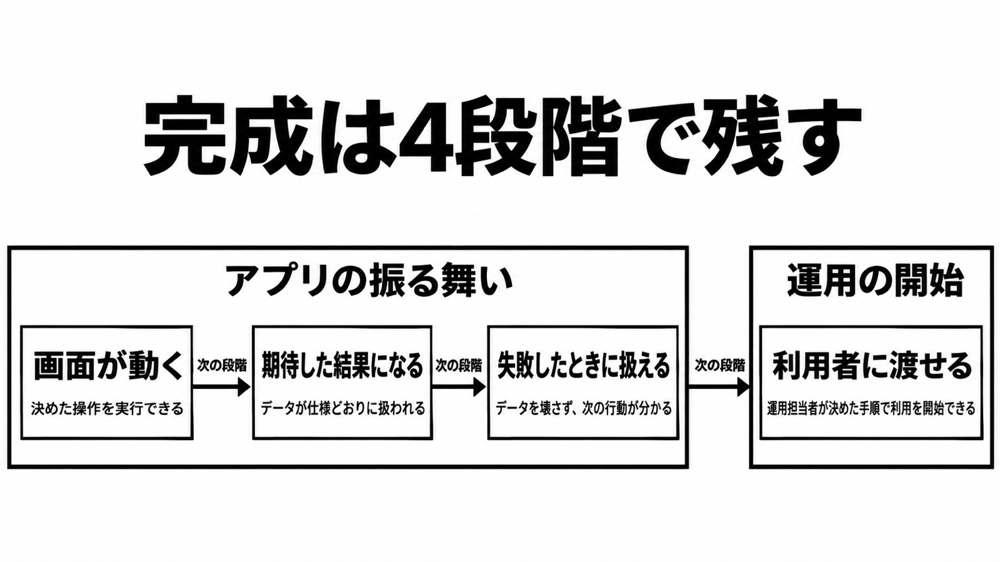

# ダイジェスト: AIで作ったアプリの引き渡しは4段階で残す

[元記事](../../../../../articles/ai-zenn-dev-techstudiolab-p7_20261109.md)

## ひとことで言うと

AIで作ったアプリの完成は、画面が動く、結果が仕様どおり、失敗時に扱える、運用担当者が手順で利用を開始できる、の4段階で記録します。

## 核心ポイント

- 完成を一つの語にすると、開発者と利用者の認識がずれやすいので、通過には確認した事実を残します。第1段階は決めた操作を実行できること、第2段階はデータが仕様どおりに扱われること、第3段階はデータを壊さず利用者が次に取る行動が分かること、第4段階は運用担当者が決めた手順で利用を開始できることです。
- 操作IDは、登録操作ごとに付ける一意の識別子で、再送が同じ操作だと分かります。通信が切れたとき、成功とも失敗とも出さず確認中だと利用者に伝える記録は第3段階、操作IDから登録結果を見る照会は第4段階です。
- 掲載の例は、一つのプロセス（そのプログラムの実行）の中で、順番に登録します。内容が違う再送の拒否は、第3段階ではなく第2段階の確認です。
- 確認項目の判定は未確認、合格、不合格、対象外で、合格の数だけを数えると未確認の問題と利用開始を妨げる不具合を見落とします。承認は引き渡し可、条件付き可、不可で、他人のデータを更新できる状態は不可と書きます。
- テストをAIに作らせるときも、完成条件を先に渡し、どの段階の確認を見ているかを確かめます。掲載の2件は第2段階だけで、通信を切る確認と照会は見ていません。

## メンタルモデル

図が第1段階から第3段階をアプリの振る舞いにまとめたのは、記事の要約です。第3段階の通過判断は、利用者が次に取る行動が分かるところまで含みます。図の「利用者に渡せる」は、運用担当者が決めた手順で利用を開始できることです。

## 具体例

備品「マウス」を数量 3 で登録する、掲載のテストです。

| 操作 | 結果 |
|---|---|
| 同じ操作IDと数量 3 をもう一度送る | 備品は 1 件のまま。登録された備品の番号も同じ |
| 同じ操作IDで数量だけ 5 にする | 保存する前に拒否され、数量 3 が残る |

## 適用と判断

向く場面:

- 画面が動いた報告だけで、業務データを扱うアプリを渡す前に、完成の記録を分けたい。
- 再送や通信断のあと、利用者が再登録してよいかを、運用担当者が調べられるようにしたい。
- 生成したテストが、どの完成条件を見ているかを、受け取るときに確かめたい。

確認すること:

- ログイン、登録、検索が動いた報告を、第1段階より先の証拠にしていないか。
- 再送のたびに新しい操作IDを発行する実装を、第2段階の証拠にしていないか。
- 第3段階として、通信が切れたとき成功とも失敗とも出さず確認中だと利用者に伝え、権限の無い更新をサーバーが拒否してデータが変わらない記録があるか。
- 第4段階では、利用開始の手順を運用担当者が実施できた記録と、利用者ごとの権限、バックアップからの復旧手順、照会、連絡先と対応担当、利用者へ渡した操作手順を、分けて残しているか。
- データを保存しない試作で復旧手順、照会、連絡先と対応担当を外すときは理由を残し、受け手が開発者本人ならその旨を書いて、担当を分けられたとは書かないか。

## 限界・注意点

- これは手順の提案であり、導入件数や障害件数の測定報告ではありません。
- ボタンを押すたびに新しい操作IDを付ける呼び方では、二度押しを止めません。プロセスが終わると記録は消え、同じ操作IDは新しい登録になります。
- 同時の登録と、サーバーが止まった場合は未確認です。本番では、操作IDの一意性をデータベースで保証し、登録した内容とその操作IDの結果を一つのトランザクション（関連する更新をまとめて成功させるか、まとめて取り消す仕組み）で保存する必要がある、と記事は書いています。
- 第4段階の5項を記録しても、開発者がデータベースを開き、運用担当者が横で一度見た記録でも照会は満たせます。連絡先を開発者本人にしても、連絡先の項目は満たせます。
- バックアップからの復旧手順は手順を確認した事実で、戻す作業の実施、所要時間、輪番、アプリログの保管場所、1件だけの取消は含みません。操作IDの発行者と表示する画面、照会失敗後の再試行、条件付き可の境界、このリストで渡した件数は、元の公開記事からは決まりません。

## 参考

- 元記事: [ai-zenn-dev-techstudiolab-p7_20261109.md](../../../../../articles/ai-zenn-dev-techstudiolab-p7_20261109.md)
- TechStudioLab「[AIで作ったアプリ、画面が動いたら完成？引き渡し前の4段階](https://zenn.dev/techstudiolab/articles/ai-generated-app-four-levels-of-done)」（Zenn、2026年11月8日）
