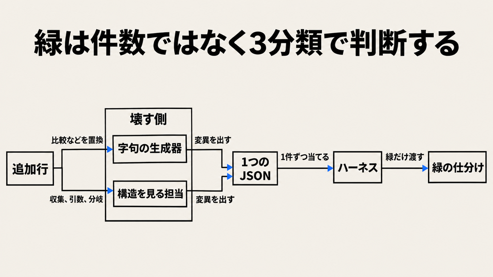

# ダイジェスト: 変異の件数はテストの穴を決めない

[元記事](../../../../../articles/zenn-dev-miyakona-mutation-p8_20261109.md)

## ひとことで言うと

コミット済み差分の追加行を意図的に壊しても、作った件数や、テストが落ちずに残った件数では、テストの穴は決まりません。残ったものは穴、等価、未分類に分けます。

## 核心ポイント

- 変異とは、動いているコードを意図的に壊した版です。この仕組みはコミット済み差分の追加行から壊した版を JSON で作り、既存のテストへ渡し、落ちたものは検出、落ちずに残ったものは緑（生き残り）です。
- 壊し方は2系統です。字句の生成器（ソースを切った単位の置換）の最小例は比較演算子だけを入れ替え、何を集めるか、どの引数を渡すか、どの分岐を通すか（実行させるか、消すか）は、構造を見る担当が作り、置換表には載っていません。
- ハーネスは、変異を1件ずつテストへ当てる側で、実装コードは掲載されていません。当てる前のテストが緑であること、ファイルごとに狭めたテストが緑なら全体も再実行すること、時間切れと置換の失敗は検出にも緑にも混ぜないことが、散文で定義されています。
- 緑が残ったら、仕分けの担当が穴（テストが守っていない壊れ方）、等価（壊しても観測する振る舞いが変わらない変異）、未分類（まだ付けていない残り）のいずれかにし、入力の範囲と観測対象を残します。
- 作った件数と緑の件数は、完了の印にしません。変異の一覧が空でも終了コード 0 になり得て、穴が無かったことにはなりません。

## メンタルモデル

追加行から、字句の生成器と、構造を見る担当が、1つの JSON を作ります。
ハーネスが1件ずつテストへ当て、緑だけを仕分けの担当へ渡します。
仕分けの担当は穴、等価、未分類のいずれかにし、件数では終わらせません。

## 具体例

修正Bは、ページングの修正2件のうち、手書き（人が書いた変異）が見つけた3種を、字句の生成器が再現しなかった方です。対象グループの中身の分類は、記事にありません。

| 操作 | 生成器 |
|---|---|
| 集める先へ、対象のグループだけを積む | 再現しない |
| 引数の渡し先へ、対象のグループだけを渡す | 再現しない |
| そのグループ用の分岐を消す | 再現しない |

## 適用と判断

向く場面:

- 壊した版の JSON を既存のハーネスへ渡し、対象をコミット済み差分に限るなら、自作の小さな生成器を選びたい。
- 条件を固定する、またはブロックの中身を空にすることだけが目的なら、自作ではなく既存ツールの演算子を見たい。

確認すること:

- 緑を穴、等価、未分類のいずれかにし、未分類を未完了のまま残し、生成器が問題ないとしただけでは通していないか。
- 等価の証明が終わるまでレビューを止めず、証明が無いものを等価として通すことと、未分類のまま残すことを分けているか。
- 緑が偏ったファイルは、比較演算子が密集しているだけか、ログや定数のような優先度の低いコードかを見て、構造を見る担当の入力にし、偏り自体は穴にしていないか。
- 条件の固定やブロックの空文化だけが目的なら、PIT（Java 向けの変異テスト。条件を固定する演算子は既定では無効）や Stryker（複数言語向け。ブロックの中身を空にする）を、既定で有効かまで見て選んでいるか。

## 限界・注意点

- 件数は miyakona 氏の概数で、同じ変異集合の前後比較ではなく、時間と見つかった穴の増分は測っていません。修正A（ページングの修正のもう一方）の最終版に残った緑は、穴か等価か未分類のままで、穴だったか等価だったかは記事から決まりません。
- 2026-11-09 時点で、公開リポジトリとしての所在は確認できていません。記録が読めない、形式が不正、記録したテストに失敗があるとき、止めるのがハーネスか生成器かは掲載されていません。
- JSON の形を宣言する検証器の呼び出しは、記事にありません。トップレベルのテストコマンドを空にし、変異ごとのテストだけを書くと、当て直す全体が無くなる、という注意が散文にあります。
- 等価であることの完全な証明を、レビュー完了の門にすると手続きが終わりません。Wang らの論文は、等価な変異の判定は、一般の入力に対して止まる手続きだけでは判定し切れない、と書いています。
- 差分の読み取りは、通常の1つの親との差分用です。複数の親を1つにまとめた形式には対応しません。

## 参考

- 元記事: [zenn-dev-miyakona-mutation-p8_20261109.md](../../../../../articles/zenn-dev-miyakona-mutation-p8_20261109.md)
- [miyakona「変異は生成できても、テストの穴はそれだけでは見つからない」](https://zenn.dev/miyakona/articles/mutation-generator-needs-structural-review)
- [PIT Mutation operators](https://pitest.org/quickstart/mutators/)
- [Stryker Supported mutators](https://stryker-mutator.io/docs/mutation-testing-elements/supported-mutators/)
- [Practical Mutation Testing at Scale（arXiv:2102.11378v2）](https://arxiv.org/html/2102.11378v2)
