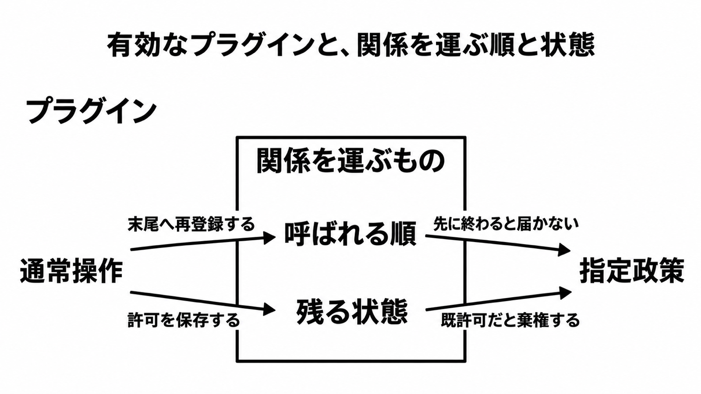

# ダイジェスト: 日常の設定変更が崩すハーネスの実行順と保持状態

[元記事](../../../../../articles/arxiv-abs-2611-09088-p2_20261110.md)

## ひとことで言うと

ハーネス（ツールと状態とガードレールの実行基盤）のピンした版では、プラグインが有効でも、実行前の政策判断が外れることがある。呼ばれる順と残る状態が、通常操作で書き換わる。

## 核心ポイント

- プラグインが載っていても、政策判断を運ぶのは呼ばれる順（先が列を終えると後ろへ届かない）と、残る状態（保存した許可や、編集の出どころの印）である。再適用（実体を破棄して作り直すこと）でできた新しい実体が私的状態の印を持たないと、制約されるはずの編集が実行される。
- DeepSeek Harness（エージェントの実行環境）では、政策プラグインが観察するモードから禁止を執行するモードへの切替が、政策プラグインを末尾へ再登録する。承認プラグインが先に列を終えると政策へ届かず、プラグインは有効なまま、操作者が承認した禁止編集が実行される。
- OpenCode（別の実行環境）2.2.5 で「always」が編集許可を残すと、要求は既許可になり、Permission Reviewer（尋ねる前に政策を当てるプラグイン）は棄権する。「ask（その都度尋ねる）」だけをレビューする約束は守るが、執行点の責務（実行前に指定政策が禁止を判断すること）は外れる。
- 同じ切替でも、列の後ろに置いたホスト自身の同意（プラグインの承認ではなく、実行環境自身が持つ同意）は、検証した列で執行点の要件を残した。操作の名前だけでは、要件を外すかは予測できない。
- 論文は、要件を外す頻度を測っておらず、「通常操作をすれば関係は壊れる」という割合には読めない。読む単位は、どの要件か、どの版か、どの操作の列かである。

## メンタルモデル

図の「関係」は、実行前の政策判断のことである。ピンした版では、通常操作が順と状態を書き換え、プラグインが有効なままでも指定政策を外すことがある。

## 具体例

DeepSeek Harness 0.2.1-rc.2 で、政策を先に並べた観察するモードは、選んだ編集（政策が評価したかを見る対象）1 件を評価した。文書化された切替のあとは、選んだ編集 5 件中 0 件しか政策が評価しなかった。操作者が承認すると、禁止編集が実行された。

## 適用と判断

向く場面:

- 政策プラグインと承認プラグインを、同じ呼び出し列に載せる。
- 「always」で許可を残し、以後の要求を既許可にする。
- レビューを、ツール名の在庫から、判断の経路と状態の寿命へ広げる。

確認すること:

- 指定政策への経路が呼び出し列だけのとき、開始、切替、設定保存、無効化と再有効化のどれが、その順を書き換えるかを見る。
- 保存した許可が政策の資格を外すなら、常設の承認を政策判断の代わりにしない。

出どころの印、応答を適用する段、合格の証拠は、元記事のレビュー項目にある。

## 限界・注意点

- 意図的に選んだ多重ケース研究で、損失の頻度は測っていない。
- DeepSeek Harness の対象版は developer preview である。列を終える承認は、その承認が対象にするツールについて、かつ政策より前のときだけ、政策を経由しない実行を起こす。
- every-edit（先に拒否された編集も含め、受け取った編集をすべて評価する要件）を外すと違反の集合は小さくなる。禁止編集が政策を経由せず実行された主結果は、執行点の責務の違反として残る。
- 停止したメンバーを再登録まで除外する、という共有黒板（誰が参加しているかの共有）の読みは研究側の読みである。再開プロンプトを再登録と見れば、共有黒板プラグインの配信は正しい、と論文は書く。
- 独立した追試は 2026-11-10 時点で未発見である。パターン責務の元論文（AgentOps catalogue）の本文、実験補足、列を終えるプラグイン 6 個の残りの名前は、この記事では未確認である。

## 参考

- 元記事: [日常の設定変更が崩すハーネスの実行順と保持状態](../../../../../articles/arxiv-abs-2611-09088-p2_20261110.md)
- Xia, Lu, Sejdinovic, Zhu. When Routine Operations Break Architectural Pattern Relationships in LLM Agent Harnesses. arXiv:2611.09088v1（2026-11-06）. <https://arxiv.org/abs/2611.09088>
