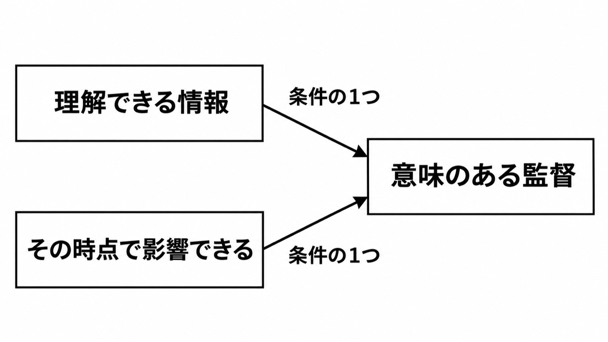

# ダイジェスト: 意図的なペースは遅くする名前ではない

[元記事](../../../../../articles/arxiv-abs-2611-09550-p3_20261110.md)

## ひとことで言うと

意図的なペースは、開発を遅くする名前ではありません。自律実行の進むタイミングを調整し、人が監督できる機会をつくる、論文のビジョンの名前です。

## 核心ポイント

- 速度は単位時間あたりの産出、ペースはその配分です。意図的なペースが調整するのは自律実行が進むタイミングで、その時点が意味のある監督になるかは、別の2条件で見ます。
- 意図的なペースから分かれる調整は3つで、重大な決定の実装前に止めること、人のレビューが終わるまで次の活動を始めないこと、中間結果を人に見せる時点を移すことです。
- 情報が無い時点で止めても、何を変えるかは決まらず、意味のある監督（決定を理解できる情報があり、その時点で決定に影響できること）には届きません。情報が揃ったあとで、その決定を前提にした成果物を見るだけなら、影響できる時点は後にずれ、この場合も意味のある監督には届きません。
- 上の3つとは別に、要求の確認、実装のレビュー、テストオラクル（テストが正しい結果かを判定する基準）の独立した確認は、必ずしも互いに代わりにはなりません。実装を後から見ても、利害関係者の必要を外した要求を必ず埋め合わせられるわけではありません。
- この論文の現在の版はビジョンと研究計画で、効果の大きさ、人の判断を待つ時間、作業をまとめる境目、変更の行数の定義はありません。

## メンタルモデル

意味のある監督は、理解できる情報と、その時点で影響できることが揃った状態です。
3つの調整は自律実行の進むタイミングを変えるもので、2条件が揃うかは位置ごとに見ます。
実行を止めずに見る監督（進行中を見ること、完了後に見ること）は、意図的なペースの外にある比較相手で、監督が成立しないという意味ではありません。

## 具体例

エージェントがアーキテクチャ上の依存を選び、部品とテストまで人に聞かずに進むと、見た時点では複数の成果物がその決定を前提にできています。1つ目の調整は、依存を選んだあと、その部品とテストができる前に止めます。

## 適用と判断

向く場面:

- 重大な決定を実装へ進める前に、人が見て変えられる位置を残したい。
- 確認の種類を増やすのではなく、既存の確認を、まだ決定を変えられる時点に置きたい。
- 効果の実証ではなく、監督の条件の名前としてこの論文を引用したい。

確認すること:

- 止める時点に、決定を理解できる情報があり、かつその時点で決定を変えられるか。
- 判断に足る情報が無い状態で、進んでいる自律実行を止めていないか。
- 中間結果を出す時点を遅らせすぎて、影響できる時点が、成果物が決定を前提にできたあとへずれていないか。
- 区間（自律実行をどこまで進めるかの範囲）は、秒数や差分行数ではなく、重大な決定が実装へ進む前の状態で切っているか。
- 止めずに進める区間を置くなら、その区間では実装前の影響機会を使っていないと明示しているか。

## 限界・注意点

- 効果量は未測定です。第4節は、面接、実行トレース（何をどの順で実行したかの記録）、準実験（無作為な割付をしない比較）、シミュレーションをこれから行う、と未来形で書いています。
- 何を重大と見なすかの手続、人の判断を待つ時間の長さ、情報の量のしきい値は、この論文にありません。
- 論文は、完了後のレビューが実装前の介入と同じ影響機会を持たないことがある、と書いています。常に持たない、とは断定していません。
- 動機にした文献20件は、人が自分で開発を意図的に遅くした理由の探索です。エージェントを止める効果は測っておらず、どの20件を選んだかの一覧は論文の本文にありません。
- 2026年11月10日時点で、会議とジャーナルへの採録は未確認です。リポジトリ検索が0件でも、実装が無いことの証明にはなりません。

## 参考

- 元記事: [arxiv-abs-2611-09550-p3_20261110.md](../../../../../articles/arxiv-abs-2611-09550-p3_20261110.md)
- [Reichel ほか「Deliberate Pacing for Human Oversight in Agentic Software Development」arXiv:2611.09550v1](https://arxiv.org/abs/2611.09550)
