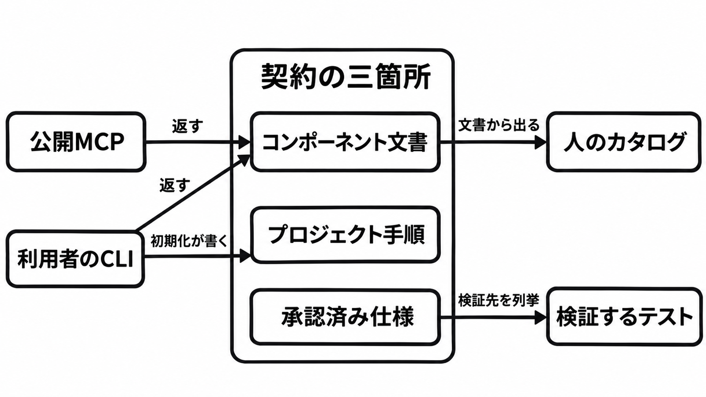

# ダイジェスト: Astryxは人とエージェントの共作に契約を三箇所へ分ける

[元記事](../../../../../articles/astryx-github-meta-astryx-p8_20261110.md)

## ひとことで言うと

Astryx は、Meta が公開した画面部品のデザインシステムです。契約（誰がどのファイルを根拠にしてよいか）は、コンポーネント文書、プロジェクト手順、承認済み仕様に分かれ、人が見るカタログは入りません。

## 核心ポイント

- 公開 MCP（エージェントが文書を引く入口）と CLI は、型・例・助言を含むコンポーネント文書を返します。初期化（利用者プロジェクトへ手順を書く操作）が書くのは、始め方、CLI の引き方、避ける書き方で、版に固定した契約全文は持ちません。
- 公開 MCP の取得は、型、例、助言、アクセシビリティの合格基準、入れるコマンドを返しますが、仕様の優先順位、実装が契約に届いていない箇所、承認状態は返しません。助言に付く印は真でも偽でも実行時に渡した値を拒まず、偽はその助言が誤りという意味ではありません。
- 原則は、渡した値は描き、デザイン上の意見は文書と例に置く、です。禁止の組み合わせを検証するスキーマは、公開資料からは見つかっていません。
- 中核パッケージ @astryxdesign/core の公開版は、npm latest と GitHub Release の 0.7.11 で、README は Beta のままです。基準コミットの 0.7.12 は次の宣言で、この公開版ではありません。
- 記事は、入っている版の CLI とその版の文書を画面を書く側の正本にし、公開 MCP の install 行と props（型・既定値・必須）は採用しないことを勧めています。変える側の正本は、対象プラットフォームの承認済み仕様と検証先のテストです。

## メンタルモデル

公開 MCP と CLI が返すコンポーネント文書と、初期化が書く手順は、実行前に読む面です。承認済み仕様は変更を拘束し、検証するテストへつながります。カタログは別の出口です。

## 具体例

Button では、助言は描き方とは別の文です。

| 記述 | 内容 |
|---|---|
| コンポーネント文書 | href をリンクとして描く |
| コンポーネント文書の助言 | ページ遷移にはボタンを使うな |
| 承認済み仕様 | href があり、操作できない状態でなければリンク要素になる |

## 適用と判断

向く場面:

- 入っている版の文書を、エージェントに渡して画面を書かせる。
- 公開の入口で部品を探し、入っている版の CLI で中身を確定する。
- 自分のデザインシステムで、人のカタログと、エージェントが引く文書・振る舞いの契約を分ける。

確認すること:

- 未決の作業状態（待ちや実行中の見た目）の文書を、エージェントのプロトコルの仕様として引用していないか。
- 承認済み仕様をまとめて渡し、Web の契約と、実験中の別プラットフォーム（Swift の文字入力など）の契約を混ぜていないか。
- 人のカタログだけを正本にして、型、承認済み仕様、実装が契約に届いていない箇所を落としていないか。
- 導入記事の「依存が無い」を、React 19 と StyleX（スタイルを書く必須の依存）が要らない根拠にしていないか。
- 150 以上のアクセシブルな部品、社内 13,000 アプリ、社内 8 年、本番向けという宣言を、日付つきの自己申告以外にしていないか。

## 限界・注意点

- 公開日は社内 8 年の裏取りにならず、150 以上の数え方は公開資料にありません。
- Button の承認済み仕様は、暗いアクセント上の hover と pressed でコントラストが 4.5:1 を下回ると書きます。公開 MCP が返す合格基準とは別にこの不足は返さず、0.7.11 での再測定も公開されていません。
- チャートと実験用パッケージは中核パッケージと同じ入れ方ではなく、利用者が入れる React Native は基準のコミットにありません。基準コミットの承認済み仕様が作り方の比較に React Native を挙げても、提供の決定ではありません。
- 脆弱性の検索 0 件は、無い証明ではありません。公開 MCP のレート制限と認証なしの範囲は、2026年11月10日の資料では未確認です。
- 2026年8月5日の一夜の記録では、Button の文書を読んだ 10 プロンプト中 8 つで、その文書の prop ではない onPress が出て、型が拒否しました。CLI の文書は正しく、文書は直さず、0.7.11 の現在の失敗率でもありません。

## 参考

- 元記事: [astryx-github-meta-astryx-p8_20261110.md](../../../../../articles/astryx-github-meta-astryx-p8_20261110.md)
- リポジトリ: [meta/astryx 基準コミット b6b0c68](https://github.com/meta/astryx/commit/b6b0c68ad570ca85c8028aa1d4e416ac76453023)
- 導入記事（2026年6月18日）: [Introducing Astryx](https://astryx.atmeta.com/blog/introducing-astryx)
- 公開 MCP: [astryx.atmeta.com/mcp](https://astryx.atmeta.com/mcp)
- 夜間テスト: [meta/astryx#3164](https://github.com/meta/astryx/issues/3164)
