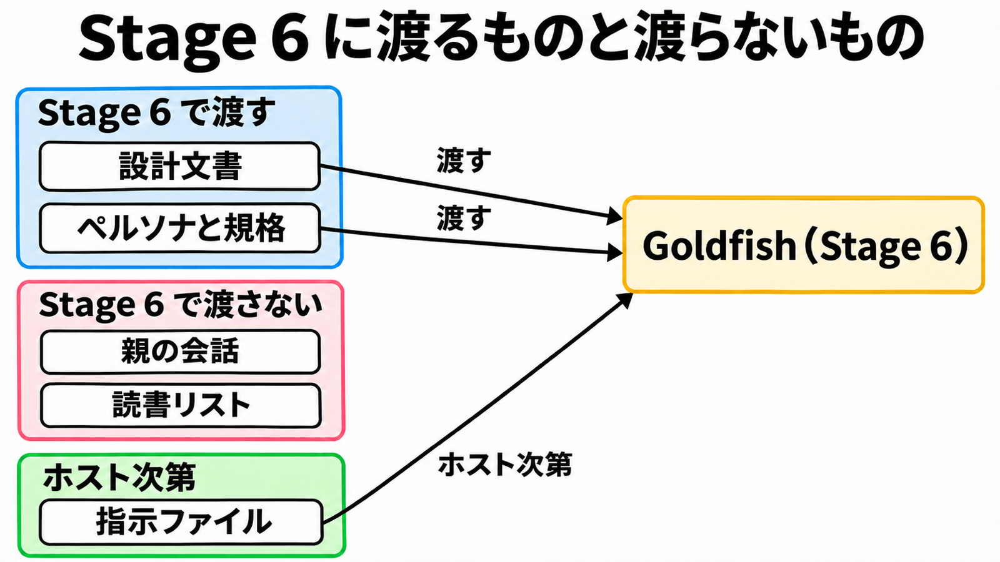

# ダイジェスト: 仕様を書く文脈と、穴を返す文脈を分ける

[元記事](../../../../../articles/github-google-elephant-goldfish-p4_20261110.md)

## ひとことで言うと

Elephant-Goldfish Model は、コーディングエージェントを動かすホストに挿すプラグインです。
穴を返す側に「文脈が無い」と呼べるのは、親の会話を渡さないことまでです。

## 核心ポイント

- EGM（Elephant-Goldfish Model）は Apache-2.0 のプラグインで、Elephant（プロジェクトと決定を持つセッション）が設計文書を書きます。Goldfish（検証者であり、親の会話をコピーせず起動するサブエージェント）が指摘を返し、人間がトレードオフを決めてから実装します。
- レビューは Stage 5 俯瞰、Stage 6 理解テスト、Stage 7 批判、Stage 8 修正後の再俯瞰、Stage 9 実装準備の 5 段で、Stage 1 から 4 はありません。親の会話はどの段にも渡さず、読書リスト（設計文書以外の参照一覧）を外すのは Stage 6 だけで、その段で言い換えられない節は Blocker です。
- 指摘は Elephant に戻り、修正案、反論、人間への引き上げ、見送りに分け、自動で適用するのは修正案だけです。読めなかった知識だけでは退けず人間に上げ、文書から理解できなかった箇所は反論にしません。
- 収束は、未決着の Blocker と Major（未決着だとループを終わらせない重さ）が無い回が 2 回続くことで、Nit（残っても止めない指摘）は残してよいです。上限の 5 回に達したら、受け入れ、続行、草案へ戻すから人が選びます。
- 公表の「ゼロ文脈」は、何も渡さないという意味には読めません。ペルソナ（段の読み方）と文書規格（指摘の書き方）は常に渡り、指示ファイル（ホストが子に注入する指示）はホスト次第です。

## メンタルモデル

図の「ペルソナと規格」は、段の読み方と、指摘の書き方（文書規格）です。
指示ファイルはプラグインが渡す入力ではなく、ホストが子へ注入し得ます。

## 具体例

Stage 6 と Stage 9 は、どちらも設計文書を読みますが、読書リストの有無が違います。

| 段 | 読書リスト | 見ること |
|---|---|---|
| Stage 6 理解テスト | 渡さない | 言い換え。できない節は Blocker |
| Stage 9 実装準備 | 渡す | 文書のパスと、今あるソースコードの照合 |

Stage 9 でソースが一致しても、仕様が文書だけで実装できる証拠にはなりません。

## 適用と判断

向く場面:

- 穴探しを、Elephant の再読だけで止めず、Goldfish に渡す層を指定する。
- 小さな既知の修正には、この 5 段を必須にしない。

確認すること:

- サブエージェントを作れず、親の会話を渡さない実行ができないレビューを、Goldfish と呼ばず止めているか。
- 指示ファイルの前提は Goldfish も読んでいるものとし、疑わせたい仮定だけを検証対象にしているか。
- 理解テストとソース照合を別結果にし、後者の合格を、仕様が単独で閉じている証拠にしていないか。
- 誤解を Elephant の記憶で消さず、反論には Goldfish が読めた根拠を残しているか。
- 収束を指摘ゼロと扱わず、未実行のレビュアーがいる回を成功にせず、利用上限で止まった段をレビュー済みにしていないか。

## 限界・注意点

- ブログの「3 段」は 2026年10月22日の説明で、2026年11月10日の main は 5 段です。1.0 前は契約が変わり得ます。
- 利用者数や完走回数は品質の証拠になりません。通常レビューとの比較は、未実装のままです。
- 未解決の報告では、Codex はプロジェクトとユーザーの指示が、Antigravity はプロジェクトの指示が、子から見えました。Claude Code は 2.1.271 以降で利用者、プロジェクト、ローカルの指示を外せますが、管理側のポリシーは残ります。
- ファイルは隔離されません。Goldfish は、読めるファイルを読めます。
- 未マージの提案は、反論の根拠が後の修正で消えても指摘は既決のまま残り、既決は未決着に数えないので開いた Major があっても収束し得ると、現行規則を読んでいます。現行 main の実測ではなく、実ループは未実施と、提案自身が書いています。

## 参考

- 元記事: [github-google-elephant-goldfish-p4_20261110.md](../../../../../articles/github-google-elephant-goldfish-p4_20261110.md)
- [google/elephant-goldfish-model](https://github.com/google/elephant-goldfish-model)
- [Google Open Source Blog（2026年10月22日）](https://opensource.googleblog.com/2026/10/introducing-elephant-goldfish-model-plugin.html)
- [Issue #237 Exclude host instructions from Codex and Antigravity reviewers](https://github.com/google/elephant-goldfish-model/issues/237)
- [Issue #61 Benchmark review quality against a baseline](https://github.com/google/elephant-goldfish-model/issues/61)
