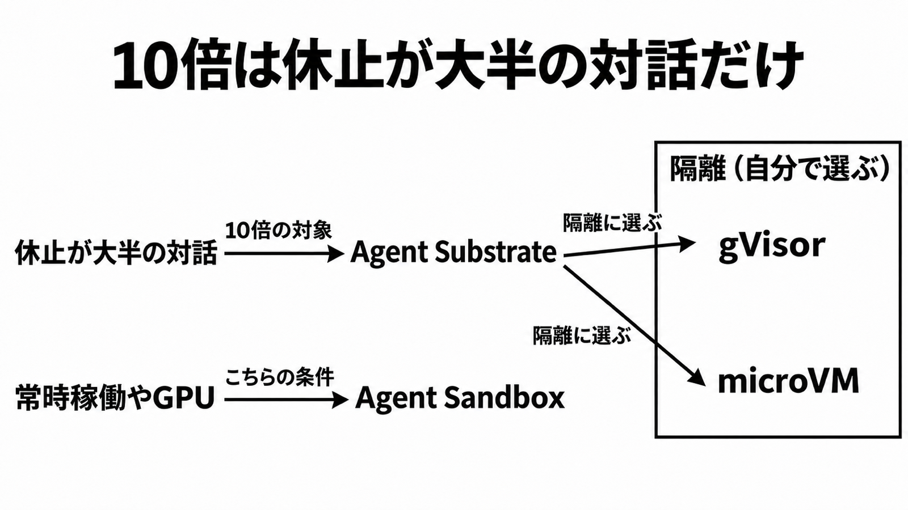

# ダイジェスト: 10倍の密度は休止が大半の対話だけに読む

[元記事](../../../../../articles/kubernetes-gvisor-cncf-jp-p5_20261110.md)

## ひとことで言うと

「10倍」は、休止が大半の対話エージェントへの自己申告です。隔離の選び方と gVisor（ユーザー空間のカーネル）の版は自社に残し、CNCF への寄贈は申請が閉じた段階までと読みます。

## 核心ポイント

- Agent Substrate（Kubernetes 上の実行基盤）は、状態の Actor（メモリ、ファイル、識別子）を Worker（起動したまま待つ Pod の枠）に載せ、終わると保存して戻し、空いた枠をプール（Worker の集まり）へ返します。
- 「10倍」は条件の表が無い自己申告が複数あり、同じ数ではありません。信じてよいのは、休止が大半なら専用 Pod より多く詰め込める、という Google の自己申告までです。
- 2026-11-10 時点で CNCF Sandbox（受け入れ段階）の申請は閉じています。可決の印は gVisor と Agent Substrate だけで OpenRL（学習用）には無く、受け入れは未了、gVisor は Google の組織のままです。
- gVisor はシステムコールをユーザー空間で受けるカーネル、microVM は小さな仮想マシンです。gVisor が GPU を持つことと、GKE では Actor へ GPU を通さず GPU 上のライブの計算状態を保存して戻せないことは別です。

## メンタルモデル

休止が大半の対話だけが 10倍の対象です。
常時稼働、GPU、TPU、サイドカー付きの Pod、Arm、Autopilot（ノード管理を任せるモード）は Pod ごとの別製品 Agent Sandbox 側です。
隔離はプールごとに 1 つ選び、寄贈後も残ります。

## 具体例

数百万サンドボックスは休止を含む自己申告で、1ノードの同時数ではありません。1ノードでおよそ 800 を超えると、ファイル監視（inotify）とアドレス表の既定を超え、起動失敗や通信停止が起きえます。

## 適用と判断

向く場面:

- 休止が大半の対話を、専用 Pod の課金でも 20秒超のゼロ起動でもなく載せるか決めるとき。
- 寄贈を、保守が移り終わった印としてよいか決めるとき。

確認すること:

- 休止が大半の対話だけを 10倍にし、図の「常時稼働やGPU」側は Agent Sandbox に分けているか。
- プールごとに gVisor か microVM を 1 つ指定し、素の Linux コンテナは選ばず、microVM は x86 の入れ子仮想化か物理マシンが要り、Arm の microVM はこの経路では不可か。
- atespace（Kubernetes の Namespace そのものではなく、それに当たる単位）を切っても、未完了のネットワークポリシーとクォータのため分離は閉じないか。
- 休止数、同時数、駐車（空きまで待たせること）、復元の遅れを分け、およそ 800 同時の前後でファイル監視とアドレス表の閾値を誰が上げるかを書いているか。
- gVisor が 20260831.0 以降かを、イメージの固定で確認しているか。

## 限界・注意点

- 比較条件の表は無く、エージェント 200,000、1ホストの休止 1,000 超、約 250 Actor を 8 Pod に載せるデモが同じ条件かはつながっていません。
- gVisor の I/O を Linux カーネルへ出すパッチは未マージで、性能の完成ではありません。パッチが無いと一部の重い I/O だけ落ちやすく、I/O 全般が重いとは書いていません。
- 次の Actor に渡す前の残りを消す処理は進行中で、暗号化と Actor 間の認可はこれからです。Worker は privileged が false でも、root のまま SYS_ADMIN と NET_ADMIN を持ちます。
- gVisor 20260831.0 未満の CVE-2026-95702 は、通常のコンテナ権限で、オーバーレイの解放済みメモリから、ホスト上の Sentry（gVisor のプロセス）でコードを実行できます。NVD はシステムコール制限と名前空間の外へ出るとは書かず、分析待ちです。
- 導入は急がず、乗るとしたら Agent Substrate の 1.0 が壊さない API、コマンド、設定の範囲だけです。ライフサイクル API がこれと同一だとは書いていません。

## 参考

- 元記事: [kubernetes-gvisor-cncf-jp-p5_20261110.md](../../../../../articles/kubernetes-gvisor-cncf-jp-p5_20261110.md)
- [Sandboxing Untrusted AI Agents at Scale（Open Source Blog、2026-11-05）](https://opensource.googleblog.com/2026/11/sandboxing-untrusted-ai-agents-at-scale.html)
- [Powering open infrastructure for autonomous agents（Cloud Blog、2026-11-06）](https://cloud.google.com/blog/products/containers-kubernetes/open-infrastructure-for-autonomous-agents-comes-to-cncf)
- [agent-substrate/substrate README](https://github.com/agent-substrate/substrate/blob/main/README.md)
- [CVE-2026-95702（NVD）](https://nvd.nist.gov/vuln/detail/CVE-2026-95702)
