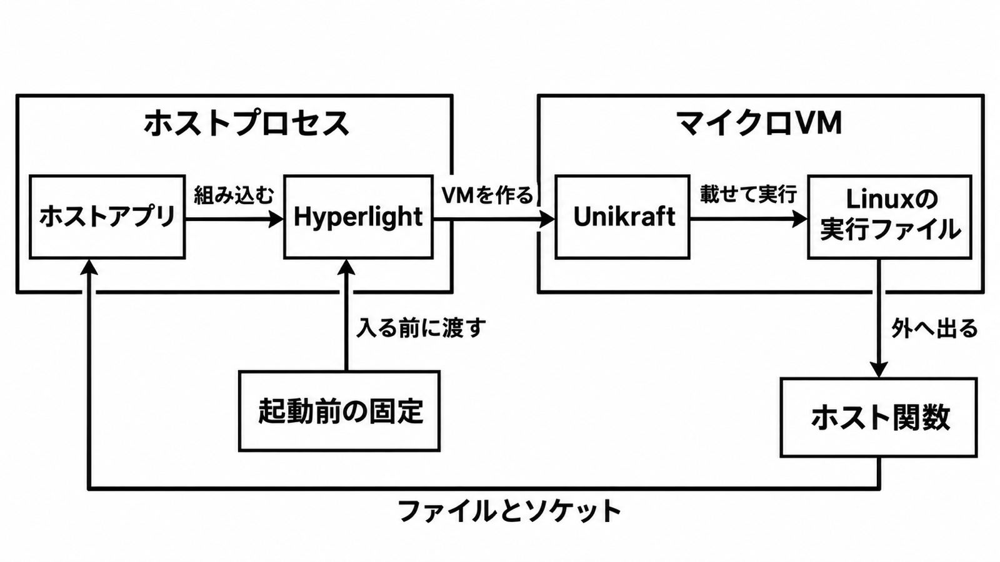

# ダイジェスト: 生成直後のコードをマイクロVMで動かす

[元記事](../../../../../articles/vm-cncf-io-2026-run-linux-p6_20261110.md)

## ひとことで言うと

生成直後の Linux 実行ファイルは、小さなカーネルを載せたマイクロ VM（デバイスのない仮想マシン）の中で動かします。入る前に固定するのは、依存を入れたイメージ、見せるファイル、ネットワークの範囲です。

## 核心ポイント

- Hyperlight は、ホストのプロセスに組み込む仮想マシンモニタ（仮想マシンを制御するソフトウェア）です。実行ファイルを移植せず載せる実行系が hyperlight-unikraft で、システムコールは Unikraft（単一アプリ向けの小さなカーネル）が受け、外へ出るのはホストが登録した関数だけです。
- 許可が無いとファイルもソケットも通りません。マウントとネットワークは、初期化後のメモリの写し（スナップショット）に焼かず、復元のたびに渡します。
- hello world は写しから測って 22 ms（ネイティブはマイクロ VM を通さず 17 ms）、numpy、pandas、scikit-learn の import も写しから測って 45 ms（ネイティブは読み込み直しで 1,119 ms）です。どちらもプロセス起動を含む時間で、Azure の 8 vCPU、入れ子の KVM、1 台の中央値であり、1〜2 ms は OS を持たない本体が仮想マシンを作る時間で、この計測ではありません。
- Python 3.12 の既知の失敗は、fork（プロセスの分岐）の直接呼び出し、疑似端末、epoll（待ちをまとめる仕組み）の非同期、スレッドの時間精度（時間どおり起きること）です。子プロセスは一部の経路だけ通ります。
- ホスト権限で直接動かしているなら、このマイクロ VM へ移す判断材料は足りています。通常の Linux と同じ fork、疑似端末、完全な epoll が要るならゲスト OS 付きの仮想マシンへ戻し、ホスト関数だけで足りるなら本体の方が攻撃面は小さいです。

## メンタルモデル

外へ戻る矢印はホスト関数だけで、下の固定は入る前に Hyperlight へ渡します。

## 具体例

| 形 | 状態 |
|---|---|
| ClickHouse（データベース） | 処理ごとに写しから復元し、あいだに状態を残さない |
| smolagents（エージェントの実行枠） | セッションに 1 つのマイクロ VM を維持し、捨てるときに初期化済みの写しへ戻す |

どちらも、マウントとネットワークは復元のたびに渡します。

## 適用と判断

向く場面:

- エージェントが直前に書いた Python や顧客プラグインを、ホスト権限から切り離したい。
- 重い初期化を写しに閉じ、毎回読み込み直したくない。

確認すること:

- 実行系は、システムコールを持たない本体ではなく hyperlight-unikraft か。
- 依存はイメージに焼き、パッケージを足すときだけネットワークを付けるか。
- 許可は名前とアドレスの列挙で、すべて許すとホストのループバックへ届き、クラウドのインスタンス情報用アドレスはどの方針でも拒否されるか。
- 入力は読み取り専用のマウントにし、マウントしない既定をホストのファイルの境界にしているか。
- 既知の失敗は、このマイクロ VM の外へ分けるか。

## 限界・注意点

- 22 ms と 45 ms は筆者 1 台の中央値で、第三者の再現は未確認です。
- 失敗の外が動くかは、適合試験として示されていません。上流のテストを追い続けるのは Python だけです。
- ネットワークを開くと、依存の固定とループバックからの分離が同時に弱くなります。名前で拒否しても、その名前が今指さないアドレスは拒否できません。
- 本体の想定に、ホストのファイルを見せる経路と、ホスト OS のソケットは含まれません。ライブラリ読込済みのプロセスで写しを戻す約 3 ms は、上の 22 ms や 45 ms ではありません。
- 大きなイメージの復元時間は、仮想マシンを動かす機構で変わり、2026-11-10 時点で未解決です。復元しても、自分で作った乱数オブジェクト、プロセス間通信の認証キー、ハッシュの種、呼び出しをまたぐスレッドは作り直されません。

## 参考

- 元記事: [vm-cncf-io-2026-run-linux-p6_20261110.md](../../../../../articles/vm-cncf-io-2026-run-linux-p6_20261110.md)
- CNCF Blog, Danilo Chiarlone, 2026-11-09. [Run Linux applications in hypervisor-isolated micro-VMs with Hyperlight](https://www.cncf.io/blog/2026/11/09/run-linux-applications-in-hypervisor-isolated-micro-vms-with-hyperlight/)
- [hyperlight-dev/hyperlight-unikraft](https://github.com/hyperlight-dev/hyperlight-unikraft)（README、net.md、known_failures.toml）
- [hyperlight-dev/hyperlight](https://github.com/hyperlight-dev/hyperlight)（README、security.md）
- Microsoft Open Source Blog, 2024-11-07. [Introducing Hyperlight](https://opensource.microsoft.com/blog/2024/11/07/introducing-hyperlight-virtual-machine-based-security-for-functions-at-scale/)
